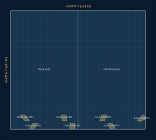
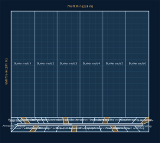

# P2-39 Munitions Bunker 8: plan

Footprint 749 ft 8 in (228 m) × 658 ft 6 in (201 m) · structural grid 32 ft 10 in (10 m)

## Levels

| Level | Floor above deck | Height | Floor area |
|---|---|---|---|
| Level B1 · Deep vault level | −26 ft 3 in (8,000 mm) | 26 ft 3 in (8,000 mm) | 493,632 sq ft (45,860 m²) |
| Level 1 · Magazine floor | 0 ft (0 mm) | 19 ft 8 in (6,000 mm) | 478,235 sq ft (44,430 m²) |

## Elements

| ID | Designation | Type | Name | Level(s) | Size / length | Area | Status |
|---|---|---|---|---|---|---|---|
| E001 | D5F2P2B39A2L1R1 | room | Bunker vault 1 | L1 | 125 ft (38 m) × 579 ft 9 in (177 m) | 72,466 sq ft (6,732 m²) | proposed |
| E002 | D5F2P2B39A2L1R2 | room | Bunker vault 2 | L1 | 125 ft (38 m) × 579 ft 9 in (177 m) | 72,466 sq ft (6,732 m²) | proposed |
| E003 | D5F2P2B39A2L1R3 | room | Bunker vault 3 | L1 | 124 ft 8 in (38 m) × 579 ft 9 in (177 m) | 72,275 sq ft (6,715 m²) | proposed |
| E004 | D5F2P2B39A2L1R4 | room | Bunker vault 4 | L1 | 125 ft (38 m) × 579 ft 9 in (177 m) | 72,466 sq ft (6,732 m²) | proposed |
| E005 | D5F2P2B39A2L1R5 | room | Bunker vault 5 | L1 | 125 ft (38 m) × 579 ft 9 in (177 m) | 72,466 sq ft (6,732 m²) | proposed |
| E006 | D5F2P2B39A2L1R6 | room | Bunker vault 6 | L1 | 125 ft (38 m) × 579 ft 9 in (177 m) | 72,466 sq ft (6,732 m²) | proposed |
| E007 | D5F2P2B39A2LB1R1, D5F2P2B39A2L1R7 | core | Stairs and lifts | LB1, L1 | 53 ft 2 in (16 m) × 32 ft 6 in (9,900 mm) | 858 sq ft (80 m²) | proposed |
| E008 | D5F2P2B39A2LB1R2, D5F2P2B39A2L1R8 | core | Stairs and lifts | LB1, L1 | 33 ft 6 in (10 m) × 32 ft 6 in (9,900 mm) | 858 sq ft (80 m²) | proposed |
| E009 | D5F2P2B39A2LB1R3, D5F2P2B39A2L1R9 | core | Stairs and lifts | LB1, L1 | 39 ft 1 in (12 m) × 32 ft 6 in (9,900 mm) | 853 sq ft (79 m²) | proposed |
| E010 | D5F2P2B39A2LB1R4, D5F2P2B39A2L1R10 | core | Stairs and lifts | LB1, L1 | 44 ft 11 in (14 m) × 36 ft 5 in (11 m) | 853 sq ft (79 m²) | proposed |
| E011 | D5F2P2B39A2LB1R5, D5F2P2B39A2L1R11 | core | Stairs and lifts | LB1, L1 | 43 ft (13 m) × 32 ft 6 in (9,900 mm) | 847 sq ft (79 m²) | proposed |
| E012 | D5F2P2B39A2LB1R6, D5F2P2B39A2L1R12 | core | Stairs and lifts | LB1, L1 | 28 ft 10 in (8,800 mm) × 32 ft 6 in (9,900 mm) | 847 sq ft (79 m²) | proposed |
| E013 | D5F2P2B39A2LB1R7, D5F2P2B39A2L1R13 | core | Stairs and lifts | LB1, L1 | 48 ft 7 in (15 m) × 32 ft 6 in (9,900 mm) | 847 sq ft (79 m²) | proposed |
| E014 | D5F2P2B39A2L1R14 | zone | Corridor | L1 | 684 ft 9 in (209 m) × 13 ft 9 in (4,200 mm) | 6,778 sq ft (630 m²) | proposed |
| E015 | D5F2P2B39A2L1R15 | room | Armoured entrance | L1 | 32 ft 6 in (9,900 mm) × 45 ft 3 in (14 m) | 863 sq ft (80 m²) | proposed |
| E016 | D5F2P2B39A2L1R16 | room | Issue room | L1 | 61 ft (19 m) × 38 ft 5 in (12 m) | 1,614 sq ft (150 m²) | proposed |
| E017 | D5F2P2B39A2L1R17 | room | Magazine control room | L1 | 48 ft 3 in (15 m) × 32 ft 6 in (9,900 mm) | 634 sq ft (59 m²) | proposed |
| E018 | D5F2P2B39A2L1R18 | room | Suppression plant | L1 | 73 ft 2 in (22 m) × 32 ft 6 in (9,900 mm) | 1,614 sq ft (150 m²) | proposed |
| E019 | D5F2P2B39A2L1R19 | room | Locker room | L1 | 49 ft 6 in (15 m) × 32 ft 6 in (9,900 mm) | 964 sq ft (90 m²) | proposed |
| E020 | D5F2P2B39A2L1R20 | room | Staff toilets and showers | L1 | 40 ft 8 in (12 m) × 32 ft 6 in (9,900 mm) | 757 sq ft (70 m²) | proposed |
| E021 | D5F2P2B39A2L1R21 | room | Armourers' workshop | L1 | 101 ft 5 in (31 m) × 32 ft 6 in (9,900 mm) | 2,893 sq ft (269 m²) | proposed |
| E022 | D5F2P2B39A2L1R22 | room | Inspection bay | L1 | 82 ft 4 in (25 m) × 32 ft 6 in (9,900 mm) | 2,563 sq ft (238 m²) | proposed |
| E023 | D5F2P2B39A2L1R23 | room | Armourers' workshop | L1 | 67 ft 3 in (20 m) × 32 ft 6 in (9,900 mm) | 2,051 sq ft (191 m²) | proposed |
| E024 | D5F2P2B39A2L1R24 | room | Inspection bay | L1 | 59 ft 1 in (18 m) × 32 ft 6 in (9,900 mm) | 1,614 sq ft (150 m²) | proposed |
| E025 | D5F2P2B39A2L1R25 | room | Armourers' workshop | L1 | 80 ft 1 in (24 m) × 32 ft 6 in (9,900 mm) | 2,051 sq ft (191 m²) | proposed |
| E026 | D5F2P2B39A2L1R26 | room | Inspection bay | L1 | 102 ft 4 in (31 m) × 32 ft 6 in (9,900 mm) | 2,568 sq ft (239 m²) | proposed |
| E027 | D5F2P2B39A2L1R27 | room | Armourers' workshop | L1 | 78 ft 9 in (24 m) × 32 ft 6 in (9,900 mm) | 1,614 sq ft (150 m²) | proposed |
| E028 | D5F2P2B39A2L1R28 | room | Inspection bay | L1 | 76 ft 1 in (23 m) × 56 ft 5 in (17 m) | 2,563 sq ft (238 m²) | proposed |
| E029 | D5F2P2B39A2L1R29 | room | Armourers' workshop | L1 | 88 ft 7 in (27 m) × 32 ft 6 in (9,900 mm) | 2,051 sq ft (191 m²) | proposed |
| E030 | D5F2P2B39A2L1R30 | room | Inspection bay | L1 | 70 ft 3 in (21 m) × 32 ft 6 in (9,900 mm) | 1,620 sq ft (150 m²) | proposed |
| E031 | D5F2P2B39A2L1R31 | room | Armourers' workshop | L1 | 76 ft 1 in (23 m) × 32 ft 6 in (9,900 mm) | 2,057 sq ft (191 m²) | proposed |
| E032 | D5F2P2B39A2L1R32 | room | Inspection bay | L1 | 85 ft 4 in (26 m) × 32 ft 6 in (9,900 mm) | 2,563 sq ft (238 m²) | proposed |
| E033 | D5F2P2B39A2L1R33 | room | Armourers' workshop | L1 | 52 ft 2 in (16 m) × 32 ft 6 in (9,900 mm) | 1,620 sq ft (150 m²) | proposed |
| E034 | D5F2P2B39A2L1R34 | room | Inspection bay | L1 | 86 ft 7 in (26 m) × 32 ft 6 in (9,900 mm) | 2,568 sq ft (239 m²) | proposed |
| E035 | D5F2P2B39A2L1R35 | room | Armourers' workshop | L1 | 77 ft 1 in (24 m) × 32 ft 6 in (9,900 mm) | 2,051 sq ft (191 m²) | proposed |
| E036 | D5F2P2B39A2L1R36 | room | Inspection bay | L1 | 68 ft 11 in (21 m) × 32 ft 6 in (9,900 mm) | 1,620 sq ft (150 m²) | proposed |
| E037 | D5F2P2B39A2L1R37 | room | Armourers' workshop | L1 | 124 ft (38 m) × 32 ft 6 in (9,900 mm) | 3,117 sq ft (290 m²) | proposed |
| E038 | D5F2P2B39A2LB1R8 | room | Deep vault | LB1 | 374 ft 8 in (114 m) × 658 ft 6 in (201 m) | 246,708 sq ft (22,920 m²) | proposed |
| E039 | D5F2P2B39A2LB1R9 | room | Overflow vault | LB1 | 375 ft (114 m) × 658 ft 6 in (201 m) | 246,924 sq ft (22,940 m²) | proposed |

## Drawings

### Level B1 · Deep vault level

### Level 1 · Magazine floor

