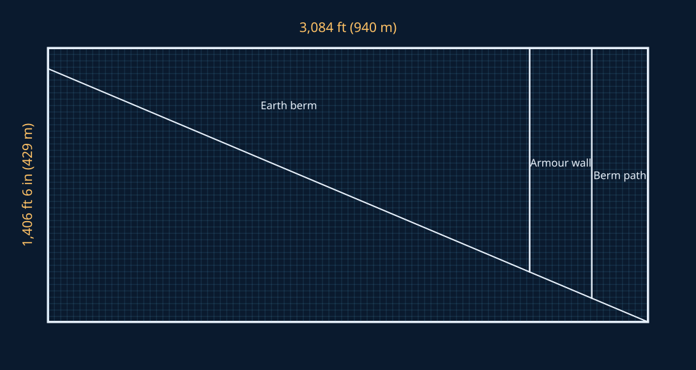

# P2-40 Blast Berm 9: plan

Footprint 3,084 ft (940 m) × 1,406 ft 6 in (429 m) · structural grid 32 ft 10 in (10 m)

## Levels

| Level | Floor above deck | Height | Floor area |
|---|---|---|---|
| Level 1 · Ground | 0 ft (0 mm) | 13 ft 1 in (4,000 mm) | — |

## Elements

| ID | Designation | Type | Name | Level(s) | Size / length | Area | Status |
|---|---|---|---|---|---|---|---|
| E001 | D5F2P2B40A1R1 | zone | Earth berm | L1 | 2,475 ft 9 in (755 m) × 1,149 ft 11 in (350 m) | 1,554,636 sq ft (144,430 m²) | proposed |
| E002 | D5F2P2B40A1R2 | zone | Armour wall | L1 | 319 ft 7 in (97 m) × 1,284 ft 9 in (392 m) | 389,011 sq ft (36,140 m²) | proposed |
| E003 | D5F2P2B40A1R3 | zone | Berm path | L1 | 288 ft 9 in (88 m) × 1,406 ft 6 in (429 m) | 388,504 sq ft (36,093 m²) | proposed |

## Drawings

### Level 1 · Ground

