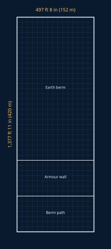

# P2-42 Blast Berm 10: plan

Footprint 497 ft 8 in (152 m) × 1,377 ft 11 in (420 m) · structural grid 32 ft 10 in (10 m)

## Levels

| Level | Floor above deck | Height | Floor area |
|---|---|---|---|
| Level 1 · Ground | 0 ft (0 mm) | 13 ft 1 in (4,000 mm) | — |

## Elements

| ID | Designation | Type | Name | Level(s) | Size / length | Area | Status |
|---|---|---|---|---|---|---|---|
| E001 | D5F2P2B5A2R1 | zone | Earth berm | L1 | 497 ft 8 in (152 m) × 918 ft 8 in (280 m) | 457,208 sq ft (42,476 m²) | proposed |
| E002 | D5F2P2B5A2R2 | zone | Armour wall | L1 | 497 ft 8 in (152 m) × 229 ft 8 in (70 m) | 114,302 sq ft (10,619 m²) | proposed |
| E003 | D5F2P2B5A2R3 | zone | Berm path | L1 | 497 ft 8 in (152 m) × 229 ft 8 in (70 m) | 114,302 sq ft (10,619 m²) | proposed |

## Drawings

### Level 1 · Ground

