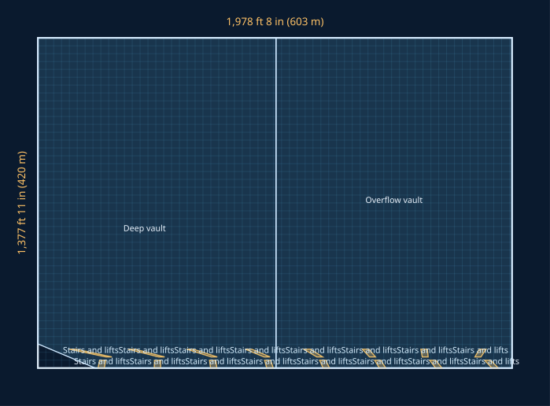
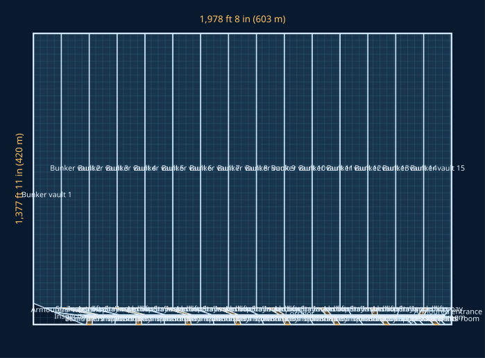

# P2-43 Munitions Bunker 10: plan

Footprint 1,978 ft 8 in (603 m) × 1,377 ft 11 in (420 m) · structural grid 32 ft 10 in (10 m)

## Levels

| Level | Floor above deck | Height | Floor area |
|---|---|---|---|
| Level B1 · Deep vault level | −26 ft 3 in (8,000 mm) | 26 ft 3 in (8,000 mm) | 2,714,475 sq ft (252,183 m²) |
| Level 1 · Magazine floor | 0 ft (0 mm) | 19 ft 8 in (6,000 mm) | 2,677,174 sq ft (248,718 m²) |

## Elements

| ID | Designation | Type | Name | Level(s) | Size / length | Area | Status |
|---|---|---|---|---|---|---|---|
| E001 | D5F2P2B6A2L1R1 | room | Bunker vault 1 | L1 | 132 ft 3 in (40 m) × 1,299 ft 3 in (396 m) | 171,206 sq ft (15,906 m²) | proposed |
| E002 | D5F2P2B6A2L1R2 | room | Bunker vault 2 | L1 | 131 ft 11 in (40 m) × 1,299 ft 3 in (396 m) | 171,353 sq ft (15,919 m²) | proposed |
| E003 | D5F2P2B6A2L1R3 | room | Bunker vault 3 | L1 | 131 ft 11 in (40 m) × 1,299 ft 3 in (396 m) | 171,353 sq ft (15,919 m²) | proposed |
| E004 | D5F2P2B6A2L1R4 | room | Bunker vault 4 | L1 | 131 ft 11 in (40 m) × 1,299 ft 3 in (396 m) | 171,353 sq ft (15,919 m²) | proposed |
| E005 | D5F2P2B6A2L1R5 | room | Bunker vault 5 | L1 | 131 ft 11 in (40 m) × 1,299 ft 3 in (396 m) | 171,353 sq ft (15,919 m²) | proposed |
| E006 | D5F2P2B6A2L1R6 | room | Bunker vault 6 | L1 | 131 ft 11 in (40 m) × 1,299 ft 3 in (396 m) | 171,353 sq ft (15,919 m²) | proposed |
| E007 | D5F2P2B6A2L1R7 | room | Bunker vault 7 | L1 | 131 ft 11 in (40 m) × 1,299 ft 3 in (396 m) | 171,353 sq ft (15,919 m²) | proposed |
| E008 | D5F2P2B6A2L1R8 | room | Bunker vault 8 | L1 | 131 ft 11 in (40 m) × 1,299 ft 3 in (396 m) | 171,353 sq ft (15,919 m²) | proposed |
| E009 | D5F2P2B6A2L1R9 | room | Bunker vault 9 | L1 | 131 ft 11 in (40 m) × 1,299 ft 3 in (396 m) | 171,353 sq ft (15,919 m²) | proposed |
| E010 | D5F2P2B6A2L1R10 | room | Bunker vault 10 | L1 | 131 ft 11 in (40 m) × 1,299 ft 3 in (396 m) | 171,353 sq ft (15,919 m²) | proposed |
| E011 | D5F2P2B6A2L1R11 | room | Bunker vault 11 | L1 | 131 ft 11 in (40 m) × 1,299 ft 3 in (396 m) | 171,353 sq ft (15,919 m²) | proposed |
| E012 | D5F2P2B6A2L1R12 | room | Bunker vault 12 | L1 | 131 ft 11 in (40 m) × 1,299 ft 3 in (396 m) | 171,353 sq ft (15,919 m²) | proposed |
| E013 | D5F2P2B6A2L1R13 | room | Bunker vault 13 | L1 | 131 ft 11 in (40 m) × 1,299 ft 3 in (396 m) | 171,353 sq ft (15,919 m²) | proposed |
| E014 | D5F2P2B6A2L1R14 | room | Bunker vault 14 | L1 | 131 ft 11 in (40 m) × 1,299 ft 3 in (396 m) | 171,353 sq ft (15,919 m²) | proposed |
| E015 | D5F2P2B6A2L1R15 | room | Bunker vault 15 | L1 | 131 ft 11 in (40 m) × 1,299 ft 3 in (396 m) | 171,353 sq ft (15,919 m²) | proposed |
| E016 | D5F2P2B6A2LB1R1, D5F2P2B6A2L1R16 | core | Stairs and lifts | LB1, L1 | 57 ft 1 in (17 m) × 32 ft 6 in (9,900 mm) | 853 sq ft (79 m²) | proposed |
| E017 | D5F2P2B6A2LB1R2, D5F2P2B6A2L1R17 | core | Stairs and lifts | LB1, L1 | 51 ft 10 in (16 m) × 32 ft 6 in (9,900 mm) | 847 sq ft (79 m²) | proposed |
| E018 | D5F2P2B6A2LB1R3, D5F2P2B6A2L1R18 | core | Stairs and lifts | LB1, L1 | 46 ft 7 in (14 m) × 32 ft 6 in (9,900 mm) | 853 sq ft (79 m²) | proposed |
| E019 | D5F2P2B6A2LB1R4, D5F2P2B6A2L1R19 | core | Stairs and lifts | LB1, L1 | 41 ft 4 in (13 m) × 32 ft 6 in (9,900 mm) | 853 sq ft (79 m²) | proposed |
| E020 | D5F2P2B6A2LB1R5, D5F2P2B6A2L1R20 | core | Stairs and lifts | LB1, L1 | 36 ft 1 in (11 m) × 32 ft 6 in (9,900 mm) | 853 sq ft (79 m²) | proposed |
| E021 | D5F2P2B6A2LB1R6, D5F2P2B6A2L1R21 | core | Stairs and lifts | LB1, L1 | 30 ft 10 in (9,400 mm) × 32 ft 6 in (9,900 mm) | 853 sq ft (79 m²) | proposed |
| E022 | D5F2P2B6A2LB1R7, D5F2P2B6A2L1R22 | core | Stairs and lifts | LB1, L1 | 27 ft 3 in (8,300 mm) × 32 ft 6 in (9,900 mm) | 858 sq ft (80 m²) | proposed |
| E023 | D5F2P2B6A2LB1R8, D5F2P2B6A2L1R23 | core | Stairs and lifts | LB1, L1 | 32 ft 2 in (9,800 mm) × 32 ft 6 in (9,900 mm) | 847 sq ft (79 m²) | proposed |
| E024 | D5F2P2B6A2LB1R9, D5F2P2B6A2L1R24 | core | Stairs and lifts | LB1, L1 | 177 ft 6 in (54 m) × 32 ft 6 in (9,900 mm) | 853 sq ft (79 m²) | proposed |
| E025 | D5F2P2B6A2LB1R10, D5F2P2B6A2L1R25 | core | Stairs and lifts | LB1, L1 | 153 ft 3 in (47 m) × 32 ft 6 in (9,900 mm) | 858 sq ft (80 m²) | proposed |
| E026 | D5F2P2B6A2LB1R11, D5F2P2B6A2L1R26 | core | Stairs and lifts | LB1, L1 | 128 ft 3 in (39 m) × 32 ft 6 in (9,900 mm) | 847 sq ft (79 m²) | proposed |
| E027 | D5F2P2B6A2LB1R12, D5F2P2B6A2L1R27 | core | Stairs and lifts | LB1, L1 | 104 ft (32 m) × 32 ft 6 in (9,900 mm) | 853 sq ft (79 m²) | proposed |
| E028 | D5F2P2B6A2LB1R13, D5F2P2B6A2L1R28 | core | Stairs and lifts | LB1, L1 | 79 ft 5 in (24 m) × 32 ft 6 in (9,900 mm) | 847 sq ft (79 m²) | proposed |
| E029 | D5F2P2B6A2LB1R14, D5F2P2B6A2L1R29 | core | Stairs and lifts | LB1, L1 | 55 ft 1 in (17 m) × 32 ft 6 in (9,900 mm) | 853 sq ft (79 m²) | proposed |
| E030 | D5F2P2B6A2LB1R15, D5F2P2B6A2L1R30 | core | Stairs and lifts | LB1, L1 | 30 ft 6 in (9,300 mm) × 32 ft 6 in (9,900 mm) | 847 sq ft (79 m²) | proposed |
| E031 | D5F2P2B6A2LB1R16, D5F2P2B6A2L1R31 | core | Stairs and lifts | LB1, L1 | 46 ft 7 in (14 m) × 32 ft 6 in (9,900 mm) | 858 sq ft (80 m²) | proposed |
| E032 | D5F2P2B6A2L1R32 | zone | Corridor | L1 | 1,733 ft 3 in (528 m) × 13 ft 9 in (4,200 mm) | 16,967 sq ft (1,576 m²) | proposed |
| E033 | D5F2P2B6A2L1R33 | room | Armoured entrance | L1 | 32 ft 6 in (9,900 mm) × 45 ft 3 in (14 m) | 863 sq ft (80 m²) | proposed |
| E034 | D5F2P2B6A2L1R34 | room | Issue room | L1 | 62 ft (19 m) × 38 ft 5 in (12 m) | 1,614 sq ft (150 m²) | proposed |
| E035 | D5F2P2B6A2L1R35 | room | Magazine control room | L1 | 57 ft 9 in (18 m) × 32 ft 6 in (9,900 mm) | 858 sq ft (80 m²) | proposed |
| E036 | D5F2P2B6A2L1R36 | room | Suppression plant | L1 | 79 ft 9 in (24 m) × 32 ft 6 in (9,900 mm) | 1,614 sq ft (150 m²) | proposed |
| E037 | D5F2P2B6A2L1R37 | room | Locker room | L1 | 59 ft 1 in (18 m) × 32 ft 6 in (9,900 mm) | 970 sq ft (90 m²) | proposed |
| E038 | D5F2P2B6A2L1R38 | room | Staff toilets and showers | L1 | 51 ft 10 in (16 m) × 32 ft 6 in (9,900 mm) | 757 sq ft (70 m²) | proposed |
| E039 | D5F2P2B6A2L1R39 | room | Armourers' workshop | L1 | 130 ft 3 in (40 m) × 32 ft 6 in (9,900 mm) | 3,351 sq ft (311 m²) | proposed |
| E040 | D5F2P2B6A2L1R40 | room | Inspection bay | L1 | 124 ft (38 m) × 32 ft 6 in (9,900 mm) | 3,234 sq ft (300 m²) | proposed |
| E041 | D5F2P2B6A2L1R41 | room | Armourers' workshop | L1 | 128 ft 3 in (39 m) × 32 ft 6 in (9,900 mm) | 3,453 sq ft (321 m²) | proposed |
| E042 | D5F2P2B6A2L1R42 | room | Inspection bay | L1 | 118 ft 5 in (36 m) × 32 ft 6 in (9,900 mm) | 3,234 sq ft (300 m²) | proposed |
| E043 | D5F2P2B6A2L1R43 | room | Armourers' workshop | L1 | 123 ft (38 m) × 32 ft 6 in (9,900 mm) | 3,458 sq ft (321 m²) | proposed |
| E044 | D5F2P2B6A2L1R44 | room | Inspection bay | L1 | 113 ft 2 in (34 m) × 32 ft 6 in (9,900 mm) | 3,234 sq ft (300 m²) | proposed |
| E045 | D5F2P2B6A2L1R45 | room | Armourers' workshop | L1 | 117 ft 9 in (36 m) × 32 ft 6 in (9,900 mm) | 3,458 sq ft (321 m²) | proposed |
| E046 | D5F2P2B6A2L1R46 | room | Inspection bay | L1 | 107 ft 11 in (33 m) × 32 ft 6 in (9,900 mm) | 3,234 sq ft (300 m²) | proposed |
| E047 | D5F2P2B6A2L1R47 | room | Armourers' workshop | L1 | 112 ft 6 in (34 m) × 32 ft 6 in (9,900 mm) | 3,458 sq ft (321 m²) | proposed |
| E048 | D5F2P2B6A2L1R48 | room | Inspection bay | L1 | 102 ft 8 in (31 m) × 32 ft 6 in (9,900 mm) | 3,234 sq ft (300 m²) | proposed |
| E049 | D5F2P2B6A2L1R49 | room | Armourers' workshop | L1 | 107 ft 7 in (33 m) × 32 ft 6 in (9,900 mm) | 3,453 sq ft (321 m²) | proposed |
| E050 | D5F2P2B6A2L1R50 | room | Inspection bay | L1 | 101 ft 5 in (31 m) × 32 ft 6 in (9,900 mm) | 3,224 sq ft (299 m²) | proposed |
| E051 | D5F2P2B6A2L1R51 | room | Armourers' workshop | L1 | 111 ft 3 in (34 m) × 32 ft 6 in (9,900 mm) | 3,463 sq ft (322 m²) | proposed |
| E052 | D5F2P2B6A2L1R52 | room | Inspection bay | L1 | 155 ft 10 in (48 m) × 58 ft 1 in (18 m) | 3,230 sq ft (300 m²) | proposed |
| E053 | D5F2P2B6A2L1R53 | room | Armourers' workshop | L1 | 231 ft 11 in (71 m) × 36 ft 1 in (11 m) | 3,453 sq ft (321 m²) | proposed |
| E054 | D5F2P2B6A2L1R54 | room | Inspection bay | L1 | 244 ft 1 in (74 m) × 32 ft 6 in (9,900 mm) | 3,234 sq ft (300 m²) | proposed |
| E055 | D5F2P2B6A2L1R55 | room | Armourers' workshop | L1 | 240 ft 2 in (73 m) × 32 ft 6 in (9,900 mm) | 3,453 sq ft (321 m²) | proposed |
| E056 | D5F2P2B6A2L1R56 | room | Inspection bay | L1 | 219 ft 6 in (67 m) × 32 ft 6 in (9,900 mm) | 3,229 sq ft (300 m²) | proposed |
| E057 | D5F2P2B6A2L1R57 | room | Armourers' workshop | L1 | 215 ft 11 in (66 m) × 32 ft 6 in (9,900 mm) | 3,463 sq ft (322 m²) | proposed |
| E058 | D5F2P2B6A2L1R58 | room | Inspection bay | L1 | 195 ft 3 in (60 m) × 32 ft 6 in (9,900 mm) | 3,234 sq ft (300 m²) | proposed |
| E059 | D5F2P2B6A2L1R59 | room | Armourers' workshop | L1 | 191 ft 3 in (58 m) × 32 ft 6 in (9,900 mm) | 3,458 sq ft (321 m²) | proposed |
| E060 | D5F2P2B6A2L1R60 | room | Inspection bay | L1 | 170 ft 7 in (52 m) × 32 ft 6 in (9,900 mm) | 3,229 sq ft (300 m²) | proposed |
| E061 | D5F2P2B6A2L1R61 | room | Armourers' workshop | L1 | 167 ft (51 m) × 32 ft 6 in (9,900 mm) | 3,463 sq ft (322 m²) | proposed |
| E062 | D5F2P2B6A2L1R62 | room | Inspection bay | L1 | 146 ft 4 in (45 m) × 32 ft 6 in (9,900 mm) | 3,234 sq ft (300 m²) | proposed |
| E063 | D5F2P2B6A2L1R63 | room | Armourers' workshop | L1 | 142 ft 5 in (43 m) × 32 ft 6 in (9,900 mm) | 3,458 sq ft (321 m²) | proposed |
| E064 | D5F2P2B6A2L1R64 | room | Inspection bay | L1 | 121 ft 9 in (37 m) × 32 ft 6 in (9,900 mm) | 3,234 sq ft (300 m²) | proposed |
| E065 | D5F2P2B6A2L1R65 | room | Armourers' workshop | L1 | 117 ft 9 in (36 m) × 32 ft 6 in (9,900 mm) | 3,458 sq ft (321 m²) | proposed |
| E066 | D5F2P2B6A2L1R66 | room | Inspection bay | L1 | 105 ft (32 m) × 32 ft 6 in (9,900 mm) | 3,240 sq ft (301 m²) | proposed |
| E067 | D5F2P2B6A2L1R67 | room | Armourers' workshop | L1 | 119 ft 5 in (36 m) × 32 ft 6 in (9,900 mm) | 3,453 sq ft (321 m²) | proposed |
| E068 | D5F2P2B6A2L1R68 | room | Inspection bay | L1 | 129 ft 11 in (40 m) × 32 ft 6 in (9,900 mm) | 3,341 sq ft (310 m²) | proposed |
| E069 | D5F2P2B6A2LB1R17 | room | Deep vault | LB1 | 993 ft 9 in (303 m) × 1,377 ft 11 in (420 m) | 1,357,318 sq ft (126,099 m²) | proposed |
| E070 | D5F2P2B6A2LB1R18 | room | Overflow vault | LB1 | 984 ft 11 in (300 m) × 1,377 ft 11 in (420 m) | 1,357,157 sq ft (126,084 m²) | proposed |

## Drawings

### Level B1 · Deep vault level

### Level 1 · Magazine floor

