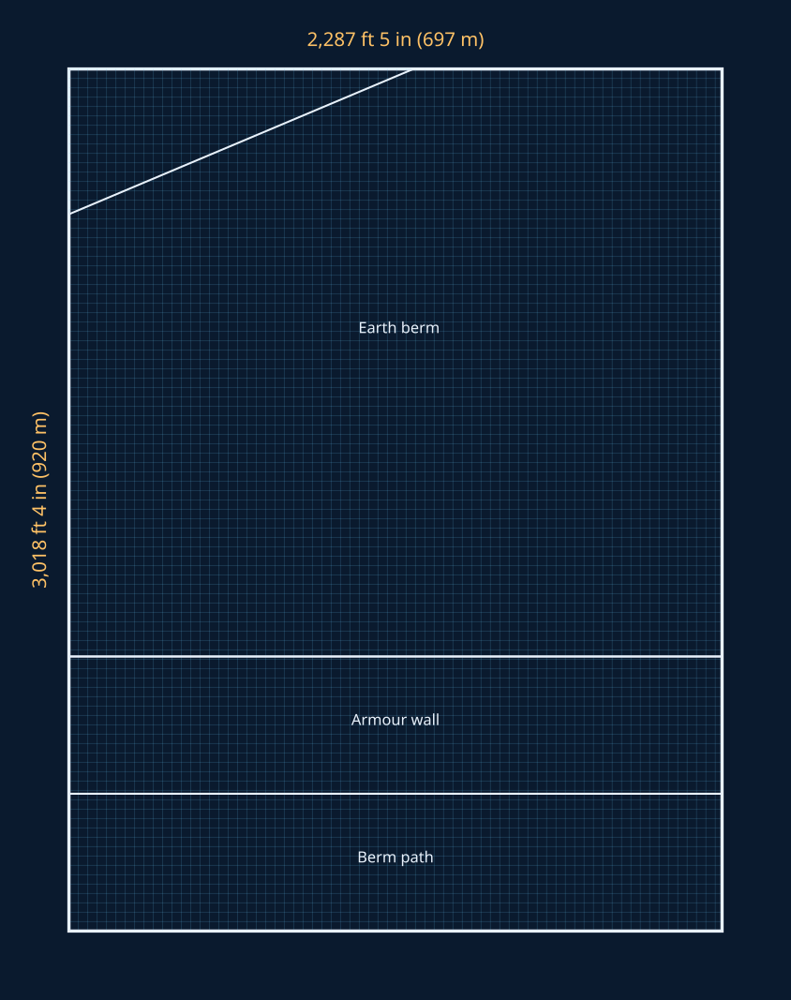

# P2-44 Blast Berm 11: plan

Footprint 2,287 ft 5 in (697 m) × 3,018 ft 4 in (920 m) · structural grid 32 ft 10 in (10 m)

## Levels

| Level | Floor above deck | Height | Floor area |
|---|---|---|---|
| Level 1 · Ground | 0 ft (0 mm) | 13 ft 1 in (4,000 mm) | — |

## Elements

| ID | Designation | Type | Name | Level(s) | Size / length | Area | Status |
|---|---|---|---|---|---|---|---|
| E001 | D5F2P2B9A3R1 | zone | Earth berm | L1 | 2,287 ft 5 in (697 m) × 2,057 ft 1 in (627 m) | 4,398,647 sq ft (408,648 m²) | proposed |
| E002 | D5F2P2B9A3R2 | zone | Armour wall | L1 | 2,287 ft 5 in (697 m) × 480 ft 8 in (146 m) | 1,099,424 sq ft (102,140 m²) | proposed |
| E003 | D5F2P2B9A3R3 | zone | Berm path | L1 | 2,287 ft 5 in (697 m) × 480 ft 8 in (146 m) | 1,099,424 sq ft (102,140 m²) | proposed |

## Drawings

### Level 1 · Ground

