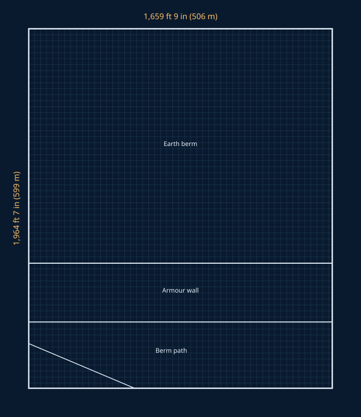

# P2-46 Blast Berm 12: plan

Footprint 1,659 ft 9 in (506 m) × 1,964 ft 7 in (599 m) · structural grid 32 ft 10 in (10 m)

## Levels

| Level | Floor above deck | Height | Floor area |
|---|---|---|---|
| Level 1 · Ground | 0 ft (0 mm) | 13 ft 1 in (4,000 mm) | — |

## Elements

| ID | Designation | Type | Name | Level(s) | Size / length | Area | Status |
|---|---|---|---|---|---|---|---|
| E001 | D5F2P2B14A3R1 | zone | Earth berm | L1 | 1,659 ft 9 in (506 m) × 1,281 ft 6 in (391 m) | 2,126,998 sq ft (197,605 m²) | proposed |
| E002 | D5F2P2B14A3R2 | zone | Armour wall | L1 | 1,659 ft 9 in (506 m) × 320 ft 3 in (98 m) | 531,477 sq ft (49,376 m²) | proposed |
| E003 | D5F2P2B14A3R3 | zone | Berm path | L1 | 1,659 ft 9 in (506 m) × 362 ft 10 in (111 m) | 531,635 sq ft (49,390 m²) | proposed |

## Drawings

### Level 1 · Ground

