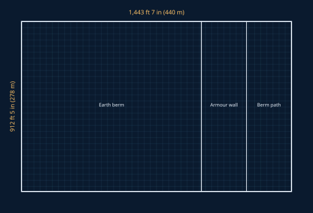

# P2-48 Blast Berm 13: plan

Footprint 1,443 ft 7 in (440 m) × 912 ft 5 in (278 m) · structural grid 32 ft 10 in (10 m)

## Levels

| Level | Floor above deck | Height | Floor area |
|---|---|---|---|
| Level 1 · Ground | 0 ft (0 mm) | 13 ft 1 in (4,000 mm) | — |

## Elements

| ID | Designation | Type | Name | Level(s) | Size / length | Area | Status |
|---|---|---|---|---|---|---|---|
| E001 | D5F2P2B25A2R1 | zone | Earth berm | L1 | 962 ft 3 in (293 m) × 912 ft 5 in (278 m) | 877,977 sq ft (81,567 m²) | proposed |
| E002 | D5F2P2B25A2R2 | zone | Armour wall | L1 | 240 ft 10 in (73 m) × 912 ft 5 in (278 m) | 219,719 sq ft (20,413 m²) | proposed |
| E003 | D5F2P2B25A2R3 | zone | Berm path | L1 | 240 ft 6 in (73 m) × 912 ft 5 in (278 m) | 219,419 sq ft (20,385 m²) | proposed |

## Drawings

### Level 1 · Ground

