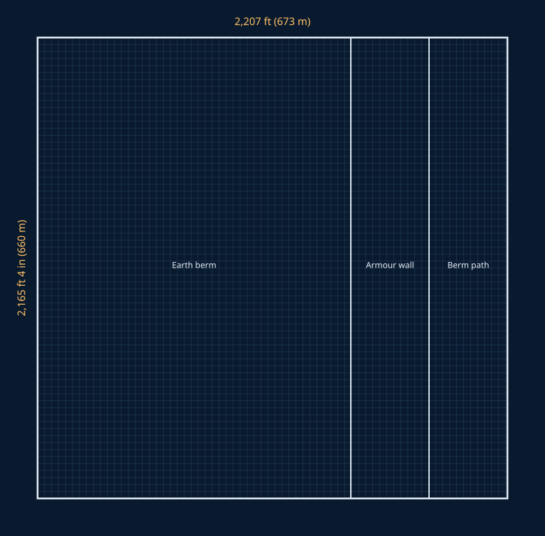

# P2-50 Blast Berm 14: plan

Footprint 2,207 ft (673 m) × 2,165 ft 4 in (660 m) · structural grid 32 ft 10 in (10 m)

## Levels

| Level | Floor above deck | Height | Floor area |
|---|---|---|---|
| Level 1 · Ground | 0 ft (0 mm) | 13 ft 1 in (4,000 mm) | — |

## Elements

| ID | Designation | Type | Name | Level(s) | Size / length | Area | Status |
|---|---|---|---|---|---|---|---|
| E001 | D5F2P2B34A3R1 | zone | Earth berm | L1 | 1,471 ft 5 in (448 m) × 2,165 ft 4 in (660 m) | 3,186,225 sq ft (296,010 m²) | proposed |
| E002 | D5F2P2B34A3R2 | zone | Armour wall | L1 | 367 ft 9 in (112 m) × 2,165 ft 4 in (660 m) | 796,379 sq ft (73,986 m²) | proposed |
| E003 | D5F2P2B34A3R3 | zone | Berm path | L1 | 367 ft 9 in (112 m) × 2,165 ft 4 in (660 m) | 796,379 sq ft (73,986 m²) | proposed |

## Drawings

### Level 1 · Ground

