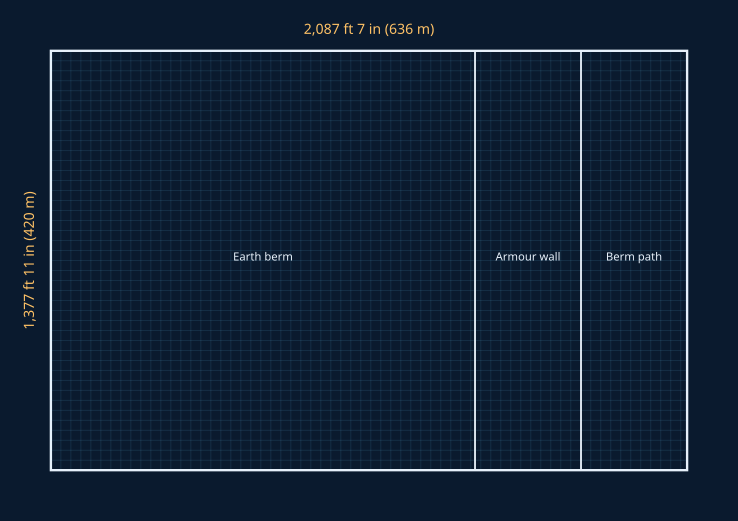

# P2-52 Blast Berm 15: plan

Footprint 2,087 ft 7 in (636 m) × 1,377 ft 11 in (420 m) · structural grid 32 ft 10 in (10 m)

## Levels

| Level | Floor above deck | Height | Floor area |
|---|---|---|---|
| Level 1 · Ground | 0 ft (0 mm) | 13 ft 1 in (4,000 mm) | — |

## Elements

| ID | Designation | Type | Name | Level(s) | Size / length | Area | Status |
|---|---|---|---|---|---|---|---|
| E001 | D5F2P2B37A2R1 | zone | Earth berm | L1 | 1,391 ft 9 in (424 m) × 1,377 ft 11 in (420 m) | 1,917,741 sq ft (178,164 m²) | proposed |
| E002 | D5F2P2B37A2R2 | zone | Armour wall | L1 | 347 ft 9 in (106 m) × 1,377 ft 11 in (420 m) | 479,209 sq ft (44,520 m²) | proposed |
| E003 | D5F2P2B37A2R3 | zone | Berm path | L1 | 348 ft 1 in (106 m) × 1,377 ft 11 in (420 m) | 479,661 sq ft (44,562 m²) | proposed |

## Drawings

### Level 1 · Ground

