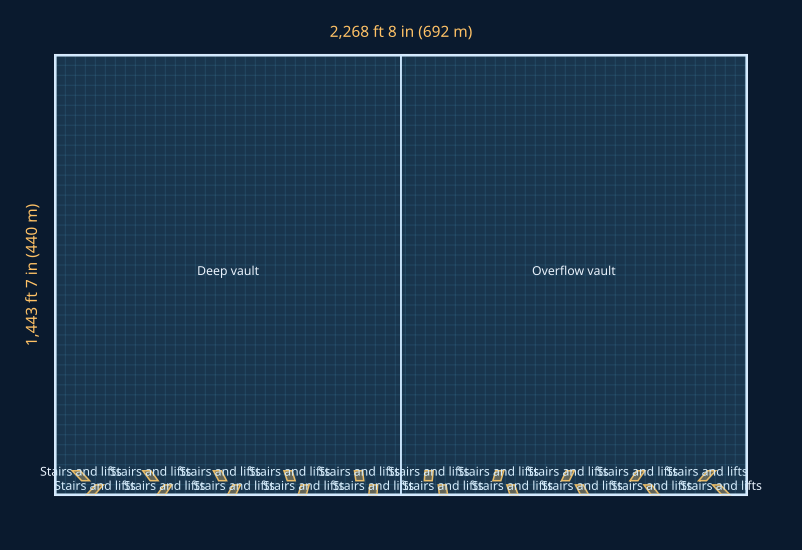
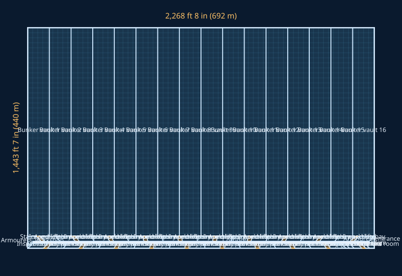

# P2-53 Munitions Bunker 15: plan

Footprint 2,268 ft 8 in (692 m) × 1,443 ft 7 in (440 m) · structural grid 32 ft 10 in (10 m)

## Levels

| Level | Floor above deck | Height | Floor area |
|---|---|---|---|
| Level B1 · Deep vault level | −26 ft 3 in (8,000 mm) | 26 ft 3 in (8,000 mm) | 3,275,028 sq ft (304,260 m²) |
| Level 1 · Magazine floor | 0 ft (0 mm) | 19 ft 8 in (6,000 mm) | 3,227,563 sq ft (299,850 m²) |

## Elements

| ID | Designation | Type | Name | Level(s) | Size / length | Area | Status |
|---|---|---|---|---|---|---|---|
| E001 | D5F2P2B39A3L1R1 | room | Bunker vault 1 | L1 | 141 ft 9 in (43 m) × 1,364 ft 10 in (416 m) | 193,440 sq ft (17,971 m²) | proposed |
| E002 | D5F2P2B39A3L1R2 | room | Bunker vault 2 | L1 | 141 ft 9 in (43 m) × 1,364 ft 10 in (416 m) | 193,440 sq ft (17,971 m²) | proposed |
| E003 | D5F2P2B39A3L1R3 | room | Bunker vault 3 | L1 | 142 ft 1 in (43 m) × 1,364 ft 10 in (416 m) | 193,888 sq ft (18,013 m²) | proposed |
| E004 | D5F2P2B39A3L1R4 | room | Bunker vault 4 | L1 | 141 ft 9 in (43 m) × 1,364 ft 10 in (416 m) | 193,440 sq ft (17,971 m²) | proposed |
| E005 | D5F2P2B39A3L1R5 | room | Bunker vault 5 | L1 | 141 ft 9 in (43 m) × 1,364 ft 10 in (416 m) | 193,440 sq ft (17,971 m²) | proposed |
| E006 | D5F2P2B39A3L1R6 | room | Bunker vault 6 | L1 | 141 ft 9 in (43 m) × 1,364 ft 10 in (416 m) | 193,440 sq ft (17,971 m²) | proposed |
| E007 | D5F2P2B39A3L1R7 | room | Bunker vault 7 | L1 | 141 ft 9 in (43 m) × 1,364 ft 10 in (416 m) | 193,440 sq ft (17,971 m²) | proposed |
| E008 | D5F2P2B39A3L1R8 | room | Bunker vault 8 | L1 | 142 ft 1 in (43 m) × 1,364 ft 10 in (416 m) | 193,888 sq ft (18,013 m²) | proposed |
| E009 | D5F2P2B39A3L1R9 | room | Bunker vault 9 | L1 | 141 ft 9 in (43 m) × 1,364 ft 10 in (416 m) | 193,440 sq ft (17,971 m²) | proposed |
| E010 | D5F2P2B39A3L1R10 | room | Bunker vault 10 | L1 | 141 ft 9 in (43 m) × 1,364 ft 10 in (416 m) | 193,440 sq ft (17,971 m²) | proposed |
| E011 | D5F2P2B39A3L1R11 | room | Bunker vault 11 | L1 | 141 ft 9 in (43 m) × 1,364 ft 10 in (416 m) | 193,440 sq ft (17,971 m²) | proposed |
| E012 | D5F2P2B39A3L1R12 | room | Bunker vault 12 | L1 | 141 ft 9 in (43 m) × 1,364 ft 10 in (416 m) | 193,440 sq ft (17,971 m²) | proposed |
| E013 | D5F2P2B39A3L1R13 | room | Bunker vault 13 | L1 | 141 ft 9 in (43 m) × 1,364 ft 10 in (416 m) | 193,440 sq ft (17,971 m²) | proposed |
| E014 | D5F2P2B39A3L1R14 | room | Bunker vault 14 | L1 | 142 ft 1 in (43 m) × 1,364 ft 10 in (416 m) | 193,888 sq ft (18,013 m²) | proposed |
| E015 | D5F2P2B39A3L1R15 | room | Bunker vault 15 | L1 | 141 ft 9 in (43 m) × 1,364 ft 10 in (416 m) | 193,440 sq ft (17,971 m²) | proposed |
| E016 | D5F2P2B39A3L1R16 | room | Bunker vault 16 | L1 | 141 ft 9 in (43 m) × 1,364 ft 10 in (416 m) | 193,440 sq ft (17,971 m²) | proposed |
| E017 | D5F2P2B39A3LB1R1, D5F2P2B39A3L1R17 | core | Stairs and lifts | LB1, L1 | 56 ft 9 in (17 m) × 32 ft 6 in (9,900 mm) | 853 sq ft (79 m²) | proposed |
| E018 | D5F2P2B39A3LB1R2, D5F2P2B39A3L1R18 | core | Stairs and lifts | LB1, L1 | 50 ft 2 in (15 m) × 32 ft 6 in (9,900 mm) | 853 sq ft (79 m²) | proposed |
| E019 | D5F2P2B39A3LB1R3, D5F2P2B39A3L1R19 | core | Stairs and lifts | LB1, L1 | 43 ft 4 in (13 m) × 32 ft 6 in (9,900 mm) | 853 sq ft (79 m²) | proposed |
| E020 | D5F2P2B39A3LB1R4, D5F2P2B39A3L1R20 | core | Stairs and lifts | LB1, L1 | 36 ft 9 in (11 m) × 32 ft 6 in (9,900 mm) | 853 sq ft (79 m²) | proposed |
| E021 | D5F2P2B39A3LB1R5, D5F2P2B39A3L1R21 | core | Stairs and lifts | LB1, L1 | 30 ft 6 in (9,300 mm) × 32 ft 6 in (9,900 mm) | 858 sq ft (80 m²) | proposed |
| E022 | D5F2P2B39A3LB1R6, D5F2P2B39A3L1R22 | core | Stairs and lifts | LB1, L1 | 28 ft 10 in (8,800 mm) × 32 ft 6 in (9,900 mm) | 853 sq ft (79 m²) | proposed |
| E023 | D5F2P2B39A3LB1R7, D5F2P2B39A3L1R23 | core | Stairs and lifts | LB1, L1 | 35 ft 5 in (11 m) × 32 ft 6 in (9,900 mm) | 853 sq ft (79 m²) | proposed |
| E024 | D5F2P2B39A3LB1R8, D5F2P2B39A3L1R24 | core | Stairs and lifts | LB1, L1 | 42 ft (13 m) × 32 ft 6 in (9,900 mm) | 847 sq ft (79 m²) | proposed |
| E025 | D5F2P2B39A3LB1R9, D5F2P2B39A3L1R25 | core | Stairs and lifts | LB1, L1 | 48 ft 11 in (15 m) × 32 ft 6 in (9,900 mm) | 853 sq ft (79 m²) | proposed |
| E026 | D5F2P2B39A3LB1R10, D5F2P2B39A3L1R26 | core | Stairs and lifts | LB1, L1 | 55 ft 5 in (17 m) × 32 ft 6 in (9,900 mm) | 853 sq ft (79 m²) | proposed |
| E027 | D5F2P2B39A3LB1R11, D5F2P2B39A3L1R27 | core | Stairs and lifts | LB1, L1 | 56 ft 9 in (17 m) × 32 ft 6 in (9,900 mm) | 853 sq ft (79 m²) | proposed |
| E028 | D5F2P2B39A3LB1R12, D5F2P2B39A3L1R28 | core | Stairs and lifts | LB1, L1 | 50 ft 2 in (15 m) × 32 ft 6 in (9,900 mm) | 853 sq ft (79 m²) | proposed |
| E029 | D5F2P2B39A3LB1R13, D5F2P2B39A3L1R29 | core | Stairs and lifts | LB1, L1 | 43 ft 4 in (13 m) × 32 ft 6 in (9,900 mm) | 853 sq ft (79 m²) | proposed |
| E030 | D5F2P2B39A3LB1R14, D5F2P2B39A3L1R30 | core | Stairs and lifts | LB1, L1 | 36 ft 9 in (11 m) × 32 ft 6 in (9,900 mm) | 853 sq ft (79 m²) | proposed |
| E031 | D5F2P2B39A3LB1R15, D5F2P2B39A3L1R31 | core | Stairs and lifts | LB1, L1 | 30 ft 6 in (9,300 mm) × 32 ft 6 in (9,900 mm) | 858 sq ft (80 m²) | proposed |
| E032 | D5F2P2B39A3LB1R16, D5F2P2B39A3L1R32 | core | Stairs and lifts | LB1, L1 | 28 ft 10 in (8,800 mm) × 32 ft 6 in (9,900 mm) | 853 sq ft (79 m²) | proposed |
| E033 | D5F2P2B39A3LB1R17, D5F2P2B39A3L1R33 | core | Stairs and lifts | LB1, L1 | 35 ft 5 in (11 m) × 32 ft 6 in (9,900 mm) | 853 sq ft (79 m²) | proposed |
| E034 | D5F2P2B39A3LB1R18, D5F2P2B39A3L1R34 | core | Stairs and lifts | LB1, L1 | 42 ft (13 m) × 32 ft 6 in (9,900 mm) | 847 sq ft (79 m²) | proposed |
| E035 | D5F2P2B39A3LB1R19, D5F2P2B39A3L1R35 | core | Stairs and lifts | LB1, L1 | 48 ft 11 in (15 m) × 32 ft 6 in (9,900 mm) | 853 sq ft (79 m²) | proposed |
| E036 | D5F2P2B39A3LB1R20, D5F2P2B39A3L1R36 | core | Stairs and lifts | LB1, L1 | 55 ft 5 in (17 m) × 32 ft 6 in (9,900 mm) | 853 sq ft (79 m²) | proposed |
| E037 | D5F2P2B39A3L1R37 | zone | Corridor | L1 | 2,203 ft 9 in (672 m) × 13 ft 9 in (4,200 mm) | 21,729 sq ft (2,019 m²) | proposed |
| E038 | D5F2P2B39A3L1R38 | room | Armoured entrance | L1 | 32 ft 6 in (9,900 mm) × 45 ft 3 in (14 m) | 863 sq ft (80 m²) | proposed |
| E039 | D5F2P2B39A3L1R39 | room | Issue room | L1 | 62 ft (19 m) × 38 ft 5 in (12 m) | 1,614 sq ft (150 m²) | proposed |
| E040 | D5F2P2B39A3L1R40 | room | Magazine control room | L1 | 55 ft 9 in (17 m) × 32 ft 6 in (9,900 mm) | 799 sq ft (74 m²) | proposed |
| E041 | D5F2P2B39A3L1R41 | room | Suppression plant | L1 | 79 ft 5 in (24 m) × 32 ft 6 in (9,900 mm) | 1,620 sq ft (150 m²) | proposed |
| E042 | D5F2P2B39A3L1R42 | room | Locker room | L1 | 58 ft 1 in (18 m) × 32 ft 6 in (9,900 mm) | 970 sq ft (90 m²) | proposed |
| E043 | D5F2P2B39A3L1R43 | room | Staff toilets and showers | L1 | 50 ft 6 in (15 m) × 32 ft 6 in (9,900 mm) | 751 sq ft (70 m²) | proposed |
| E044 | D5F2P2B39A3L1R44 | room | Armourers' workshop | L1 | 125 ft (38 m) × 32 ft 6 in (9,900 mm) | 3,224 sq ft (299 m²) | proposed |
| E045 | D5F2P2B39A3L1R45 | room | Inspection bay | L1 | 121 ft 9 in (37 m) × 32 ft 6 in (9,900 mm) | 3,234 sq ft (300 m²) | proposed |
| E046 | D5F2P2B39A3L1R46 | room | Armourers' workshop | L1 | 121 ft 5 in (37 m) × 32 ft 6 in (9,900 mm) | 3,325 sq ft (309 m²) | proposed |
| E047 | D5F2P2B39A3L1R47 | room | Inspection bay | L1 | 114 ft 10 in (35 m) × 32 ft 6 in (9,900 mm) | 3,234 sq ft (300 m²) | proposed |
| E048 | D5F2P2B39A3L1R48 | room | Armourers' workshop | L1 | 114 ft 10 in (35 m) × 32 ft 6 in (9,900 mm) | 3,330 sq ft (309 m²) | proposed |
| E049 | D5F2P2B39A3L1R49 | room | Inspection bay | L1 | 108 ft 3 in (33 m) × 32 ft 6 in (9,900 mm) | 3,234 sq ft (300 m²) | proposed |
| E050 | D5F2P2B39A3L1R50 | room | Armourers' workshop | L1 | 108 ft 3 in (33 m) × 32 ft 6 in (9,900 mm) | 3,325 sq ft (309 m²) | proposed |
| E051 | D5F2P2B39A3L1R51 | room | Inspection bay | L1 | 101 ft 8 in (31 m) × 32 ft 6 in (9,900 mm) | 3,229 sq ft (300 m²) | proposed |
| E052 | D5F2P2B39A3L1R52 | room | Armourers' workshop | L1 | 104 ft (32 m) × 32 ft 6 in (9,900 mm) | 3,325 sq ft (309 m²) | proposed |
| E053 | D5F2P2B39A3L1R53 | room | Inspection bay | L1 | 104 ft (32 m) × 32 ft 6 in (9,900 mm) | 3,234 sq ft (300 m²) | proposed |
| E054 | D5F2P2B39A3L1R54 | room | Armourers' workshop | L1 | 109 ft 11 in (34 m) × 32 ft 6 in (9,900 mm) | 3,330 sq ft (309 m²) | proposed |
| E055 | D5F2P2B39A3L1R55 | room | Inspection bay | L1 | 110 ft 7 in (34 m) × 32 ft 6 in (9,900 mm) | 3,234 sq ft (300 m²) | proposed |
| E056 | D5F2P2B39A3L1R56 | room | Armourers' workshop | L1 | 116 ft 6 in (36 m) × 32 ft 6 in (9,900 mm) | 3,330 sq ft (309 m²) | proposed |
| E057 | D5F2P2B39A3L1R57 | room | Inspection bay | L1 | 117 ft 5 in (36 m) × 32 ft 6 in (9,900 mm) | 3,234 sq ft (300 m²) | proposed |
| E058 | D5F2P2B39A3L1R58 | room | Armourers' workshop | L1 | 123 ft 4 in (38 m) × 32 ft 6 in (9,900 mm) | 3,330 sq ft (309 m²) | proposed |
| E059 | D5F2P2B39A3L1R59 | room | Inspection bay | L1 | 124 ft (38 m) × 32 ft 6 in (9,900 mm) | 3,234 sq ft (300 m²) | proposed |
| E060 | D5F2P2B39A3L1R60 | room | Armourers' workshop | L1 | 129 ft 11 in (40 m) × 32 ft 6 in (9,900 mm) | 3,330 sq ft (309 m²) | proposed |
| E061 | D5F2P2B39A3L1R61 | room | Inspection bay | L1 | 130 ft 3 in (40 m) × 32 ft 6 in (9,900 mm) | 3,229 sq ft (300 m²) | proposed |
| E062 | D5F2P2B39A3L1R62 | room | Armourers' workshop | L1 | 86 ft 3 in (26 m) × 78 ft 9 in (24 m) | 3,325 sq ft (309 m²) | proposed |
| E063 | D5F2P2B39A3L1R63 | room | Inspection bay | L1 | 128 ft 3 in (39 m) × 32 ft 6 in (9,900 mm) | 3,234 sq ft (300 m²) | proposed |
| E064 | D5F2P2B39A3L1R64 | room | Armourers' workshop | L1 | 128 ft 3 in (39 m) × 32 ft 6 in (9,900 mm) | 3,330 sq ft (309 m²) | proposed |
| E065 | D5F2P2B39A3L1R65 | room | Inspection bay | L1 | 121 ft 9 in (37 m) × 32 ft 6 in (9,900 mm) | 3,234 sq ft (300 m²) | proposed |
| E066 | D5F2P2B39A3L1R66 | room | Armourers' workshop | L1 | 121 ft 5 in (37 m) × 32 ft 6 in (9,900 mm) | 3,325 sq ft (309 m²) | proposed |
| E067 | D5F2P2B39A3L1R67 | room | Inspection bay | L1 | 114 ft 10 in (35 m) × 32 ft 6 in (9,900 mm) | 3,234 sq ft (300 m²) | proposed |
| E068 | D5F2P2B39A3L1R68 | room | Armourers' workshop | L1 | 114 ft 10 in (35 m) × 32 ft 6 in (9,900 mm) | 3,330 sq ft (309 m²) | proposed |
| E069 | D5F2P2B39A3L1R69 | room | Inspection bay | L1 | 108 ft 3 in (33 m) × 32 ft 6 in (9,900 mm) | 3,234 sq ft (300 m²) | proposed |
| E070 | D5F2P2B39A3L1R70 | room | Armourers' workshop | L1 | 108 ft 3 in (33 m) × 32 ft 6 in (9,900 mm) | 3,325 sq ft (309 m²) | proposed |
| E071 | D5F2P2B39A3L1R71 | room | Inspection bay | L1 | 101 ft 8 in (31 m) × 32 ft 6 in (9,900 mm) | 3,229 sq ft (300 m²) | proposed |
| E072 | D5F2P2B39A3L1R72 | room | Armourers' workshop | L1 | 104 ft (32 m) × 32 ft 6 in (9,900 mm) | 3,325 sq ft (309 m²) | proposed |
| E073 | D5F2P2B39A3L1R73 | room | Inspection bay | L1 | 104 ft (32 m) × 32 ft 6 in (9,900 mm) | 3,234 sq ft (300 m²) | proposed |
| E074 | D5F2P2B39A3L1R74 | room | Armourers' workshop | L1 | 109 ft 11 in (34 m) × 32 ft 6 in (9,900 mm) | 3,330 sq ft (309 m²) | proposed |
| E075 | D5F2P2B39A3L1R75 | room | Inspection bay | L1 | 110 ft 7 in (34 m) × 32 ft 6 in (9,900 mm) | 3,234 sq ft (300 m²) | proposed |
| E076 | D5F2P2B39A3L1R76 | room | Armourers' workshop | L1 | 116 ft 6 in (36 m) × 32 ft 6 in (9,900 mm) | 3,330 sq ft (309 m²) | proposed |
| E077 | D5F2P2B39A3L1R77 | room | Inspection bay | L1 | 117 ft 5 in (36 m) × 32 ft 6 in (9,900 mm) | 3,234 sq ft (300 m²) | proposed |
| E078 | D5F2P2B39A3L1R78 | room | Armourers' workshop | L1 | 123 ft 4 in (38 m) × 32 ft 6 in (9,900 mm) | 3,330 sq ft (309 m²) | proposed |
| E079 | D5F2P2B39A3L1R79 | room | Inspection bay | L1 | 124 ft (38 m) × 32 ft 6 in (9,900 mm) | 3,234 sq ft (300 m²) | proposed |
| E080 | D5F2P2B39A3L1R80 | room | Armourers' workshop | L1 | 129 ft 11 in (40 m) × 32 ft 6 in (9,900 mm) | 3,330 sq ft (309 m²) | proposed |
| E081 | D5F2P2B39A3L1R81 | room | Inspection bay | L1 | 130 ft 3 in (40 m) × 32 ft 6 in (9,900 mm) | 3,229 sq ft (300 m²) | proposed |
| E082 | D5F2P2B39A3LB1R21 | room | Deep vault | LB1 | 1,134 ft 2 in (346 m) × 1,443 ft 7 in (440 m) | 1,637,277 sq ft (152,108 m²) | proposed |
| E083 | D5F2P2B39A3LB1R22 | room | Overflow vault | LB1 | 1,134 ft 6 in (346 m) × 1,443 ft 7 in (440 m) | 1,637,751 sq ft (152,152 m²) | proposed |

## Drawings

### Level B1 · Deep vault level

### Level 1 · Magazine floor

