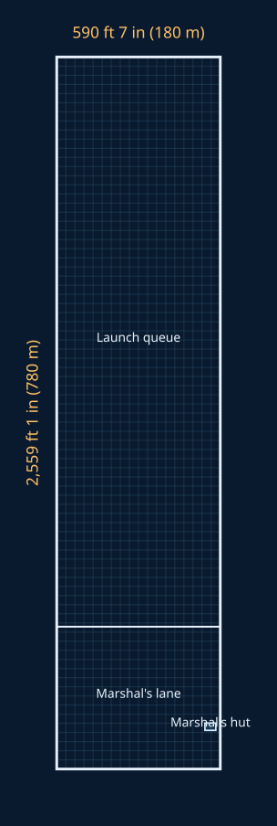

# P3-06 Launch Queue Apron: plan

Footprint 590 ft 7 in (180 m) × 2,559 ft 1 in (780 m) · structural grid 32 ft 10 in (10 m)

## Levels

| Level | Floor above deck | Height | Floor area |
|---|---|---|---|
| Level 1 · Ground | 0 ft (0 mm) | 13 ft 1 in (4,000 mm) | 1,033 sq ft (96 m²) |

## Elements

| ID | Designation | Type | Name | Level(s) | Size / length | Area | Status |
|---|---|---|---|---|---|---|---|
| E001 | D5F2P3B4A2R1 | zone | Launch queue | L1 | 590 ft 7 in (180 m) × 2,047 ft 3 in (624 m) | 1,209,002 sq ft (112,320 m²) | proposed |
| E002 | D5F2P3B4A2R2 | zone | Marshal's lane | L1 | 590 ft 7 in (180 m) × 511 ft 10 in (156 m) | 302,251 sq ft (28,080 m²) | proposed |
| E003 | D5F2P3B4A2R3 | room | Marshal's hut | L1 | 39 ft 4 in (12 m) × 26 ft 3 in (8,000 mm) | 1,033 sq ft (96 m²) | proposed |

## Drawings

### Level 1 · Ground

