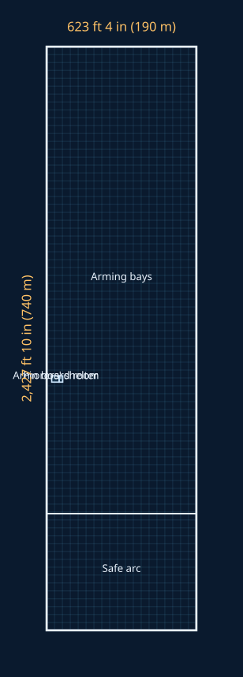

# P3-07 Port Arming Apron: plan

Footprint 623 ft 4 in (190 m) × 2,427 ft 10 in (740 m) · structural grid 32 ft 10 in (10 m)

## Levels

| Level | Floor above deck | Height | Floor area |
|---|---|---|---|
| Level 1 · Ground | 0 ft (0 mm) | 13 ft 1 in (4,000 mm) | 1,206 sq ft (112 m²) |

## Elements

| ID | Designation | Type | Name | Level(s) | Size / length | Area | Status |
|---|---|---|---|---|---|---|---|
| E001 | D5F2P3B6A2R1 | zone | Arming bays | L1 | 623 ft 4 in (190 m) × 1,942 ft 3 in (592 m) | 1,210,725 sq ft (112,480 m²) | proposed |
| E002 | D5F2P3B6A2R2 | room | Armorers' shelter | L1 | 30 ft 10 in (9,400 mm) × 26 ft 3 in (8,000 mm) | 809 sq ft (75 m²) | proposed |
| E003 | D5F2P3B6A2R3 | room | Pin board room | L1 | 15 ft 1 in (4,600 mm) × 26 ft 3 in (8,000 mm) | 396 sq ft (37 m²) | proposed |
| E004 | D5F2P3B6A2R4 | zone | Safe arc | L1 | 623 ft 4 in (190 m) × 485 ft 7 in (148 m) | 302,681 sq ft (28,120 m²) | proposed |

## Drawings

### Level 1 · Ground

