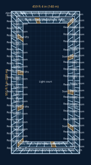
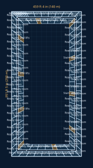

# P3-08 Port Launch Ready Rooms: plan

Footprint 459 ft 4 in (140 m) × 951 ft 5 in (290 m) · structural grid 32 ft 10 in (10 m)

## Levels

| Level | Floor above deck | Height | Floor area |
|---|---|---|---|
| Level 1 · Ground floor | 0 ft (0 mm) | 14 ft 9 in (4,500 mm) | 163,655 sq ft (15,204 m²) |
| Level 2 · Upper floor | 14 ft 9 in (4,500 mm) | 13 ft 1 in (4,000 mm) | 163,655 sq ft (15,204 m²) |

## Elements

| ID | Designation | Type | Name | Level(s) | Size / length | Area | Status |
|---|---|---|---|---|---|---|---|
| E001 | D5F2P3B6A3L1R1 | zone | Light court | L1 | 301 ft 10 in (92 m) × 794 ft (242 m) | 239,648 sq ft (22,264 m²) | proposed |
| E002 | D5F2P3B6A3L1R2 | zone | Corridor | L1 | 390 ft 5 in (119 m) × 23 ft (7,000 mm) | 3,875 sq ft (360 m²) | proposed |
| E003 | D5F2P3B6A3L1R3 | zone | Corridor | L1 | 9 ft 10 in (3,000 mm) × 398 ft 11 in (122 m) | 3,875 sq ft (360 m²) | proposed |
| E004 | D5F2P3B6A3L1R4 | zone | Corridor | L1 | 9 ft 10 in (3,000 mm) × 398 ft 4 in (121 m) | 3,875 sq ft (360 m²) | proposed |
| E005 | D5F2P3B6A3L1R5 | zone | Corridor | L1 | 329 ft 9 in (100 m) × 81 ft 4 in (25 m) | 3,875 sq ft (360 m²) | proposed |
| E006 | D5F2P3B6A3L1R6 | zone | Corridor | L1 | 67 ft 3 in (20 m) × 340 ft 7 in (104 m) | 3,875 sq ft (360 m²) | proposed |
| E007 | D5F2P3B6A3L1R7 | zone | Corridor | L1 | 9 ft 10 in (3,000 mm) × 398 ft (121 m) | 3,875 sq ft (360 m²) | proposed |
| E008 | D5F2P3B6A3L1R8 | zone | Corridor | L1 | 9 ft 10 in (3,000 mm) × 152 ft 7 in (46 m) | 1,421 sq ft (132 m²) | proposed |
| E009 | D5F2P3B6A3L1R9, D5F2P3B6A3L2R1 | core | Stairs and lifts | L1, L2 | 37 ft 1 in (11 m) × 34 ft 5 in (10 m) | 904 sq ft (84 m²) | proposed |
| E010 | D5F2P3B6A3L1R10, D5F2P3B6A3L2R2 | core | Stairs and lifts | L1, L2 | 34 ft 5 in (10 m) × 59 ft 9 in (18 m) | 904 sq ft (84 m²) | proposed |
| E011 | D5F2P3B6A3L1R11, D5F2P3B6A3L2R3 | core | Stairs and lifts | L1, L2 | 34 ft 5 in (10 m) × 40 ft (12 m) | 904 sq ft (84 m²) | proposed |
| E012 | D5F2P3B6A3L1R12, D5F2P3B6A3L2R4 | core | Stairs and lifts | L1, L2 | 34 ft 5 in (10 m) × 31 ft 6 in (9,600 mm) | 904 sq ft (84 m²) | proposed |
| E013 | D5F2P3B6A3L1R13, D5F2P3B6A3L2R5 | core | Stairs and lifts | L1, L2 | 34 ft 5 in (10 m) × 51 ft 2 in (16 m) | 904 sq ft (84 m²) | proposed |
| E014 | D5F2P3B6A3L1R14, D5F2P3B6A3L2R6 | core | Stairs and lifts | L1, L2 | 37 ft 1 in (11 m) × 34 ft 5 in (10 m) | 904 sq ft (84 m²) | proposed |
| E015 | D5F2P3B6A3L1R15, D5F2P3B6A3L2R7 | core | Stairs and lifts | L1, L2 | 34 ft 5 in (10 m) × 59 ft 9 in (18 m) | 904 sq ft (84 m²) | proposed |
| E016 | D5F2P3B6A3L1R16, D5F2P3B6A3L2R8 | core | Stairs and lifts | L1, L2 | 34 ft 5 in (10 m) × 40 ft (12 m) | 904 sq ft (84 m²) | proposed |
| E017 | D5F2P3B6A3L1R17, D5F2P3B6A3L2R9 | core | Stairs and lifts | L1, L2 | 34 ft 5 in (10 m) × 31 ft 6 in (9,600 mm) | 904 sq ft (84 m²) | proposed |
| E018 | D5F2P3B6A3L1R18, D5F2P3B6A3L2R10 | core | Stairs and lifts | L1, L2 | 34 ft 5 in (10 m) × 51 ft 2 in (16 m) | 904 sq ft (84 m²) | proposed |
| E019 | D5F2P3B6A3L1R19 | room | Alert board room | L1 | 57 ft 5 in (18 m) × 34 ft 5 in (10 m) | 859 sq ft (80 m²) | proposed |
| E020 | D5F2P3B6A3L1R20 | room | Kit room | L1 | 59 ft 5 in (18 m) × 34 ft 5 in (10 m) | 1,079 sq ft (100 m²) | proposed |
| E021 | D5F2P3B6A3L1R21 | room | Toilets | L1 | 42 ft 8 in (13 m) × 34 ft 5 in (10 m) | 644 sq ft (60 m²) | proposed |
| E022 | D5F2P3B6A3L1R22 | room | Ready room | L1 | 65 ft 3 in (20 m) × 34 ft 5 in (10 m) | 1,616 sq ft (150 m²) | proposed |
| E023 | D5F2P3B6A3L1R23 | room | Ready room | L1 | 57 ft 9 in (18 m) × 34 ft 5 in (10 m) | 1,616 sq ft (150 m²) | proposed |
| E024 | D5F2P3B6A3L1R24 | room | Ready room | L1 | 50 ft 6 in (15 m) × 34 ft 5 in (10 m) | 1,611 sq ft (150 m²) | proposed |
| E025 | D5F2P3B6A3L1R25 | room | Ready room | L1 | 51 ft 2 in (16 m) × 34 ft 5 in (10 m) | 1,616 sq ft (150 m²) | proposed |
| E026 | D5F2P3B6A3L1R26 | room | Ready room | L1 | 58 ft 9 in (18 m) × 34 ft 5 in (10 m) | 1,611 sq ft (150 m²) | proposed |
| E027 | D5F2P3B6A3L1R27 | room | Ready room | L1 | 66 ft 7 in (20 m) × 34 ft 5 in (10 m) | 1,622 sq ft (151 m²) | proposed |
| E028 | D5F2P3B6A3L1R28 | room | Ready room | L1 | 73 ft 10 in (23 m) × 34 ft 5 in (10 m) | 1,611 sq ft (150 m²) | proposed |
| E029 | D5F2P3B6A3L1R29 | room | Ready room | L1 | 54 ft 6 in (17 m) × 58 ft 9 in (18 m) | 1,616 sq ft (150 m²) | proposed |
| E030 | D5F2P3B6A3L1R30 | room | Ready room | L1 | 34 ft 5 in (10 m) × 77 ft 9 in (24 m) | 1,616 sq ft (150 m²) | proposed |
| E031 | D5F2P3B6A3L1R31 | room | Ready room | L1 | 34 ft 5 in (10 m) × 74 ft 2 in (23 m) | 1,616 sq ft (150 m²) | proposed |
| E032 | D5F2P3B6A3L1R32 | room | Ready room | L1 | 34 ft 5 in (10 m) × 70 ft 6 in (22 m) | 1,611 sq ft (150 m²) | proposed |
| E033 | D5F2P3B6A3L1R33 | room | Ready room | L1 | 34 ft 5 in (10 m) × 67 ft 3 in (21 m) | 1,616 sq ft (150 m²) | proposed |
| E034 | D5F2P3B6A3L1R34 | room | Ready room | L1 | 34 ft 5 in (10 m) × 63 ft 8 in (19 m) | 1,611 sq ft (150 m²) | proposed |
| E035 | D5F2P3B6A3L1R35 | room | Ready room | L1 | 34 ft 5 in (10 m) × 60 ft (18 m) | 1,616 sq ft (150 m²) | proposed |
| E036 | D5F2P3B6A3L1R36 | room | Ready room | L1 | 34 ft 5 in (10 m) × 56 ft 5 in (17 m) | 1,616 sq ft (150 m²) | proposed |
| E037 | D5F2P3B6A3L1R37 | room | Ready room | L1 | 34 ft 5 in (10 m) × 52 ft 10 in (16 m) | 1,611 sq ft (150 m²) | proposed |
| E038 | D5F2P3B6A3L1R38 | room | Ready room | L1 | 34 ft 5 in (10 m) × 49 ft 6 in (15 m) | 1,616 sq ft (150 m²) | proposed |
| E039 | D5F2P3B6A3L1R39 | room | Ready room | L1 | 34 ft 5 in (10 m) × 48 ft 11 in (15 m) | 1,616 sq ft (150 m²) | proposed |
| E040 | D5F2P3B6A3L1R40 | room | Ready room | L1 | 34 ft 5 in (10 m) × 51 ft 6 in (16 m) | 1,616 sq ft (150 m²) | proposed |
| E041 | D5F2P3B6A3L1R41 | room | Ready room | L1 | 34 ft 5 in (10 m) × 54 ft 9 in (17 m) | 1,611 sq ft (150 m²) | proposed |
| E042 | D5F2P3B6A3L1R42 | room | Ready room | L1 | 34 ft 5 in (10 m) × 58 ft 5 in (18 m) | 1,616 sq ft (150 m²) | proposed |
| E043 | D5F2P3B6A3L1R43 | room | Ready room | L1 | 34 ft 5 in (10 m) × 61 ft 8 in (19 m) | 1,611 sq ft (150 m²) | proposed |
| E044 | D5F2P3B6A3L1R44 | room | Ready room | L1 | 34 ft 5 in (10 m) × 65 ft 7 in (20 m) | 1,622 sq ft (151 m²) | proposed |
| E045 | D5F2P3B6A3L1R45 | room | Ready room | L1 | 34 ft 5 in (10 m) × 68 ft 11 in (21 m) | 1,611 sq ft (150 m²) | proposed |
| E046 | D5F2P3B6A3L1R46 | room | Ready room | L1 | 34 ft 5 in (10 m) × 72 ft 6 in (22 m) | 1,616 sq ft (150 m²) | proposed |
| E047 | D5F2P3B6A3L1R47 | room | Ready room | L1 | 34 ft 5 in (10 m) × 75 ft 9 in (23 m) | 1,611 sq ft (150 m²) | proposed |
| E048 | D5F2P3B6A3L1R48 | room | Ready room | L1 | 34 ft 5 in (10 m) × 79 ft 9 in (24 m) | 1,622 sq ft (151 m²) | proposed |
| E049 | D5F2P3B6A3L1R49 | room | Ready room | L1 | 76 ft 1 in (23 m) × 35 ft 9 in (11 m) | 1,611 sq ft (150 m²) | proposed |
| E050 | D5F2P3B6A3L1R50 | room | Ready room | L1 | 70 ft 3 in (21 m) × 34 ft 5 in (10 m) | 1,616 sq ft (150 m²) | proposed |
| E051 | D5F2P3B6A3L1R51 | room | Ready room | L1 | 62 ft 8 in (19 m) × 34 ft 5 in (10 m) | 1,616 sq ft (150 m²) | proposed |
| E052 | D5F2P3B6A3L1R52 | room | Ready room | L1 | 54 ft 9 in (17 m) × 34 ft 5 in (10 m) | 1,611 sq ft (150 m²) | proposed |
| E053 | D5F2P3B6A3L1R53 | room | Ready room | L1 | 50 ft 10 in (16 m) × 34 ft 5 in (10 m) | 1,616 sq ft (150 m²) | proposed |
| E054 | D5F2P3B6A3L1R54 | room | Ready room | L1 | 54 ft 2 in (16 m) × 34 ft 5 in (10 m) | 1,616 sq ft (150 m²) | proposed |
| E055 | D5F2P3B6A3L1R55 | room | Ready room | L1 | 61 ft 4 in (19 m) × 34 ft 5 in (10 m) | 1,611 sq ft (150 m²) | proposed |
| E056 | D5F2P3B6A3L1R56 | room | Ready room | L1 | 69 ft 3 in (21 m) × 34 ft 5 in (10 m) | 1,616 sq ft (150 m²) | proposed |
| E057 | D5F2P3B6A3L1R57 | room | Ready room | L1 | 76 ft 9 in (23 m) × 34 ft 5 in (10 m) | 1,616 sq ft (150 m²) | proposed |
| E058 | D5F2P3B6A3L1R58 | room | Ready room | L1 | 38 ft 5 in (12 m) × 75 ft 2 in (23 m) | 1,611 sq ft (150 m²) | proposed |
| E059 | D5F2P3B6A3L1R59 | room | Ready room | L1 | 34 ft 5 in (10 m) × 76 ft 5 in (23 m) | 1,616 sq ft (150 m²) | proposed |
| E060 | D5F2P3B6A3L1R60 | room | Ready room | L1 | 34 ft 5 in (10 m) × 72 ft 10 in (22 m) | 1,616 sq ft (150 m²) | proposed |
| E061 | D5F2P3B6A3L1R61 | room | Ready room | L1 | 34 ft 5 in (10 m) × 69 ft 3 in (21 m) | 1,616 sq ft (150 m²) | proposed |
| E062 | D5F2P3B6A3L1R62 | room | Ready room | L1 | 34 ft 5 in (10 m) × 65 ft 7 in (20 m) | 1,611 sq ft (150 m²) | proposed |
| E063 | D5F2P3B6A3L1R63 | room | Ready room | L1 | 34 ft 5 in (10 m) × 62 ft 4 in (19 m) | 1,616 sq ft (150 m²) | proposed |
| E064 | D5F2P3B6A3L1R64 | room | Ready room | L1 | 34 ft 5 in (10 m) × 58 ft 9 in (18 m) | 1,611 sq ft (150 m²) | proposed |
| E065 | D5F2P3B6A3L1R65 | room | Ready room | L1 | 34 ft 5 in (10 m) × 55 ft 5 in (17 m) | 1,622 sq ft (151 m²) | proposed |
| E066 | D5F2P3B6A3L1R66 | room | Ready room | L1 | 34 ft 5 in (10 m) × 51 ft 6 in (16 m) | 1,611 sq ft (150 m²) | proposed |
| E067 | D5F2P3B6A3L1R67 | room | Ready room | L1 | 34 ft 5 in (10 m) × 48 ft 7 in (15 m) | 1,616 sq ft (150 m²) | proposed |
| E068 | D5F2P3B6A3L1R68 | room | Ready room | L1 | 34 ft 5 in (10 m) × 48 ft 11 in (15 m) | 1,611 sq ft (150 m²) | proposed |
| E069 | D5F2P3B6A3L1R69 | room | Ready room | L1 | 34 ft 5 in (10 m) × 52 ft 10 in (16 m) | 1,622 sq ft (151 m²) | proposed |
| E070 | D5F2P3B6A3L1R70 | room | Ready room | L1 | 34 ft 5 in (10 m) × 56 ft 1 in (17 m) | 1,611 sq ft (150 m²) | proposed |
| E071 | D5F2P3B6A3L1R71 | room | Ready room | L1 | 34 ft 5 in (10 m) × 59 ft 9 in (18 m) | 1,616 sq ft (150 m²) | proposed |
| E072 | D5F2P3B6A3L1R72 | room | Ready room | L1 | 34 ft 5 in (10 m) × 63 ft (19 m) | 1,611 sq ft (150 m²) | proposed |
| E073 | D5F2P3B6A3L1R73 | room | Ready room | L1 | 34 ft 5 in (10 m) × 66 ft 11 in (20 m) | 1,622 sq ft (151 m²) | proposed |
| E074 | D5F2P3B6A3L1R74 | room | Ready room | L1 | 34 ft 5 in (10 m) × 70 ft 3 in (21 m) | 1,611 sq ft (150 m²) | proposed |
| E075 | D5F2P3B6A3L1R75 | room | Ready room | L1 | 34 ft 5 in (10 m) × 73 ft 10 in (22 m) | 1,616 sq ft (150 m²) | proposed |
| E076 | D5F2P3B6A3L1R76 | room | Ready room | L1 | 34 ft 5 in (10 m) × 77 ft 1 in (23 m) | 1,611 sq ft (150 m²) | proposed |
| E077 | D5F2P3B6A3L1R77 | room | Ready room | L1 | 34 ft 5 in (10 m) × 64 ft 4 in (20 m) | 1,068 sq ft (99 m²) | proposed |
| E078 | D5F2P3B6A3L1R78 | room | Ready room | L1 | 76 ft 5 in (23 m) × 34 ft 5 in (10 m) | 1,611 sq ft (150 m²) | proposed |
| E079 | D5F2P3B6A3L1R79 | room | Ready room | L1 | 75 ft 9 in (23 m) × 34 ft 5 in (10 m) | 1,950 sq ft (181 m²) | proposed |
| E080 | D5F2P3B6A3L1R80 | room | Ready room | L1 | 51 ft 10 in (16 m) × 34 ft 5 in (10 m) | 1,616 sq ft (150 m²) | proposed |
| E081 | D5F2P3B6A3L1R81 | room | Ready room | L1 | 53 ft 2 in (16 m) × 34 ft 5 in (10 m) | 1,611 sq ft (150 m²) | proposed |
| E082 | D5F2P3B6A3L1R82 | room | Ready room | L1 | 63 ft (19 m) × 34 ft 5 in (10 m) | 1,616 sq ft (150 m²) | proposed |
| E083 | D5F2P3B6A3L1R83 | room | Ready room | L1 | 93 ft 10 in (29 m) × 34 ft 5 in (10 m) | 2,277 sq ft (212 m²) | proposed |
| E084 | D5F2P3B6A3L1R84 | room | Ready room | L1 | 34 ft 5 in (10 m) × 77 ft 5 in (24 m) | 1,616 sq ft (150 m²) | proposed |
| E085 | D5F2P3B6A3L1R85 | room | Ready room | L1 | 34 ft 5 in (10 m) × 73 ft 6 in (22 m) | 1,616 sq ft (150 m²) | proposed |
| E086 | D5F2P3B6A3L1R86 | room | Ready room | L1 | 34 ft 5 in (10 m) × 69 ft 3 in (21 m) | 1,611 sq ft (150 m²) | proposed |
| E087 | D5F2P3B6A3L1R87 | room | Ready room | L1 | 34 ft 5 in (10 m) × 83 ft 8 in (26 m) | 2,277 sq ft (212 m²) | proposed |
| E088 | D5F2P3B6A3L1R88 | room | Ready room | L1 | 34 ft 5 in (10 m) × 57 ft 9 in (18 m) | 1,616 sq ft (150 m²) | proposed |
| E089 | D5F2P3B6A3L1R89 | room | Ready room | L1 | 34 ft 5 in (10 m) × 53 ft 10 in (16 m) | 1,611 sq ft (150 m²) | proposed |
| E090 | D5F2P3B6A3L1R90 | room | Ready room | L1 | 34 ft 5 in (10 m) × 50 ft 2 in (15 m) | 1,616 sq ft (150 m²) | proposed |
| E091 | D5F2P3B6A3L1R91 | room | Ready room | L1 | 34 ft 5 in (10 m) × 68 ft 11 in (21 m) | 2,277 sq ft (212 m²) | proposed |
| E092 | D5F2P3B6A3L1R92 | room | Ready room | L1 | 34 ft 5 in (10 m) × 55 ft 1 in (17 m) | 1,616 sq ft (150 m²) | proposed |
| E093 | D5F2P3B6A3L1R93 | room | Ready room | L1 | 34 ft 5 in (10 m) × 59 ft 1 in (18 m) | 1,611 sq ft (150 m²) | proposed |
| E094 | D5F2P3B6A3L1R94 | room | Ready room | L1 | 34 ft 5 in (10 m) × 63 ft 4 in (19 m) | 1,616 sq ft (150 m²) | proposed |
| E095 | D5F2P3B6A3L1R95 | room | Ready room | L1 | 34 ft 5 in (10 m) × 87 ft 3 in (27 m) | 2,277 sq ft (212 m²) | proposed |
| E096 | D5F2P3B6A3L1R96 | room | Ready room | L1 | 34 ft 5 in (10 m) × 74 ft 10 in (23 m) | 1,616 sq ft (150 m²) | proposed |
| E097 | D5F2P3B6A3L1R97 | room | Ready room | L1 | 34 ft 5 in (10 m) × 78 ft 5 in (24 m) | 1,611 sq ft (150 m²) | proposed |
| E098 | D5F2P3B6A3L1R98 | room | Ready room | L1 | 67 ft 11 in (21 m) × 43 ft 8 in (13 m) | 1,616 sq ft (150 m²) | proposed |
| E099 | D5F2P3B6A3L1R99 | room | Ready room | L1 | 86 ft 3 in (26 m) × 34 ft 5 in (10 m) | 2,277 sq ft (212 m²) | proposed |
| E100 | D5F2P3B6A3L1R100 | room | Ready room | L1 | 51 ft 10 in (16 m) × 34 ft 5 in (10 m) | 1,616 sq ft (150 m²) | proposed |
| E101 | D5F2P3B6A3L1R101 | room | Ready room | L1 | 53 ft 2 in (16 m) × 34 ft 5 in (10 m) | 1,611 sq ft (150 m²) | proposed |
| E102 | D5F2P3B6A3L1R102 | room | Ready room | L1 | 63 ft (19 m) × 34 ft 5 in (10 m) | 1,616 sq ft (150 m²) | proposed |
| E103 | D5F2P3B6A3L1R103 | room | Ready room | L1 | 93 ft 10 in (29 m) × 34 ft 5 in (10 m) | 2,277 sq ft (212 m²) | proposed |
| E104 | D5F2P3B6A3L1R104 | room | Ready room | L1 | 34 ft 5 in (10 m) × 77 ft 5 in (24 m) | 1,616 sq ft (150 m²) | proposed |
| E105 | D5F2P3B6A3L1R105 | room | Ready room | L1 | 34 ft 5 in (10 m) × 73 ft 6 in (22 m) | 1,616 sq ft (150 m²) | proposed |
| E106 | D5F2P3B6A3L1R106 | room | Ready room | L1 | 34 ft 5 in (10 m) × 69 ft 3 in (21 m) | 1,611 sq ft (150 m²) | proposed |
| E107 | D5F2P3B6A3L1R107 | room | Ready room | L1 | 34 ft 5 in (10 m) × 83 ft 8 in (26 m) | 2,277 sq ft (212 m²) | proposed |
| E108 | D5F2P3B6A3L1R108 | room | Ready room | L1 | 34 ft 5 in (10 m) × 57 ft 9 in (18 m) | 1,616 sq ft (150 m²) | proposed |
| E109 | D5F2P3B6A3L1R109 | room | Ready room | L1 | 34 ft 5 in (10 m) × 53 ft 10 in (16 m) | 1,611 sq ft (150 m²) | proposed |
| E110 | D5F2P3B6A3L1R110 | room | Ready room | L1 | 34 ft 5 in (10 m) × 50 ft 2 in (15 m) | 1,616 sq ft (150 m²) | proposed |
| E111 | D5F2P3B6A3L1R111 | room | Ready room | L1 | 34 ft 5 in (10 m) × 68 ft 11 in (21 m) | 2,277 sq ft (212 m²) | proposed |
| E112 | D5F2P3B6A3L1R112 | room | Ready room | L1 | 34 ft 5 in (10 m) × 55 ft 1 in (17 m) | 1,616 sq ft (150 m²) | proposed |
| E113 | D5F2P3B6A3L1R113 | room | Ready room | L1 | 34 ft 5 in (10 m) × 59 ft 1 in (18 m) | 1,611 sq ft (150 m²) | proposed |
| E114 | D5F2P3B6A3L1R114 | room | Ready room | L1 | 34 ft 5 in (10 m) × 63 ft 4 in (19 m) | 1,616 sq ft (150 m²) | proposed |
| E115 | D5F2P3B6A3L1R115 | room | Ready room | L1 | 34 ft 5 in (10 m) × 87 ft 3 in (27 m) | 2,277 sq ft (212 m²) | proposed |
| E116 | D5F2P3B6A3L1R116 | room | Ready room | L1 | 34 ft 5 in (10 m) × 74 ft 10 in (23 m) | 1,616 sq ft (150 m²) | proposed |
| E117 | D5F2P3B6A3L1R117 | room | Ready room | L1 | 34 ft 5 in (10 m) × 88 ft 7 in (27 m) | 1,944 sq ft (181 m²) | proposed |
| E118 | D5F2P3B6A3L2R11 | zone | Corridor | L2 | 390 ft 5 in (119 m) × 23 ft (7,000 mm) | 3,875 sq ft (360 m²) | proposed |
| E119 | D5F2P3B6A3L2R12 | zone | Corridor | L2 | 9 ft 10 in (3,000 mm) × 398 ft 11 in (122 m) | 3,875 sq ft (360 m²) | proposed |
| E120 | D5F2P3B6A3L2R13 | zone | Corridor | L2 | 9 ft 10 in (3,000 mm) × 398 ft 4 in (121 m) | 3,875 sq ft (360 m²) | proposed |
| E121 | D5F2P3B6A3L2R14 | zone | Corridor | L2 | 329 ft 9 in (100 m) × 81 ft 4 in (25 m) | 3,875 sq ft (360 m²) | proposed |
| E122 | D5F2P3B6A3L2R15 | zone | Corridor | L2 | 67 ft 3 in (20 m) × 340 ft 7 in (104 m) | 3,875 sq ft (360 m²) | proposed |
| E123 | D5F2P3B6A3L2R16 | zone | Corridor | L2 | 9 ft 10 in (3,000 mm) × 398 ft (121 m) | 3,875 sq ft (360 m²) | proposed |
| E124 | D5F2P3B6A3L2R17 | zone | Corridor | L2 | 9 ft 10 in (3,000 mm) × 152 ft 7 in (46 m) | 1,421 sq ft (132 m²) | proposed |
| E125 | D5F2P3B6A3L2R18 | room | Rest room | L2 | 45 ft 7 in (14 m) × 34 ft 5 in (10 m) | 418 sq ft (39 m²) | proposed |
| E126 | D5F2P3B6A3L2R19 | room | Rest room | L2 | 43 ft 8 in (13 m) × 34 ft 5 in (10 m) | 413 sq ft (38 m²) | proposed |
| E127 | D5F2P3B6A3L2R20 | room | Rest room | L2 | 41 ft 8 in (13 m) × 34 ft 5 in (10 m) | 413 sq ft (38 m²) | proposed |
| E128 | D5F2P3B6A3L2R21 | room | Rest room | L2 | 39 ft 8 in (12 m) × 34 ft 5 in (10 m) | 418 sq ft (39 m²) | proposed |
| E129 | D5F2P3B6A3L2R22 | room | Rest room | L2 | 37 ft 9 in (11 m) × 34 ft 5 in (10 m) | 418 sq ft (39 m²) | proposed |
| E130 | D5F2P3B6A3L2R23 | room | Rest room | L2 | 35 ft 9 in (11 m) × 34 ft 5 in (10 m) | 413 sq ft (38 m²) | proposed |
| E131 | D5F2P3B6A3L2R24 | room | Tea point | L2 | 33 ft 10 in (10 m) × 34 ft 5 in (10 m) | 413 sq ft (38 m²) | proposed |
| E132 | D5F2P3B6A3L2R25 | room | Ready room | L2 | 64 ft (19 m) × 34 ft 5 in (10 m) | 1,622 sq ft (151 m²) | proposed |
| E133 | D5F2P3B6A3L2R26 | room | Ready room | L2 | 56 ft 1 in (17 m) × 34 ft 5 in (10 m) | 1,611 sq ft (150 m²) | proposed |
| E134 | D5F2P3B6A3L2R27 | room | Ready room | L2 | 50 ft 6 in (15 m) × 34 ft 5 in (10 m) | 1,611 sq ft (150 m²) | proposed |
| E135 | D5F2P3B6A3L2R28 | room | Ready room | L2 | 52 ft 10 in (16 m) × 34 ft 5 in (10 m) | 1,616 sq ft (150 m²) | proposed |
| E136 | D5F2P3B6A3L2R29 | room | Ready room | L2 | 60 ft 4 in (18 m) × 34 ft 5 in (10 m) | 1,616 sq ft (150 m²) | proposed |
| E137 | D5F2P3B6A3L2R30 | room | Ready room | L2 | 67 ft 11 in (21 m) × 34 ft 5 in (10 m) | 1,616 sq ft (150 m²) | proposed |
| E138 | D5F2P3B6A3L2R31 | room | Ready room | L2 | 75 ft 6 in (23 m) × 34 ft 5 in (10 m) | 1,611 sq ft (150 m²) | proposed |
| E139 | D5F2P3B6A3L2R32 | room | Ready room | L2 | 45 ft 11 in (14 m) × 67 ft 7 in (21 m) | 1,616 sq ft (150 m²) | proposed |
| E140 | D5F2P3B6A3L2R33 | room | Ready room | L2 | 34 ft 5 in (10 m) × 77 ft 1 in (24 m) | 1,616 sq ft (150 m²) | proposed |
| E141 | D5F2P3B6A3L2R34 | room | Ready room | L2 | 34 ft 5 in (10 m) × 73 ft 6 in (22 m) | 1,616 sq ft (150 m²) | proposed |
| E142 | D5F2P3B6A3L2R35 | room | Ready room | L2 | 34 ft 5 in (10 m) × 69 ft 11 in (21 m) | 1,616 sq ft (150 m²) | proposed |
| E143 | D5F2P3B6A3L2R36 | room | Ready room | L2 | 34 ft 5 in (10 m) × 66 ft 3 in (20 m) | 1,611 sq ft (150 m²) | proposed |
| E144 | D5F2P3B6A3L2R37 | room | Ready room | L2 | 34 ft 5 in (10 m) × 63 ft (19 m) | 1,616 sq ft (150 m²) | proposed |
| E145 | D5F2P3B6A3L2R38 | room | Ready room | L2 | 34 ft 5 in (10 m) × 59 ft 5 in (18 m) | 1,611 sq ft (150 m²) | proposed |
| E146 | D5F2P3B6A3L2R39 | room | Ready room | L2 | 34 ft 5 in (10 m) × 56 ft 1 in (17 m) | 1,622 sq ft (151 m²) | proposed |
| E147 | D5F2P3B6A3L2R40 | room | Ready room | L2 | 34 ft 5 in (10 m) × 52 ft 2 in (16 m) | 1,611 sq ft (150 m²) | proposed |
| E148 | D5F2P3B6A3L2R41 | room | Ready room | L2 | 34 ft 5 in (10 m) × 48 ft 11 in (15 m) | 1,616 sq ft (150 m²) | proposed |
| E149 | D5F2P3B6A3L2R42 | room | Ready room | L2 | 34 ft 5 in (10 m) × 48 ft 7 in (15 m) | 1,611 sq ft (150 m²) | proposed |
| E150 | D5F2P3B6A3L2R43 | room | Ready room | L2 | 34 ft 5 in (10 m) × 52 ft 2 in (16 m) | 1,622 sq ft (151 m²) | proposed |
| E151 | D5F2P3B6A3L2R44 | room | Ready room | L2 | 34 ft 5 in (10 m) × 55 ft 5 in (17 m) | 1,611 sq ft (150 m²) | proposed |
| E152 | D5F2P3B6A3L2R45 | room | Ready room | L2 | 34 ft 5 in (10 m) × 59 ft 1 in (18 m) | 1,616 sq ft (150 m²) | proposed |
| E153 | D5F2P3B6A3L2R46 | room | Ready room | L2 | 34 ft 5 in (10 m) × 62 ft 4 in (19 m) | 1,611 sq ft (150 m²) | proposed |
| E154 | D5F2P3B6A3L2R47 | room | Ready room | L2 | 34 ft 5 in (10 m) × 65 ft 11 in (20 m) | 1,616 sq ft (150 m²) | proposed |
| E155 | D5F2P3B6A3L2R48 | room | Ready room | L2 | 34 ft 5 in (10 m) × 69 ft 7 in (21 m) | 1,616 sq ft (150 m²) | proposed |
| E156 | D5F2P3B6A3L2R49 | room | Ready room | L2 | 34 ft 5 in (10 m) × 73 ft 2 in (22 m) | 1,611 sq ft (150 m²) | proposed |
| E157 | D5F2P3B6A3L2R50 | room | Ready room | L2 | 34 ft 5 in (10 m) × 76 ft 9 in (23 m) | 1,616 sq ft (150 m²) | proposed |
| E158 | D5F2P3B6A3L2R51 | room | Ready room | L2 | 41 ft 8 in (13 m) × 71 ft 10 in (22 m) | 1,611 sq ft (150 m²) | proposed |
| E159 | D5F2P3B6A3L2R52 | room | Ready room | L2 | 76 ft 5 in (23 m) × 34 ft 5 in (10 m) | 1,622 sq ft (151 m²) | proposed |
| E160 | D5F2P3B6A3L2R53 | room | Ready room | L2 | 68 ft 7 in (21 m) × 34 ft 5 in (10 m) | 1,611 sq ft (150 m²) | proposed |
| E161 | D5F2P3B6A3L2R54 | room | Ready room | L2 | 61 ft (19 m) × 34 ft 5 in (10 m) | 1,616 sq ft (150 m²) | proposed |
| E162 | D5F2P3B6A3L2R55 | room | Ready room | L2 | 53 ft 6 in (16 m) × 34 ft 5 in (10 m) | 1,616 sq ft (150 m²) | proposed |
| E163 | D5F2P3B6A3L2R56 | room | Ready room | L2 | 50 ft 10 in (15 m) × 34 ft 5 in (10 m) | 1,616 sq ft (150 m²) | proposed |
| E164 | D5F2P3B6A3L2R57 | room | Ready room | L2 | 55 ft 5 in (17 m) × 34 ft 5 in (10 m) | 1,611 sq ft (150 m²) | proposed |
| E165 | D5F2P3B6A3L2R58 | room | Ready room | L2 | 63 ft (19 m) × 34 ft 5 in (10 m) | 1,611 sq ft (150 m²) | proposed |
| E166 | D5F2P3B6A3L2R59 | room | Ready room | L2 | 70 ft 10 in (22 m) × 34 ft 5 in (10 m) | 1,622 sq ft (151 m²) | proposed |
| E167 | D5F2P3B6A3L2R60 | room | Ready room | L2 | 72 ft 10 in (22 m) × 39 ft 4 in (12 m) | 1,616 sq ft (150 m²) | proposed |
| E168 | D5F2P3B6A3L2R61 | room | Ready room | L2 | 34 ft 5 in (10 m) × 79 ft 1 in (24 m) | 1,611 sq ft (150 m²) | proposed |
| E169 | D5F2P3B6A3L2R62 | room | Ready room | L2 | 34 ft 5 in (10 m) × 75 ft 9 in (23 m) | 1,616 sq ft (150 m²) | proposed |
| E170 | D5F2P3B6A3L2R63 | room | Ready room | L2 | 34 ft 5 in (10 m) × 72 ft 2 in (22 m) | 1,611 sq ft (150 m²) | proposed |
| E171 | D5F2P3B6A3L2R64 | room | Ready room | L2 | 34 ft 5 in (10 m) × 68 ft 11 in (21 m) | 1,622 sq ft (151 m²) | proposed |
| E172 | D5F2P3B6A3L2R65 | room | Ready room | L2 | 34 ft 5 in (10 m) × 65 ft (20 m) | 1,611 sq ft (150 m²) | proposed |
| E173 | D5F2P3B6A3L2R66 | room | Ready room | L2 | 34 ft 5 in (10 m) × 61 ft 4 in (19 m) | 1,611 sq ft (150 m²) | proposed |
| E174 | D5F2P3B6A3L2R67 | room | Ready room | L2 | 34 ft 5 in (10 m) × 58 ft 1 in (18 m) | 1,616 sq ft (150 m²) | proposed |
| E175 | D5F2P3B6A3L2R68 | room | Ready room | L2 | 34 ft 5 in (10 m) × 54 ft 6 in (17 m) | 1,611 sq ft (150 m²) | proposed |
| E176 | D5F2P3B6A3L2R69 | room | Ready room | L2 | 34 ft 5 in (10 m) × 51 ft 2 in (16 m) | 1,622 sq ft (151 m²) | proposed |
| E177 | D5F2P3B6A3L2R70 | room | Ready room | L2 | 34 ft 5 in (10 m) × 48 ft 7 in (15 m) | 1,611 sq ft (150 m²) | proposed |
| E178 | D5F2P3B6A3L2R71 | room | Ready room | L2 | 34 ft 5 in (10 m) × 49 ft 10 in (15 m) | 1,616 sq ft (150 m²) | proposed |
| E179 | D5F2P3B6A3L2R72 | room | Ready room | L2 | 34 ft 5 in (10 m) × 53 ft 2 in (16 m) | 1,611 sq ft (150 m²) | proposed |
| E180 | D5F2P3B6A3L2R73 | room | Ready room | L2 | 34 ft 5 in (10 m) × 57 ft 1 in (17 m) | 1,622 sq ft (151 m²) | proposed |
| E181 | D5F2P3B6A3L2R74 | room | Ready room | L2 | 34 ft 5 in (10 m) × 60 ft 4 in (18 m) | 1,611 sq ft (150 m²) | proposed |
| E182 | D5F2P3B6A3L2R75 | room | Ready room | L2 | 34 ft 5 in (10 m) × 64 ft (20 m) | 1,616 sq ft (150 m²) | proposed |
| E183 | D5F2P3B6A3L2R76 | room | Ready room | L2 | 34 ft 5 in (10 m) × 67 ft 3 in (20 m) | 1,611 sq ft (150 m²) | proposed |
| E184 | D5F2P3B6A3L2R77 | room | Ready room | L2 | 34 ft 5 in (10 m) × 70 ft 10 in (22 m) | 1,616 sq ft (150 m²) | proposed |
| E185 | D5F2P3B6A3L2R78 | room | Ready room | L2 | 34 ft 5 in (10 m) × 74 ft 6 in (23 m) | 1,616 sq ft (150 m²) | proposed |
| E186 | D5F2P3B6A3L2R79 | room | Ready room | L2 | 34 ft 5 in (10 m) × 78 ft 1 in (24 m) | 1,616 sq ft (150 m²) | proposed |
| E187 | D5F2P3B6A3L2R80 | room | Ready room | L2 | 34 ft 5 in (10 m) × 55 ft 1 in (17 m) | 740 sq ft (69 m²) | proposed |
| E188 | D5F2P3B6A3L2R81 | room | Ready room | L2 | 76 ft 5 in (23 m) × 34 ft 5 in (10 m) | 1,611 sq ft (150 m²) | proposed |
| E189 | D5F2P3B6A3L2R82 | room | Ready room | L2 | 75 ft 9 in (23 m) × 34 ft 5 in (10 m) | 1,950 sq ft (181 m²) | proposed |
| E190 | D5F2P3B6A3L2R83 | room | Ready room | L2 | 51 ft 10 in (16 m) × 34 ft 5 in (10 m) | 1,616 sq ft (150 m²) | proposed |
| E191 | D5F2P3B6A3L2R84 | room | Ready room | L2 | 53 ft 2 in (16 m) × 34 ft 5 in (10 m) | 1,611 sq ft (150 m²) | proposed |
| E192 | D5F2P3B6A3L2R85 | room | Ready room | L2 | 63 ft (19 m) × 34 ft 5 in (10 m) | 1,616 sq ft (150 m²) | proposed |
| E193 | D5F2P3B6A3L2R86 | room | Ready room | L2 | 93 ft 10 in (29 m) × 34 ft 5 in (10 m) | 2,277 sq ft (212 m²) | proposed |
| E194 | D5F2P3B6A3L2R87 | room | Ready room | L2 | 34 ft 5 in (10 m) × 77 ft 5 in (24 m) | 1,616 sq ft (150 m²) | proposed |
| E195 | D5F2P3B6A3L2R88 | room | Ready room | L2 | 34 ft 5 in (10 m) × 73 ft 6 in (22 m) | 1,616 sq ft (150 m²) | proposed |
| E196 | D5F2P3B6A3L2R89 | room | Ready room | L2 | 34 ft 5 in (10 m) × 69 ft 3 in (21 m) | 1,611 sq ft (150 m²) | proposed |
| E197 | D5F2P3B6A3L2R90 | room | Ready room | L2 | 34 ft 5 in (10 m) × 83 ft 8 in (26 m) | 2,277 sq ft (212 m²) | proposed |
| E198 | D5F2P3B6A3L2R91 | room | Ready room | L2 | 34 ft 5 in (10 m) × 57 ft 9 in (18 m) | 1,616 sq ft (150 m²) | proposed |
| E199 | D5F2P3B6A3L2R92 | room | Ready room | L2 | 34 ft 5 in (10 m) × 53 ft 10 in (16 m) | 1,611 sq ft (150 m²) | proposed |
| E200 | D5F2P3B6A3L2R93 | room | Ready room | L2 | 34 ft 5 in (10 m) × 50 ft 2 in (15 m) | 1,616 sq ft (150 m²) | proposed |
| E201 | D5F2P3B6A3L2R94 | room | Ready room | L2 | 34 ft 5 in (10 m) × 68 ft 11 in (21 m) | 2,277 sq ft (212 m²) | proposed |
| E202 | D5F2P3B6A3L2R95 | room | Ready room | L2 | 34 ft 5 in (10 m) × 55 ft 1 in (17 m) | 1,616 sq ft (150 m²) | proposed |
| E203 | D5F2P3B6A3L2R96 | room | Ready room | L2 | 34 ft 5 in (10 m) × 59 ft 1 in (18 m) | 1,611 sq ft (150 m²) | proposed |
| E204 | D5F2P3B6A3L2R97 | room | Ready room | L2 | 34 ft 5 in (10 m) × 63 ft 4 in (19 m) | 1,616 sq ft (150 m²) | proposed |
| E205 | D5F2P3B6A3L2R98 | room | Ready room | L2 | 34 ft 5 in (10 m) × 87 ft 3 in (27 m) | 2,277 sq ft (212 m²) | proposed |
| E206 | D5F2P3B6A3L2R99 | room | Ready room | L2 | 34 ft 5 in (10 m) × 74 ft 10 in (23 m) | 1,616 sq ft (150 m²) | proposed |
| E207 | D5F2P3B6A3L2R100 | room | Ready room | L2 | 34 ft 5 in (10 m) × 78 ft 5 in (24 m) | 1,611 sq ft (150 m²) | proposed |
| E208 | D5F2P3B6A3L2R101 | room | Ready room | L2 | 67 ft 11 in (21 m) × 43 ft 8 in (13 m) | 1,616 sq ft (150 m²) | proposed |
| E209 | D5F2P3B6A3L2R102 | room | Ready room | L2 | 86 ft 3 in (26 m) × 34 ft 5 in (10 m) | 2,277 sq ft (212 m²) | proposed |
| E210 | D5F2P3B6A3L2R103 | room | Ready room | L2 | 51 ft 10 in (16 m) × 34 ft 5 in (10 m) | 1,616 sq ft (150 m²) | proposed |
| E211 | D5F2P3B6A3L2R104 | room | Ready room | L2 | 53 ft 2 in (16 m) × 34 ft 5 in (10 m) | 1,611 sq ft (150 m²) | proposed |
| E212 | D5F2P3B6A3L2R105 | room | Ready room | L2 | 63 ft (19 m) × 34 ft 5 in (10 m) | 1,616 sq ft (150 m²) | proposed |
| E213 | D5F2P3B6A3L2R106 | room | Ready room | L2 | 93 ft 10 in (29 m) × 34 ft 5 in (10 m) | 2,277 sq ft (212 m²) | proposed |
| E214 | D5F2P3B6A3L2R107 | room | Ready room | L2 | 34 ft 5 in (10 m) × 77 ft 5 in (24 m) | 1,616 sq ft (150 m²) | proposed |
| E215 | D5F2P3B6A3L2R108 | room | Ready room | L2 | 34 ft 5 in (10 m) × 73 ft 6 in (22 m) | 1,616 sq ft (150 m²) | proposed |
| E216 | D5F2P3B6A3L2R109 | room | Ready room | L2 | 34 ft 5 in (10 m) × 69 ft 3 in (21 m) | 1,611 sq ft (150 m²) | proposed |
| E217 | D5F2P3B6A3L2R110 | room | Ready room | L2 | 34 ft 5 in (10 m) × 83 ft 8 in (26 m) | 2,277 sq ft (212 m²) | proposed |
| E218 | D5F2P3B6A3L2R111 | room | Ready room | L2 | 34 ft 5 in (10 m) × 57 ft 9 in (18 m) | 1,616 sq ft (150 m²) | proposed |
| E219 | D5F2P3B6A3L2R112 | room | Ready room | L2 | 34 ft 5 in (10 m) × 53 ft 10 in (16 m) | 1,611 sq ft (150 m²) | proposed |
| E220 | D5F2P3B6A3L2R113 | room | Ready room | L2 | 34 ft 5 in (10 m) × 50 ft 2 in (15 m) | 1,616 sq ft (150 m²) | proposed |
| E221 | D5F2P3B6A3L2R114 | room | Ready room | L2 | 34 ft 5 in (10 m) × 68 ft 11 in (21 m) | 2,277 sq ft (212 m²) | proposed |
| E222 | D5F2P3B6A3L2R115 | room | Ready room | L2 | 34 ft 5 in (10 m) × 55 ft 1 in (17 m) | 1,616 sq ft (150 m²) | proposed |
| E223 | D5F2P3B6A3L2R116 | room | Ready room | L2 | 34 ft 5 in (10 m) × 59 ft 1 in (18 m) | 1,611 sq ft (150 m²) | proposed |
| E224 | D5F2P3B6A3L2R117 | room | Ready room | L2 | 34 ft 5 in (10 m) × 63 ft 4 in (19 m) | 1,616 sq ft (150 m²) | proposed |
| E225 | D5F2P3B6A3L2R118 | room | Ready room | L2 | 34 ft 5 in (10 m) × 87 ft 3 in (27 m) | 2,277 sq ft (212 m²) | proposed |
| E226 | D5F2P3B6A3L2R119 | room | Ready room | L2 | 34 ft 5 in (10 m) × 74 ft 10 in (23 m) | 1,616 sq ft (150 m²) | proposed |
| E227 | D5F2P3B6A3L2R120 | room | Ready room | L2 | 34 ft 5 in (10 m) × 88 ft 7 in (27 m) | 1,944 sq ft (181 m²) | proposed |

## Drawings

### Level 1 · Ground floor

### Level 2 · Upper floor

