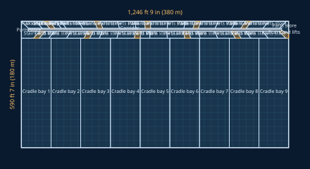
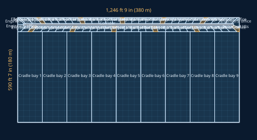

# P3-09 Shaft Maintenance Shop: plan

Footprint 1,246 ft 9 in (380 m) × 590 ft 7 in (180 m) · structural grid 32 ft 10 in (10 m)

## Levels

| Level | Floor above deck | Height | Floor area |
|---|---|---|---|
| Level 1 · Hall floor | 0 ft (0 mm) | 52 ft 6 in (16 m) | 710,595 sq ft (66,016 m²) |
| Level 2 · Gallery floor | 52 ft 6 in (16 m) | 14 ft 9 in (4,500 mm) | 710,595 sq ft (66,016 m²) |

## Elements

| ID | Designation | Type | Name | Level(s) | Size / length | Area | Status |
|---|---|---|---|---|---|---|---|
| E001 | D5F2P3B8A2L1R1, D5F2P3B8A2L2R1 | room | Cradle bay 1 | L1, L2 | 138 ft 5 in (42 m) × 511 ft 10 in (156 m) | 70,861 sq ft (6,583 m²) | proposed |
| E002 | D5F2P3B8A2L1R2, D5F2P3B8A2L2R2 | room | Cradle bay 2 | L1, L2 | 138 ft 5 in (42 m) × 511 ft 10 in (156 m) | 70,861 sq ft (6,583 m²) | proposed |
| E003 | D5F2P3B8A2L1R3, D5F2P3B8A2L2R3 | room | Cradle bay 3 | L1, L2 | 138 ft 9 in (42 m) × 511 ft 10 in (156 m) | 71,029 sq ft (6,599 m²) | proposed |
| E004 | D5F2P3B8A2L1R4, D5F2P3B8A2L2R4 | room | Cradle bay 4 | L1, L2 | 138 ft 5 in (42 m) × 511 ft 10 in (156 m) | 70,861 sq ft (6,583 m²) | proposed |
| E005 | D5F2P3B8A2L1R5, D5F2P3B8A2L2R5 | room | Cradle bay 5 | L1, L2 | 138 ft 5 in (42 m) × 511 ft 10 in (156 m) | 70,861 sq ft (6,583 m²) | proposed |
| E006 | D5F2P3B8A2L1R6, D5F2P3B8A2L2R6 | room | Cradle bay 6 | L1, L2 | 138 ft 5 in (42 m) × 511 ft 10 in (156 m) | 70,861 sq ft (6,583 m²) | proposed |
| E007 | D5F2P3B8A2L1R7, D5F2P3B8A2L2R7 | room | Cradle bay 7 | L1, L2 | 138 ft 9 in (42 m) × 511 ft 10 in (156 m) | 71,029 sq ft (6,599 m²) | proposed |
| E008 | D5F2P3B8A2L1R8, D5F2P3B8A2L2R8 | room | Cradle bay 8 | L1, L2 | 138 ft 5 in (42 m) × 511 ft 10 in (156 m) | 70,861 sq ft (6,583 m²) | proposed |
| E009 | D5F2P3B8A2L1R9, D5F2P3B8A2L2R9 | room | Cradle bay 9 | L1, L2 | 138 ft 5 in (42 m) × 511 ft 10 in (156 m) | 70,861 sq ft (6,583 m²) | proposed |
| E010 | D5F2P3B8A2L1R10, D5F2P3B8A2L2R10 | core | Stairs and lifts | L1, L2 | 52 ft 6 in (16 m) × 32 ft 6 in (9,900 mm) | 853 sq ft (79 m²) | proposed |
| E011 | D5F2P3B8A2L1R11, D5F2P3B8A2L2R11 | core | Stairs and lifts | L1, L2 | 40 ft 4 in (12 m) × 32 ft 6 in (9,900 mm) | 853 sq ft (79 m²) | proposed |
| E012 | D5F2P3B8A2L1R12, D5F2P3B8A2L2R12 | core | Stairs and lifts | L1, L2 | 28 ft 3 in (8,600 mm) × 32 ft 6 in (9,900 mm) | 853 sq ft (79 m²) | proposed |
| E013 | D5F2P3B8A2L1R13, D5F2P3B8A2L2R13 | core | Stairs and lifts | L1, L2 | 36 ft 5 in (11 m) × 32 ft 6 in (9,900 mm) | 853 sq ft (79 m²) | proposed |
| E014 | D5F2P3B8A2L1R14, D5F2P3B8A2L2R14 | core | Stairs and lifts | L1, L2 | 48 ft 11 in (15 m) × 32 ft 6 in (9,900 mm) | 847 sq ft (79 m²) | proposed |
| E015 | D5F2P3B8A2L1R15, D5F2P3B8A2L2R15 | core | Stairs and lifts | L1, L2 | 45 ft 3 in (14 m) × 36 ft 5 in (11 m) | 853 sq ft (79 m²) | proposed |
| E016 | D5F2P3B8A2L1R16, D5F2P3B8A2L2R16 | core | Stairs and lifts | L1, L2 | 46 ft 7 in (14 m) × 32 ft 6 in (9,900 mm) | 853 sq ft (79 m²) | proposed |
| E017 | D5F2P3B8A2L1R17, D5F2P3B8A2L2R17 | core | Stairs and lifts | L1, L2 | 34 ft 5 in (10 m) × 32 ft 6 in (9,900 mm) | 858 sq ft (80 m²) | proposed |
| E018 | D5F2P3B8A2L1R18, D5F2P3B8A2L2R18 | core | Stairs and lifts | L1, L2 | 30 ft 6 in (9,300 mm) × 32 ft 6 in (9,900 mm) | 853 sq ft (79 m²) | proposed |
| E019 | D5F2P3B8A2L1R19, D5F2P3B8A2L2R19 | core | Stairs and lifts | L1, L2 | 42 ft 8 in (13 m) × 32 ft 6 in (9,900 mm) | 853 sq ft (79 m²) | proposed |
| E020 | D5F2P3B8A2L1R20, D5F2P3B8A2L2R20 | core | Stairs and lifts | L1, L2 | 54 ft 9 in (17 m) × 32 ft 6 in (9,900 mm) | 847 sq ft (79 m²) | proposed |
| E021 | D5F2P3B8A2L1R21 | zone | Corridor | L1 | 1,181 ft 9 in (360 m) × 13 ft 9 in (4,200 mm) | 11,670 sq ft (1,084 m²) | proposed |
| E022 | D5F2P3B8A2L1R22 | room | Rail shop | L1 | 97 ft 1 in (30 m) × 32 ft 6 in (9,900 mm) | 2,158 sq ft (200 m²) | proposed |
| E023 | D5F2P3B8A2L1R23 | room | Door seal shop | L1 | 63 ft (19 m) × 32 ft 6 in (9,900 mm) | 1,140 sq ft (106 m²) | proposed |
| E024 | D5F2P3B8A2L1R24 | room | Locker room | L1 | 54 ft 6 in (17 m) × 32 ft 6 in (9,900 mm) | 964 sq ft (90 m²) | proposed |
| E025 | D5F2P3B8A2L1R25 | room | Staff toilets and showers | L1 | 46 ft 7 in (14 m) × 32 ft 6 in (9,900 mm) | 757 sq ft (70 m²) | proposed |
| E026 | D5F2P3B8A2L1R26 | room | Parts store | L1 | 100 ft 1 in (30 m) × 32 ft 6 in (9,900 mm) | 2,584 sq ft (240 m²) | proposed |
| E027 | D5F2P3B8A2L1R27 | room | Parts store | L1 | 86 ft 11 in (26 m) × 32 ft 6 in (9,900 mm) | 2,286 sq ft (212 m²) | proposed |
| E028 | D5F2P3B8A2L1R28 | room | Parts store | L1 | 90 ft 11 in (28 m) × 32 ft 6 in (9,900 mm) | 2,584 sq ft (240 m²) | proposed |
| E029 | D5F2P3B8A2L1R29 | room | Parts store | L1 | 86 ft 7 in (26 m) × 32 ft 6 in (9,900 mm) | 2,584 sq ft (240 m²) | proposed |
| E030 | D5F2P3B8A2L1R30 | room | Parts store | L1 | 47 ft 7 in (14 m) × 32 ft 6 in (9,900 mm) | 1,423 sq ft (132 m²) | proposed |
| E031 | D5F2P3B8A2L1R31 | room | Parts store | L1 | 81 ft 8 in (25 m) × 32 ft 6 in (9,900 mm) | 2,584 sq ft (240 m²) | proposed |
| E032 | D5F2P3B8A2L1R32 | room | Parts store | L1 | 85 ft (26 m) × 32 ft 6 in (9,900 mm) | 2,589 sq ft (241 m²) | proposed |
| E033 | D5F2P3B8A2L1R33 | room | Parts store | L1 | 52 ft 2 in (16 m) × 32 ft 6 in (9,900 mm) | 1,417 sq ft (132 m²) | proposed |
| E034 | D5F2P3B8A2L1R34 | room | Parts store | L1 | 92 ft 10 in (28 m) × 32 ft 6 in (9,900 mm) | 2,589 sq ft (241 m²) | proposed |
| E035 | D5F2P3B8A2L1R35 | room | Parts store | L1 | 97 ft 1 in (30 m) × 32 ft 6 in (9,900 mm) | 2,584 sq ft (240 m²) | proposed |
| E036 | D5F2P3B8A2L1R36 | room | Parts store | L1 | 64 ft 8 in (20 m) × 32 ft 6 in (9,900 mm) | 1,423 sq ft (132 m²) | proposed |
| E037 | D5F2P3B8A2L1R37 | room | Parts store | L1 | 105 ft 4 in (32 m) × 32 ft 6 in (9,900 mm) | 2,589 sq ft (241 m²) | proposed |
| E038 | D5F2P3B8A2L1R38 | room | Parts store | L1 | 109 ft 3 in (33 m) × 32 ft 6 in (9,900 mm) | 2,584 sq ft (240 m²) | proposed |
| E039 | D5F2P3B8A2L1R39 | room | Parts store | L1 | 42 ft 8 in (13 m) × 56 ft 5 in (17 m) | 1,417 sq ft (132 m²) | proposed |
| E040 | D5F2P3B8A2L1R40 | room | Parts store | L1 | 109 ft 3 in (33 m) × 32 ft 6 in (9,900 mm) | 2,584 sq ft (240 m²) | proposed |
| E041 | D5F2P3B8A2L1R41 | room | Parts store | L1 | 105 ft (32 m) × 32 ft 6 in (9,900 mm) | 2,584 sq ft (240 m²) | proposed |
| E042 | D5F2P3B8A2L1R42 | room | Parts store | L1 | 65 ft 11 in (20 m) × 32 ft 6 in (9,900 mm) | 1,423 sq ft (132 m²) | proposed |
| E043 | D5F2P3B8A2L1R43 | room | Parts store | L1 | 97 ft 1 in (30 m) × 32 ft 6 in (9,900 mm) | 2,589 sq ft (241 m²) | proposed |
| E044 | D5F2P3B8A2L1R44 | room | Parts store | L1 | 92 ft 6 in (28 m) × 32 ft 6 in (9,900 mm) | 2,584 sq ft (240 m²) | proposed |
| E045 | D5F2P3B8A2L1R45 | room | Parts store | L1 | 53 ft 6 in (16 m) × 32 ft 6 in (9,900 mm) | 1,417 sq ft (132 m²) | proposed |
| E046 | D5F2P3B8A2L1R46 | room | Parts store | L1 | 84 ft 8 in (26 m) × 32 ft 6 in (9,900 mm) | 2,584 sq ft (240 m²) | proposed |
| E047 | D5F2P3B8A2L1R47 | room | Parts store | L1 | 81 ft 8 in (25 m) × 32 ft 6 in (9,900 mm) | 2,584 sq ft (240 m²) | proposed |
| E048 | D5F2P3B8A2L1R48 | room | Parts store | L1 | 46 ft 3 in (14 m) × 32 ft 6 in (9,900 mm) | 1,423 sq ft (132 m²) | proposed |
| E049 | D5F2P3B8A2L1R49 | room | Parts store | L1 | 86 ft 7 in (26 m) × 32 ft 6 in (9,900 mm) | 2,584 sq ft (240 m²) | proposed |
| E050 | D5F2P3B8A2L1R50 | room | Parts store | L1 | 90 ft 11 in (28 m) × 32 ft 6 in (9,900 mm) | 2,584 sq ft (240 m²) | proposed |
| E051 | D5F2P3B8A2L1R51 | room | Parts store | L1 | 58 ft 5 in (18 m) × 32 ft 6 in (9,900 mm) | 1,423 sq ft (132 m²) | proposed |
| E052 | D5F2P3B8A2L1R52 | room | Parts store | L1 | 98 ft 9 in (30 m) × 32 ft 6 in (9,900 mm) | 2,584 sq ft (240 m²) | proposed |
| E053 | D5F2P3B8A2L1R53 | room | Parts store | L1 | 103 ft (31 m) × 32 ft 6 in (9,900 mm) | 2,584 sq ft (240 m²) | proposed |
| E054 | D5F2P3B8A2L1R54 | room | Parts store | L1 | 70 ft 6 in (22 m) × 32 ft 6 in (9,900 mm) | 1,423 sq ft (132 m²) | proposed |
| E055 | D5F2P3B8A2L1R55 | room | Parts store | L1 | 86 ft 3 in (26 m) × 78 ft 9 in (24 m) | 3,298 sq ft (306 m²) | proposed |
| E056 | D5F2P3B8A2L2R21 | zone | Corridor | L2 | 1,181 ft 9 in (360 m) × 13 ft 9 in (4,200 mm) | 11,670 sq ft (1,084 m²) | proposed |
| E057 | D5F2P3B8A2L2R22 | room | Tea point | L2 | 43 ft 8 in (13 m) × 32 ft 6 in (9,900 mm) | 373 sq ft (35 m²) | proposed |
| E058 | D5F2P3B8A2L2R23 | room | Engineers' office | L2 | 70 ft 6 in (22 m) × 32 ft 6 in (9,900 mm) | 1,289 sq ft (120 m²) | proposed |
| E059 | D5F2P3B8A2L2R24 | room | Engineers' office | L2 | 78 ft 9 in (24 m) × 32 ft 6 in (9,900 mm) | 1,636 sq ft (152 m²) | proposed |
| E060 | D5F2P3B8A2L2R25 | room | Engineers' office | L2 | 64 ft 4 in (20 m) × 32 ft 6 in (9,900 mm) | 1,289 sq ft (120 m²) | proposed |
| E061 | D5F2P3B8A2L2R26 | room | Engineers' office | L2 | 62 ft 4 in (19 m) × 32 ft 6 in (9,900 mm) | 1,295 sq ft (120 m²) | proposed |
| E062 | D5F2P3B8A2L2R27 | room | Engineers' office | L2 | 60 ft (18 m) × 32 ft 6 in (9,900 mm) | 1,289 sq ft (120 m²) | proposed |
| E063 | D5F2P3B8A2L2R28 | room | Engineers' office | L2 | 58 ft 1 in (18 m) × 32 ft 6 in (9,900 mm) | 1,295 sq ft (120 m²) | proposed |
| E064 | D5F2P3B8A2L2R29 | room | Engineers' office | L2 | 59 ft 9 in (18 m) × 32 ft 6 in (9,900 mm) | 1,423 sq ft (132 m²) | proposed |
| E065 | D5F2P3B8A2L2R30 | room | Engineers' office | L2 | 52 ft 2 in (16 m) × 32 ft 6 in (9,900 mm) | 1,295 sq ft (120 m²) | proposed |
| E066 | D5F2P3B8A2L2R31 | room | Engineers' office | L2 | 49 ft 10 in (15 m) × 32 ft 6 in (9,900 mm) | 1,289 sq ft (120 m²) | proposed |
| E067 | D5F2P3B8A2L2R32 | room | Engineers' office | L2 | 47 ft 11 in (15 m) × 32 ft 6 in (9,900 mm) | 1,295 sq ft (120 m²) | proposed |
| E068 | D5F2P3B8A2L2R33 | room | Engineers' office | L2 | 45 ft 7 in (14 m) × 32 ft 6 in (9,900 mm) | 1,289 sq ft (120 m²) | proposed |
| E069 | D5F2P3B8A2L2R34 | room | Engineers' office | L2 | 47 ft 7 in (14 m) × 32 ft 6 in (9,900 mm) | 1,423 sq ft (132 m²) | proposed |
| E070 | D5F2P3B8A2L2R35 | room | Engineers' office | L2 | 41 ft (12 m) × 32 ft 6 in (9,900 mm) | 1,295 sq ft (120 m²) | proposed |
| E071 | D5F2P3B8A2L2R36 | room | Engineers' office | L2 | 41 ft 8 in (13 m) × 32 ft 6 in (9,900 mm) | 1,289 sq ft (120 m²) | proposed |
| E072 | D5F2P3B8A2L2R37 | room | Engineers' office | L2 | 44 ft (13 m) × 32 ft 6 in (9,900 mm) | 1,295 sq ft (120 m²) | proposed |
| E073 | D5F2P3B8A2L2R38 | room | Engineers' office | L2 | 46 ft 3 in (14 m) × 32 ft 6 in (9,900 mm) | 1,295 sq ft (120 m²) | proposed |
| E074 | D5F2P3B8A2L2R39 | room | Engineers' office | L2 | 52 ft 2 in (16 m) × 32 ft 6 in (9,900 mm) | 1,417 sq ft (132 m²) | proposed |
| E075 | D5F2P3B8A2L2R40 | room | Engineers' office | L2 | 51 ft 10 in (16 m) × 32 ft 6 in (9,900 mm) | 1,295 sq ft (120 m²) | proposed |
| E076 | D5F2P3B8A2L2R41 | room | Engineers' office | L2 | 54 ft 2 in (16 m) × 32 ft 6 in (9,900 mm) | 1,295 sq ft (120 m²) | proposed |
| E077 | D5F2P3B8A2L2R42 | room | Engineers' office | L2 | 56 ft 1 in (17 m) × 32 ft 6 in (9,900 mm) | 1,289 sq ft (120 m²) | proposed |
| E078 | D5F2P3B8A2L2R43 | room | Engineers' office | L2 | 58 ft 5 in (18 m) × 32 ft 6 in (9,900 mm) | 1,295 sq ft (120 m²) | proposed |
| E079 | D5F2P3B8A2L2R44 | room | Engineers' office | L2 | 64 ft 8 in (20 m) × 32 ft 6 in (9,900 mm) | 1,423 sq ft (132 m²) | proposed |
| E080 | D5F2P3B8A2L2R45 | room | Engineers' office | L2 | 64 ft 4 in (20 m) × 32 ft 6 in (9,900 mm) | 1,295 sq ft (120 m²) | proposed |
| E081 | D5F2P3B8A2L2R46 | room | Engineers' office | L2 | 66 ft 3 in (20 m) × 32 ft 6 in (9,900 mm) | 1,295 sq ft (120 m²) | proposed |
| E082 | D5F2P3B8A2L2R47 | room | Engineers' office | L2 | 68 ft 3 in (21 m) × 32 ft 6 in (9,900 mm) | 1,289 sq ft (120 m²) | proposed |
| E083 | D5F2P3B8A2L2R48 | room | Engineers' office | L2 | 70 ft 6 in (22 m) × 32 ft 6 in (9,900 mm) | 1,295 sq ft (120 m²) | proposed |
| E084 | D5F2P3B8A2L2R49 | room | Engineers' office | L2 | 42 ft 8 in (13 m) × 56 ft 5 in (17 m) | 1,417 sq ft (132 m²) | proposed |
| E085 | D5F2P3B8A2L2R50 | room | Engineers' office | L2 | 70 ft 6 in (22 m) × 32 ft 6 in (9,900 mm) | 1,295 sq ft (120 m²) | proposed |
| E086 | D5F2P3B8A2L2R51 | room | Engineers' office | L2 | 68 ft 3 in (21 m) × 32 ft 6 in (9,900 mm) | 1,289 sq ft (120 m²) | proposed |
| E087 | D5F2P3B8A2L2R52 | room | Engineers' office | L2 | 66 ft 3 in (20 m) × 32 ft 6 in (9,900 mm) | 1,295 sq ft (120 m²) | proposed |
| E088 | D5F2P3B8A2L2R53 | room | Engineers' office | L2 | 64 ft (20 m) × 32 ft 6 in (9,900 mm) | 1,289 sq ft (120 m²) | proposed |
| E089 | D5F2P3B8A2L2R54 | room | Engineers' office | L2 | 65 ft 11 in (20 m) × 32 ft 6 in (9,900 mm) | 1,423 sq ft (132 m²) | proposed |
| E090 | D5F2P3B8A2L2R55 | room | Engineers' office | L2 | 58 ft 5 in (18 m) × 32 ft 6 in (9,900 mm) | 1,295 sq ft (120 m²) | proposed |
| E091 | D5F2P3B8A2L2R56 | room | Engineers' office | L2 | 56 ft 1 in (17 m) × 32 ft 6 in (9,900 mm) | 1,295 sq ft (120 m²) | proposed |
| E092 | D5F2P3B8A2L2R57 | room | Engineers' office | L2 | 53 ft 10 in (16 m) × 32 ft 6 in (9,900 mm) | 1,289 sq ft (120 m²) | proposed |
| E093 | D5F2P3B8A2L2R58 | room | Engineers' office | L2 | 51 ft 10 in (16 m) × 32 ft 6 in (9,900 mm) | 1,295 sq ft (120 m²) | proposed |
| E094 | D5F2P3B8A2L2R59 | room | Engineers' office | L2 | 53 ft 6 in (16 m) × 32 ft 6 in (9,900 mm) | 1,417 sq ft (132 m²) | proposed |
| E095 | D5F2P3B8A2L2R60 | room | Engineers' office | L2 | 45 ft 11 in (14 m) × 32 ft 6 in (9,900 mm) | 1,289 sq ft (120 m²) | proposed |
| E096 | D5F2P3B8A2L2R61 | room | Engineers' office | L2 | 44 ft (13 m) × 32 ft 6 in (9,900 mm) | 1,295 sq ft (120 m²) | proposed |
| E097 | D5F2P3B8A2L2R62 | room | Engineers' office | L2 | 41 ft 8 in (13 m) × 32 ft 6 in (9,900 mm) | 1,289 sq ft (120 m²) | proposed |
| E098 | D5F2P3B8A2L2R63 | room | Engineers' office | L2 | 41 ft (12 m) × 32 ft 6 in (9,900 mm) | 1,295 sq ft (120 m²) | proposed |
| E099 | D5F2P3B8A2L2R64 | room | Engineers' office | L2 | 46 ft 3 in (14 m) × 32 ft 6 in (9,900 mm) | 1,423 sq ft (132 m²) | proposed |
| E100 | D5F2P3B8A2L2R65 | room | Engineers' office | L2 | 45 ft 7 in (14 m) × 32 ft 6 in (9,900 mm) | 1,289 sq ft (120 m²) | proposed |
| E101 | D5F2P3B8A2L2R66 | room | Engineers' office | L2 | 47 ft 11 in (15 m) × 32 ft 6 in (9,900 mm) | 1,295 sq ft (120 m²) | proposed |
| E102 | D5F2P3B8A2L2R67 | room | Engineers' office | L2 | 50 ft 2 in (15 m) × 32 ft 6 in (9,900 mm) | 1,295 sq ft (120 m²) | proposed |
| E103 | D5F2P3B8A2L2R68 | room | Engineers' office | L2 | 52 ft 2 in (16 m) × 32 ft 6 in (9,900 mm) | 1,289 sq ft (120 m²) | proposed |
| E104 | D5F2P3B8A2L2R69 | room | Engineers' office | L2 | 58 ft 5 in (18 m) × 32 ft 6 in (9,900 mm) | 1,423 sq ft (132 m²) | proposed |
| E105 | D5F2P3B8A2L2R70 | room | Engineers' office | L2 | 58 ft 1 in (18 m) × 32 ft 6 in (9,900 mm) | 1,295 sq ft (120 m²) | proposed |
| E106 | D5F2P3B8A2L2R71 | room | Engineers' office | L2 | 60 ft (18 m) × 32 ft 6 in (9,900 mm) | 1,289 sq ft (120 m²) | proposed |
| E107 | D5F2P3B8A2L2R72 | room | Engineers' office | L2 | 62 ft 4 in (19 m) × 32 ft 6 in (9,900 mm) | 1,295 sq ft (120 m²) | proposed |
| E108 | D5F2P3B8A2L2R73 | room | Engineers' office | L2 | 64 ft 4 in (20 m) × 32 ft 6 in (9,900 mm) | 1,289 sq ft (120 m²) | proposed |
| E109 | D5F2P3B8A2L2R74 | room | Engineers' office | L2 | 70 ft 6 in (22 m) × 32 ft 6 in (9,900 mm) | 1,423 sq ft (132 m²) | proposed |
| E110 | D5F2P3B8A2L2R75 | room | Engineers' office | L2 | 70 ft 6 in (22 m) × 32 ft 6 in (9,900 mm) | 1,300 sq ft (121 m²) | proposed |
| E111 | D5F2P3B8A2L2R76 | room | Engineers' office | L2 | 47 ft 3 in (14 m) × 41 ft 8 in (13 m) | 1,289 sq ft (120 m²) | proposed |
| E112 | D5F2P3B8A2L2R77 | room | Engineers' office | L2 | 32 ft 6 in (9,900 mm) × 39 ft 1 in (12 m) | 709 sq ft (66 m²) | proposed |

## Drawings

### Level 1 · Hall floor

### Level 2 · Gallery floor

