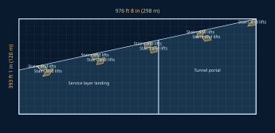
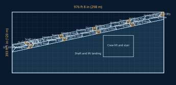
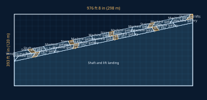

# P3-12 Port Launch Service Shaft: plan

Footprint 976 ft 8 in (298 m) × 393 ft 1 in (120 m) · structural grid 32 ft 10 in (10 m)

## Levels

| Level | Floor above deck | Height | Floor area |
|---|---|---|---|
| Level B1 · Service layer landing | −19 ft 8 in (6,000 mm) | 19 ft 8 in (6,000 mm) | 280,672 sq ft (26,075 m²) |
| Level 1 · Lift landing | 0 ft (0 mm) | 29 ft 6 in (9,000 mm) | 273,358 sq ft (25,396 m²) |
| Level 2 · Winding room | 29 ft 6 in (9,000 mm) | 19 ft 8 in (6,000 mm) | 273,328 sq ft (25,393 m²) |

## Elements

| ID | Designation | Type | Name | Level(s) | Size / length | Area | Status |
|---|---|---|---|---|---|---|---|
| E001 | D5F2P3B13A1L1R1, D5F2P3B13A1L2R1 | room | Shaft and lift landing | L1, L2 | 976 ft 8 in (298 m) × 346 ft 2 in (106 m) | 234,884 sq ft (21,821 m²) | proposed |
| E002 |  | fixture | Crew lift and stair | L1 | 195 ft 6 in (60 m) × 138 ft 5 in (42 m) | 27,073 sq ft (2,515 m²) | proposed |
| E003 | D5F2P3B13A1LB1R1, D5F2P3B13A1L1R2, D5F2P3B13A1L2R2 | core | Stairs and lifts | LB1, L1, L2 | 43 ft 8 in (13 m) × 23 ft 11 in (7,300 mm) | 573 sq ft (53 m²) | proposed |
| E004 | D5F2P3B13A1LB1R2, D5F2P3B13A1L1R3, D5F2P3B13A1L2R3 | core | Stairs and lifts | LB1, L1, L2 | 33 ft 10 in (10 m) × 25 ft 11 in (7,900 mm) | 572 sq ft (53 m²) | proposed |
| E005 | D5F2P3B13A1LB1R3, D5F2P3B13A1L1R4, D5F2P3B13A1L2R4 | core | Stairs and lifts | LB1, L1, L2 | 27 ft 7 in (8,400 mm) × 28 ft 3 in (8,600 mm) | 573 sq ft (53 m²) | proposed |
| E006 | D5F2P3B13A1LB1R4, D5F2P3B13A1L1R5, D5F2P3B13A1L2R5 | core | Stairs and lifts | LB1, L1, L2 | 37 ft 9 in (12 m) × 30 ft 6 in (9,300 mm) | 575 sq ft (53 m²) | proposed |
| E007 | D5F2P3B13A1LB1R5, D5F2P3B13A1L1R6, D5F2P3B13A1L2R6 | core | Stairs and lifts | LB1, L1, L2 | 34 ft 5 in (10 m) × 29 ft 10 in (9,100 mm) | 569 sq ft (53 m²) | proposed |
| E008 | D5F2P3B13A1LB1R6, D5F2P3B13A1L1R7, D5F2P3B13A1L2R7 | core | Stairs and lifts | LB1, L1, L2 | 38 ft 9 in (12 m) × 24 ft 11 in (7,600 mm) | 571 sq ft (53 m²) | proposed |
| E009 | D5F2P3B13A1LB1R7, D5F2P3B13A1L1R8, D5F2P3B13A1L2R8 | core | Stairs and lifts | LB1, L1, L2 | 28 ft 10 in (8,800 mm) × 27 ft 3 in (8,300 mm) | 575 sq ft (53 m²) | proposed |
| E010 | D5F2P3B13A1LB1R8, D5F2P3B13A1L1R9, D5F2P3B13A1L2R9 | core | Stairs and lifts | LB1, L1, L2 | 32 ft 10 in (10 m) × 29 ft 6 in (9,000 mm) | 572 sq ft (53 m²) | proposed |
| E011 | D5F2P3B13A1LB1R9, D5F2P3B13A1L1R10, D5F2P3B13A1L2R10 | core | Stairs and lifts | LB1, L1, L2 | 42 ft 8 in (13 m) × 31 ft 6 in (9,600 mm) | 573 sq ft (53 m²) | proposed |
| E012 | D5F2P3B13A1L1R11 | room | Lift control room | L1 | 21 ft 8 in (6,600 mm) × 46 ft 11 in (14 m) | 533 sq ft (49 m²) | proposed |
| E013 | D5F2P3B13A1L1R12 | room | Loading bay | L1 | 91 ft 10 in (28 m) × 33 ft 6 in (10 m) | 1,597 sq ft (148 m²) | proposed |
| E014 | D5F2P3B13A1L1R13 | room | Crew check-in | L1 | 36 ft 1 in (11 m) × 23 ft (7,000 mm) | 431 sq ft (40 m²) | proposed |
| E015 | D5F2P3B13A1L1R14 | room | Tool store | L1 | 54 ft 2 in (16 m) × 27 ft 3 in (8,300 mm) | 858 sq ft (80 m²) | proposed |
| E016 | D5F2P3B13A1L1R15 | room | Staff toilets and showers | L1 | 47 ft 11 in (15 m) × 26 ft 7 in (8,100 mm) | 758 sq ft (70 m²) | proposed |
| E017 | D5F2P3B13A1L1R16 | room | Holding store | L1 | 110 ft 11 in (34 m) × 41 ft 8 in (13 m) | 2,237 sq ft (208 m²) | proposed |
| E018 | D5F2P3B13A1L1R17 | room | Holding store | L1 | 97 ft 1 in (30 m) × 41 ft (12 m) | 2,048 sq ft (190 m²) | proposed |
| E019 | D5F2P3B13A1L1R18 | room | Holding store | L1 | 102 ft 4 in (31 m) × 44 ft (13 m) | 2,237 sq ft (208 m²) | proposed |
| E020 | D5F2P3B13A1L1R19 | room | Holding store | L1 | 96 ft 2 in (29 m) × 43 ft (13 m) | 2,033 sq ft (189 m²) | proposed |
| E021 | D5F2P3B13A1L1R20 | room | Holding store | L1 | 109 ft 3 in (33 m) × 45 ft 11 in (14 m) | 2,238 sq ft (208 m²) | proposed |
| E022 | D5F2P3B13A1L1R21 | room | Holding store | L1 | 106 ft (32 m) × 45 ft 3 in (14 m) | 2,041 sq ft (190 m²) | proposed |
| E023 | D5F2P3B13A1L1R22 | room | Holding store | L1 | 119 ft 1 in (36 m) × 47 ft 11 in (15 m) | 2,242 sq ft (208 m²) | proposed |
| E024 | D5F2P3B13A1L1R23 | room | Holding store | L1 | 100 ft 5 in (31 m) × 39 ft 8 in (12 m) | 2,034 sq ft (189 m²) | proposed |
| E025 | D5F2P3B13A1L1R24 | room | Holding store | L1 | 116 ft 2 in (35 m) × 40 ft 8 in (12 m) | 2,238 sq ft (208 m²) | proposed |
| E026 | D5F2P3B13A1L1R25 | room | Holding store | L1 | 102 ft (31 m) × 39 ft 8 in (12 m) | 2,025 sq ft (188 m²) | proposed |
| E027 | D5F2P3B13A1L1R26 | room | Holding store | L1 | 106 ft (32 m) × 42 ft 8 in (13 m) | 2,229 sq ft (207 m²) | proposed |
| E028 | D5F2P3B13A1L1R27 | room | Holding store | L1 | 93 ft 10 in (29 m) × 42 ft (13 m) | 2,041 sq ft (190 m²) | proposed |
| E029 | D5F2P3B13A1L1R28 | room | Holding store | L1 | 104 ft 4 in (32 m) × 44 ft 7 in (14 m) | 2,230 sq ft (207 m²) | proposed |
| E030 | D5F2P3B13A1L1R29 | room | Holding store | L1 | 101 ft 1 in (31 m) × 44 ft 3 in (14 m) | 2,048 sq ft (190 m²) | proposed |
| E031 | D5F2P3B13A1L1R30 | room | Holding store | L1 | 114 ft 2 in (35 m) × 46 ft 11 in (14 m) | 2,230 sq ft (207 m²) | proposed |
| E032 | D5F2P3B13A1L1R31 | room | Holding store | L1 | 115 ft 6 in (35 m) × 47 ft 3 in (14 m) | 2,147 sq ft (199 m²) | proposed |
| E033 | D5F2P3B13A1L2R11 | room | Winding machinery | L2 | 91 ft 10 in (28 m) × 62 ft 8 in (19 m) | 2,129 sq ft (198 m²) | proposed |
| E034 | D5F2P3B13A1L2R12 | room | Shaft ventilation fans | L2 | 73 ft 10 in (22 m) × 31 ft 6 in (9,600 mm) | 1,292 sq ft (120 m²) | proposed |
| E035 | D5F2P3B13A1L2R13 | room | Machine gallery | L2 | 145 ft 8 in (44 m) × 48 ft 7 in (15 m) | 2,974 sq ft (276 m²) | proposed |
| E036 | D5F2P3B13A1L2R14 | room | Machine gallery | L2 | 105 ft (32 m) × 43 ft (13 m) | 2,225 sq ft (207 m²) | proposed |
| E037 | D5F2P3B13A1L2R15 | room | Machine gallery | L2 | 94 ft 2 in (29 m) × 42 ft (13 m) | 2,054 sq ft (191 m²) | proposed |
| E038 | D5F2P3B13A1L2R16 | room | Machine gallery | L2 | 104 ft 8 in (32 m) × 44 ft 11 in (14 m) | 2,224 sq ft (207 m²) | proposed |
| E039 | D5F2P3B13A1L2R17 | room | Machine gallery | L2 | 101 ft 5 in (31 m) × 44 ft 3 in (14 m) | 2,064 sq ft (192 m²) | proposed |
| E040 | D5F2P3B13A1L2R18 | room | Machine gallery | L2 | 114 ft 6 in (35 m) × 46 ft 11 in (14 m) | 2,219 sq ft (206 m²) | proposed |
| E041 | D5F2P3B13A1L2R19 | room | Machine gallery | L2 | 111 ft 3 in (34 m) × 46 ft 3 in (14 m) | 2,050 sq ft (190 m²) | proposed |
| E042 | D5F2P3B13A1L2R20 | room | Machine gallery | L2 | 108 ft 3 in (33 m) × 41 ft 8 in (13 m) | 2,214 sq ft (206 m²) | proposed |
| E043 | D5F2P3B13A1L2R21 | room | Machine gallery | L2 | 107 ft 7 in (33 m) × 38 ft 9 in (12 m) | 2,045 sq ft (190 m²) | proposed |
| E044 | D5F2P3B13A1L2R22 | room | Machine gallery | L2 | 109 ft 11 in (34 m) × 41 ft 8 in (13 m) | 2,216 sq ft (206 m²) | proposed |
| E045 | D5F2P3B13A1L2R23 | room | Machine gallery | L2 | 97 ft 9 in (30 m) × 41 ft (13 m) | 2,061 sq ft (192 m²) | proposed |
| E046 | D5F2P3B13A1L2R24 | room | Machine gallery | L2 | 102 ft (31 m) × 43 ft 8 in (13 m) | 2,216 sq ft (206 m²) | proposed |
| E047 | D5F2P3B13A1L2R25 | room | Machine gallery | L2 | 96 ft 5 in (29 m) × 43 ft (13 m) | 2,048 sq ft (190 m²) | proposed |
| E048 | D5F2P3B13A1L2R26 | room | Machine gallery | L2 | 109 ft 7 in (33 m) × 45 ft 11 in (14 m) | 2,226 sq ft (207 m²) | proposed |
| E049 | D5F2P3B13A1L2R27 | room | Machine gallery | L2 | 106 ft 4 in (32 m) × 45 ft 3 in (14 m) | 2,039 sq ft (189 m²) | proposed |
| E050 | D5F2P3B13A1L2R28 | room | Machine gallery | L2 | 115 ft 6 in (35 m) × 47 ft 3 in (14 m) | 2,147 sq ft (199 m²) | proposed |
| E051 | D5F2P3B13A1LB1R10 | room | Service layer landing | LB1 | 575 ft 2 in (175 m) × 306 ft 1 in (93 m) | 140,292 sq ft (13,034 m²) | proposed |
| E052 | D5F2P3B13A1LB1R11 | room | Tunnel portal | LB1 | 401 ft 7 in (122 m) × 393 ft 1 in (120 m) | 140,380 sq ft (13,042 m²) | proposed |

## Drawings

### Level B1 · Service layer landing

### Level 1 · Lift landing

### Level 2 · Winding room

