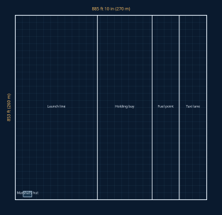

# P3-13 Launch Apron 1: plan

Footprint 885 ft 10 in (270 m) × 853 ft (260 m) · structural grid 32 ft 10 in (10 m)

## Levels

| Level | Floor above deck | Height | Floor area |
|---|---|---|---|
| Level 1 · Ground | 0 ft (0 mm) | 13 ft 1 in (4,000 mm) | 1,033 sq ft (96 m²) |

## Elements

| ID | Designation | Type | Name | Level(s) | Size / length | Area | Status |
|---|---|---|---|---|---|---|---|
| E001 | D5F2P3B2A3R1 | zone | Launch line | L1 | 379 ft 7 in (116 m) × 853 ft (260 m) | 323,800 sq ft (30,082 m²) | proposed |
| E002 | D5F2P3B2A3R2 | room | Marshal's hut | L1 | 39 ft 4 in (12 m) × 26 ft 3 in (8,000 mm) | 1,033 sq ft (96 m²) | proposed |
| E003 | D5F2P3B2A3R3 | zone | Holding bay | L1 | 253 ft 3 in (77 m) × 853 ft (260 m) | 216,053 sq ft (20,072 m²) | proposed |
| E004 | D5F2P3B2A3R4 | zone | Fuel point | L1 | 126 ft 4 in (38 m) × 853 ft (260 m) | 107,747 sq ft (10,010 m²) | proposed |
| E005 | D5F2P3B2A3R5 | zone | Taxi lane | L1 | 126 ft 8 in (39 m) × 853 ft (260 m) | 108,027 sq ft (10,036 m²) | proposed |

## Drawings

### Level 1 · Ground

