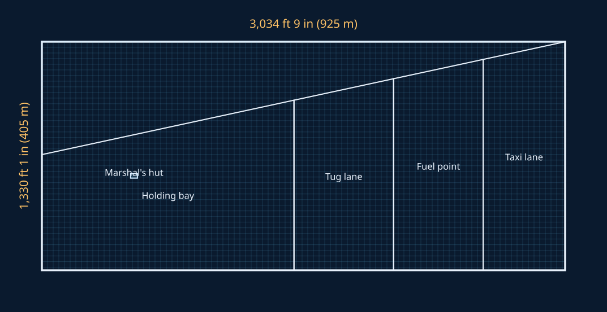

# P3-14 Launch Apron 2: plan

Footprint 3,034 ft 9 in (925 m) × 1,330 ft 1 in (405 m) · structural grid 32 ft 10 in (10 m)

## Levels

| Level | Floor above deck | Height | Floor area |
|---|---|---|---|
| Level 1 · Ground | 0 ft (0 mm) | 13 ft 1 in (4,000 mm) | 1,033 sq ft (96 m²) |

## Elements

| ID | Designation | Type | Name | Level(s) | Size / length | Area | Status |
|---|---|---|---|---|---|---|---|
| E001 | D5F2P3B7A1R1 | zone | Holding bay | L1 | 1,462 ft 3 in (446 m) × 989 ft 10 in (302 m) | 1,215,920 sq ft (112,963 m²) | proposed |
| E002 | D5F2P3B7A1R2 | room | Marshal's hut | L1 | 39 ft 4 in (12 m) × 26 ft 3 in (8,000 mm) | 1,033 sq ft (96 m²) | proposed |
| E003 | D5F2P3B7A1R3 | zone | Tug lane | L1 | 577 ft 9 in (176 m) × 1,114 ft 10 in (340 m) | 607,990 sq ft (56,484 m²) | proposed |
| E004 | D5F2P3B7A1R4 | zone | Fuel point | L1 | 519 ft 4 in (158 m) × 1,227 ft (374 m) | 608,132 sq ft (56,497 m²) | proposed |
| E005 | D5F2P3B7A1R5 | zone | Taxi lane | L1 | 475 ft 5 in (145 m) × 1,330 ft 1 in (405 m) | 607,811 sq ft (56,468 m²) | proposed |

## Drawings

### Level 1 · Ground

