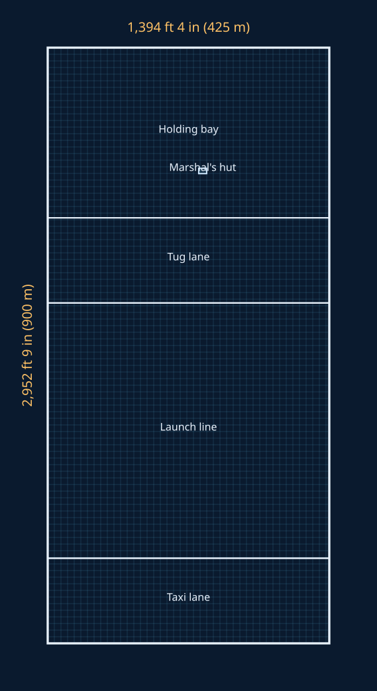

# P3-16 Launch Apron 4: plan

Footprint 1,394 ft 4 in (425 m) × 2,952 ft 9 in (900 m) · structural grid 32 ft 10 in (10 m)

## Levels

| Level | Floor above deck | Height | Floor area |
|---|---|---|---|
| Level 1 · Ground | 0 ft (0 mm) | 13 ft 1 in (4,000 mm) | 1,033 sq ft (96 m²) |

## Elements

| ID | Designation | Type | Name | Level(s) | Size / length | Area | Status |
|---|---|---|---|---|---|---|---|
| E001 | D5F2P3B10A1R1 | zone | Holding bay | L1 | 1,394 ft 4 in (425 m) × 843 ft 6 in (257 m) | 1,176,146 sq ft (109,268 m²) | proposed |
| E002 | D5F2P3B10A1R2 | room | Marshal's hut | L1 | 39 ft 4 in (12 m) × 26 ft 3 in (8,000 mm) | 1,033 sq ft (96 m²) | proposed |
| E003 | D5F2P3B10A1R3 | zone | Tug lane | L1 | 1,394 ft 4 in (425 m) × 421 ft 11 in (129 m) | 588,302 sq ft (54,655 m²) | proposed |
| E004 | D5F2P3B10A1R4 | zone | Launch line | L1 | 1,394 ft 4 in (425 m) × 1,265 ft 5 in (386 m) | 1,764,447 sq ft (163,922 m²) | proposed |
| E005 | D5F2P3B10A1R5 | zone | Taxi lane | L1 | 1,394 ft 4 in (425 m) × 421 ft 11 in (129 m) | 588,302 sq ft (54,655 m²) | proposed |

## Drawings

### Level 1 · Ground

