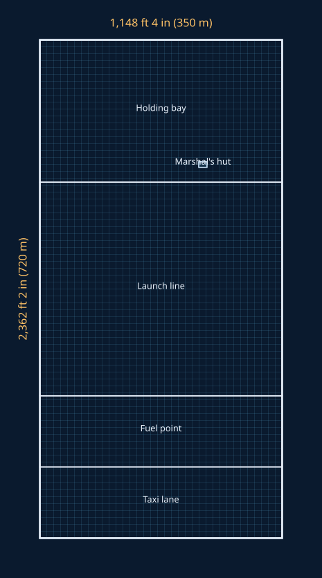

# P3-17 Launch Apron 5: plan

Footprint 1,148 ft 4 in (350 m) × 2,362 ft 2 in (720 m) · structural grid 32 ft 10 in (10 m)

## Levels

| Level | Floor above deck | Height | Floor area |
|---|---|---|---|
| Level 1 · Ground | 0 ft (0 mm) | 13 ft 1 in (4,000 mm) | 1,033 sq ft (96 m²) |

## Elements

| ID | Designation | Type | Name | Level(s) | Size / length | Area | Status |
|---|---|---|---|---|---|---|---|
| E001 | D5F2P3B12A2R1 | zone | Holding bay | L1 | 1,148 ft 4 in (350 m) × 674 ft 10 in (206 m) | 774,948 sq ft (71,995 m²) | proposed |
| E002 | D5F2P3B12A2R2 | room | Marshal's hut | L1 | 39 ft 4 in (12 m) × 26 ft 3 in (8,000 mm) | 1,033 sq ft (96 m²) | proposed |
| E003 | D5F2P3B12A2R3 | zone | Launch line | L1 | 1,148 ft 4 in (350 m) × 1,012 ft 6 in (309 m) | 1,162,610 sq ft (108,010 m²) | proposed |
| E004 | D5F2P3B12A2R4 | zone | Fuel point | L1 | 1,148 ft 4 in (350 m) × 337 ft 3 in (103 m) | 387,286 sq ft (35,980 m²) | proposed |
| E005 | D5F2P3B12A2R5 | zone | Taxi lane | L1 | 1,148 ft 4 in (350 m) × 337 ft 7 in (103 m) | 387,662 sq ft (36,015 m²) | proposed |

## Drawings

### Level 1 · Ground

