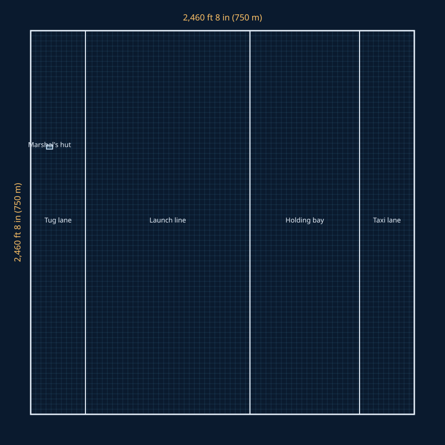

# P3-19 Launch Apron 7: plan

Footprint 2,460 ft 8 in (750 m) × 2,460 ft 8 in (750 m) · structural grid 32 ft 10 in (10 m)

## Levels

| Level | Floor above deck | Height | Floor area |
|---|---|---|---|
| Level 1 · Ground | 0 ft (0 mm) | 13 ft 1 in (4,000 mm) | 1,033 sq ft (96 m²) |

## Elements

| ID | Designation | Type | Name | Level(s) | Size / length | Area | Status |
|---|---|---|---|---|---|---|---|
| E001 | D5F2P3B14A2R1 | zone | Tug lane | L1 | 351 ft 5 in (107 m) × 2,460 ft 8 in (750 m) | 864,611 sq ft (80,325 m²) | proposed |
| E002 | D5F2P3B14A2R2 | room | Marshal's hut | L1 | 39 ft 4 in (12 m) × 26 ft 3 in (8,000 mm) | 1,033 sq ft (96 m²) | proposed |
| E003 | D5F2P3B14A2R3 | zone | Launch line | L1 | 1,054 ft 9 in (322 m) × 2,460 ft 8 in (750 m) | 2,595,448 sq ft (241,125 m²) | proposed |
| E004 | D5F2P3B14A2R4 | zone | Holding bay | L1 | 703 ft 1 in (214 m) × 2,460 ft 8 in (750 m) | 1,730,030 sq ft (160,725 m²) | proposed |
| E005 | D5F2P3B14A2R5 | zone | Taxi lane | L1 | 351 ft 5 in (107 m) × 2,460 ft 8 in (750 m) | 864,611 sq ft (80,325 m²) | proposed |

## Drawings

### Level 1 · Ground

