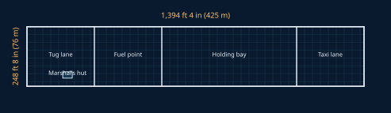

# P3-20 Launch Apron 8: plan

Footprint 1,394 ft 4 in (425 m) × 248 ft 8 in (76 m) · structural grid 32 ft 10 in (10 m)

## Levels

| Level | Floor above deck | Height | Floor area |
|---|---|---|---|
| Level 1 · Ground | 0 ft (0 mm) | 13 ft 1 in (4,000 mm) | 1,033 sq ft (96 m²) |

## Elements

| ID | Designation | Type | Name | Level(s) | Size / length | Area | Status |
|---|---|---|---|---|---|---|---|
| E001 | D5F2P3B9A2R1 | zone | Tug lane | L1 | 278 ft 10 in (85 m) × 248 ft 8 in (76 m) | 69,352 sq ft (6,443 m²) | proposed |
| E002 | D5F2P3B9A2R2 | room | Marshal's hut | L1 | 39 ft 4 in (12 m) × 26 ft 3 in (8,000 mm) | 1,033 sq ft (96 m²) | proposed |
| E003 | D5F2P3B9A2R3 | zone | Fuel point | L1 | 278 ft 10 in (85 m) × 248 ft 8 in (76 m) | 69,352 sq ft (6,443 m²) | proposed |
| E004 | D5F2P3B9A2R4 | zone | Holding bay | L1 | 557 ft 9 in (170 m) × 248 ft 8 in (76 m) | 138,704 sq ft (12,886 m²) | proposed |
| E005 | D5F2P3B9A2R5 | zone | Taxi lane | L1 | 278 ft 10 in (85 m) × 248 ft 8 in (76 m) | 69,352 sq ft (6,443 m²) | proposed |

## Drawings

### Level 1 · Ground

