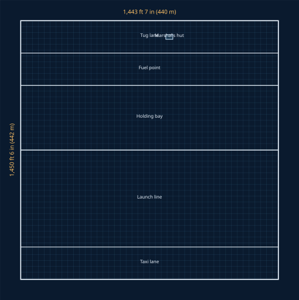

# P3-21 Launch Apron 9: plan

Footprint 1,443 ft 7 in (440 m) × 1,450 ft 6 in (442 m) · structural grid 32 ft 10 in (10 m)

## Levels

| Level | Floor above deck | Height | Floor area |
|---|---|---|---|
| Level 1 · Ground | 0 ft (0 mm) | 13 ft 1 in (4,000 mm) | 1,033 sq ft (96 m²) |

## Elements

| ID | Designation | Type | Name | Level(s) | Size / length | Area | Status |
|---|---|---|---|---|---|---|---|
| E001 | D5F2P3B11A2R1 | zone | Tug lane | L1 | 1,443 ft 7 in (440 m) × 181 ft 5 in (55 m) | 261,907 sq ft (24,332 m²) | proposed |
| E002 | D5F2P3B11A2R2 | room | Marshal's hut | L1 | 39 ft 4 in (12 m) × 26 ft 3 in (8,000 mm) | 1,033 sq ft (96 m²) | proposed |
| E003 | D5F2P3B11A2R3 | zone | Fuel point | L1 | 1,443 ft 7 in (440 m) × 181 ft 1 in (55 m) | 261,434 sq ft (24,288 m²) | proposed |
| E004 | D5F2P3B11A2R4 | zone | Holding bay | L1 | 1,443 ft 7 in (440 m) × 362 ft 10 in (111 m) | 523,815 sq ft (48,664 m²) | proposed |
| E005 | D5F2P3B11A2R5 | zone | Launch line | L1 | 1,443 ft 7 in (440 m) × 543 ft 8 in (166 m) | 784,775 sq ft (72,908 m²) | proposed |
| E006 | D5F2P3B11A2R6 | zone | Taxi lane | L1 | 1,443 ft 7 in (440 m) × 181 ft 5 in (55 m) | 261,907 sq ft (24,332 m²) | proposed |

## Drawings

### Level 1 · Ground

