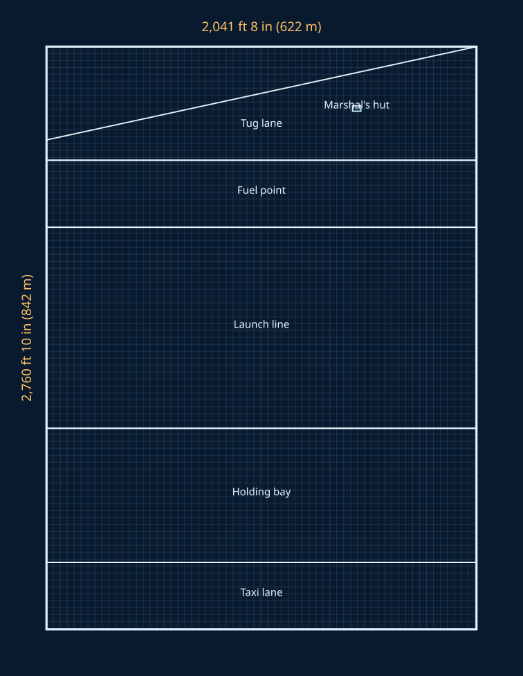

# P3-22 Launch Apron 10: plan

Footprint 2,041 ft 8 in (622 m) × 2,760 ft 10 in (842 m) · structural grid 32 ft 10 in (10 m)

## Levels

| Level | Floor above deck | Height | Floor area |
|---|---|---|---|
| Level 1 · Ground | 0 ft (0 mm) | 13 ft 1 in (4,000 mm) | 1,033 sq ft (96 m²) |

## Elements

| ID | Designation | Type | Name | Level(s) | Size / length | Area | Status |
|---|---|---|---|---|---|---|---|
| E001 | D5F2P3B13A3R1 | zone | Tug lane | L1 | 2,041 ft 8 in (622 m) × 538 ft 5 in (164 m) | 648,068 sq ft (60,208 m²) | proposed |
| E002 | D5F2P3B13A3R2 | room | Marshal's hut | L1 | 39 ft 4 in (12 m) × 26 ft 3 in (8,000 mm) | 1,033 sq ft (96 m²) | proposed |
| E003 | D5F2P3B13A3R3 | zone | Fuel point | L1 | 2,041 ft 8 in (622 m) × 317 ft 7 in (97 m) | 648,403 sq ft (60,239 m²) | proposed |
| E004 | D5F2P3B13A3R4 | zone | Launch line | L1 | 2,041 ft 8 in (622 m) × 952 ft 5 in (290 m) | 1,944,540 sq ft (180,654 m²) | proposed |
| E005 | D5F2P3B13A3R5 | zone | Holding bay | L1 | 2,041 ft 8 in (622 m) × 634 ft 10 in (194 m) | 1,296,137 sq ft (120,415 m²) | proposed |
| E006 | D5F2P3B13A3R6 | zone | Taxi lane | L1 | 2,041 ft 8 in (622 m) × 317 ft 7 in (97 m) | 648,403 sq ft (60,239 m²) | proposed |

## Drawings

### Level 1 · Ground

