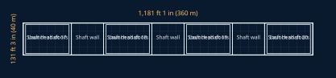

# P4-01 Launch Shafts 17–20: plan

Footprint 1,181 ft 1 in (360 m) × 131 ft 3 in (40 m) · structural grid 32 ft 10 in (10 m)

## Levels

| Level | Floor above deck | Height | Floor area |
|---|---|---|---|
| Level 1 · Ground | 0 ft (0 mm) | 13 ft 1 in (4,000 mm) | — |

## Elements

| ID | Designation | Type | Name | Level(s) | Size / length | Area | Status |
|---|---|---|---|---|---|---|---|
| E001 | D5F2P4B1A1R1 | zone | Launch shaft 17 | L1 | 196 ft 10 in (60 m) × 131 ft 3 in (40 m) | 25,833 sq ft (2,400 m²) | proposed |
| E002 |  | fixture | Shaft head doors | L1 | 177 ft 2 in (54 m) × 118 ft 1 in (36 m) | 20,925 sq ft (1,944 m²) | proposed |
| E003 | D5F2P4B1A1R2 | zone | Shaft wall | L1 | 131 ft 3 in (40 m) × 131 ft 3 in (40 m) | 17,222 sq ft (1,600 m²) | proposed |
| E004 | D5F2P4B1A1R3 | zone | Launch shaft 18 | L1 | 196 ft 10 in (60 m) × 131 ft 3 in (40 m) | 25,833 sq ft (2,400 m²) | proposed |
| E005 |  | fixture | Shaft head doors | L1 | 177 ft 2 in (54 m) × 118 ft 1 in (36 m) | 20,925 sq ft (1,944 m²) | proposed |
| E006 | D5F2P4B1A1R4 | zone | Shaft wall | L1 | 131 ft 3 in (40 m) × 131 ft 3 in (40 m) | 17,222 sq ft (1,600 m²) | proposed |
| E007 | D5F2P4B1A1R5 | zone | Launch shaft 19 | L1 | 196 ft 10 in (60 m) × 131 ft 3 in (40 m) | 25,833 sq ft (2,400 m²) | proposed |
| E008 |  | fixture | Shaft head doors | L1 | 177 ft 2 in (54 m) × 118 ft 1 in (36 m) | 20,925 sq ft (1,944 m²) | proposed |
| E009 | D5F2P4B1A1R6 | zone | Shaft wall | L1 | 131 ft 3 in (40 m) × 131 ft 3 in (40 m) | 17,222 sq ft (1,600 m²) | proposed |
| E010 | D5F2P4B1A1R7 | zone | Launch shaft 20 | L1 | 196 ft 10 in (60 m) × 131 ft 3 in (40 m) | 25,833 sq ft (2,400 m²) | proposed |
| E011 |  | fixture | Shaft head doors | L1 | 177 ft 2 in (54 m) × 118 ft 1 in (36 m) | 20,925 sq ft (1,944 m²) | proposed |

## Drawings

### Level 1 · Ground

