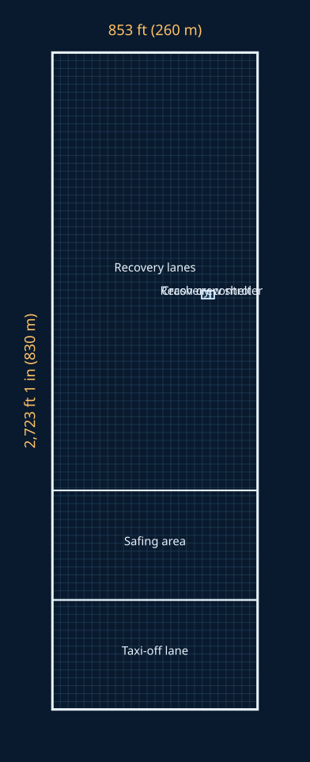

# P4-06 Recovery Apron: plan

Footprint 853 ft (260 m) × 2,723 ft 1 in (830 m) · structural grid 32 ft 10 in (10 m)

## Levels

| Level | Floor above deck | Height | Floor area |
|---|---|---|---|
| Level 1 · Ground | 0 ft (0 mm) | 13 ft 1 in (4,000 mm) | 1,722 sq ft (160 m²) |

## Elements

| ID | Designation | Type | Name | Level(s) | Size / length | Area | Status |
|---|---|---|---|---|---|---|---|
| E001 | D5F2P4B5A2R1 | zone | Recovery lanes | L1 | 853 ft (260 m) × 1,815 ft 3 in (553 m) | 1,548,475 sq ft (143,858 m²) | proposed |
| E002 | D5F2P4B5A2R2 | room | Recovery control | L1 | 35 ft 1 in (11 m) × 32 ft 10 in (10 m) | 1,152 sq ft (107 m²) | proposed |
| E003 | D5F2P4B5A2R3 | room | Crash crew shelter | L1 | 17 ft 5 in (5,300 mm) × 32 ft 10 in (10 m) | 570 sq ft (53 m²) | proposed |
| E004 | D5F2P4B5A2R4 | zone | Safing area | L1 | 853 ft (260 m) × 454 ft 1 in (138 m) | 387,329 sq ft (35,984 m²) | proposed |
| E005 | D5F2P4B5A2R5 | zone | Taxi-off lane | L1 | 853 ft (260 m) × 453 ft 9 in (138 m) | 387,049 sq ft (35,958 m²) | proposed |

## Drawings

### Level 1 · Ground

