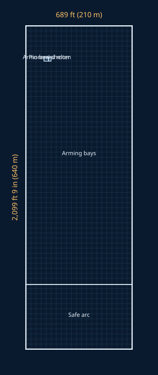

# P4-07 Starboard Arming Apron: plan

Footprint 689 ft (210 m) × 2,099 ft 9 in (640 m) · structural grid 32 ft 10 in (10 m)

## Levels

| Level | Floor above deck | Height | Floor area |
|---|---|---|---|
| Level 1 · Ground | 0 ft (0 mm) | 13 ft 1 in (4,000 mm) | 1,206 sq ft (112 m²) |

## Elements

| ID | Designation | Type | Name | Level(s) | Size / length | Area | Status |
|---|---|---|---|---|---|---|---|
| E001 | D5F2P4B3A2R1 | zone | Arming bays | L1 | 689 ft (210 m) × 1,679 ft 9 in (512 m) | 1,157,336 sq ft (107,520 m²) | proposed |
| E002 | D5F2P4B3A2R2 | room | Armorers' shelter | L1 | 30 ft 6 in (9,300 mm) × 26 ft 3 in (8,000 mm) | 801 sq ft (74 m²) | proposed |
| E003 | D5F2P4B3A2R3 | room | Pin board room | L1 | 15 ft 5 in (4,700 mm) × 26 ft 3 in (8,000 mm) | 405 sq ft (38 m²) | proposed |
| E004 | D5F2P4B3A2R4 | zone | Safe arc | L1 | 689 ft (210 m) × 419 ft 11 in (128 m) | 289,334 sq ft (26,880 m²) | proposed |

## Drawings

### Level 1 · Ground

