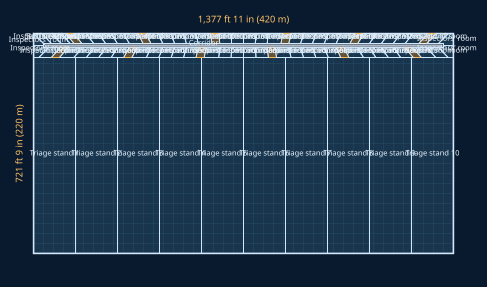
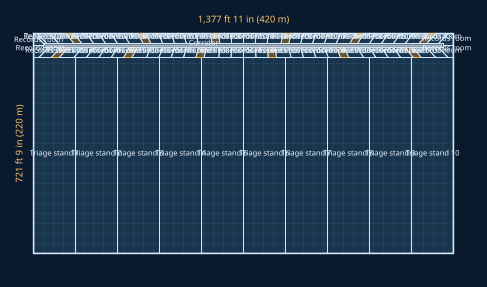

# P4-08 Damage Triage Bay: plan

Footprint 1,377 ft 11 in (420 m) × 721 ft 9 in (220 m) · structural grid 32 ft 10 in (10 m)

## Levels

| Level | Floor above deck | Height | Floor area |
|---|---|---|---|
| Level 1 · Hall floor | 0 ft (0 mm) | 45 ft 11 in (14 m) | 966,274 sq ft (89,770 m²) |
| Level 2 · Gallery floor | 45 ft 11 in (14 m) | 14 ft 9 in (4,500 mm) | 966,274 sq ft (89,770 m²) |

## Elements

| ID | Designation | Type | Name | Level(s) | Size / length | Area | Status |
|---|---|---|---|---|---|---|---|
| E001 | D5F2P4B7A2L1R1, D5F2P4B7A2L2R1 | room | Triage stand 1 | L1, L2 | 137 ft 10 in (42 m) × 643 ft 1 in (196 m) | 88,609 sq ft (8,232 m²) | proposed |
| E002 | D5F2P4B7A2L1R2, D5F2P4B7A2L2R2 | room | Triage stand 2 | L1, L2 | 137 ft 10 in (42 m) × 643 ft 1 in (196 m) | 88,609 sq ft (8,232 m²) | proposed |
| E003 | D5F2P4B7A2L1R3, D5F2P4B7A2L2R3 | room | Triage stand 3 | L1, L2 | 137 ft 10 in (42 m) × 643 ft 1 in (196 m) | 88,609 sq ft (8,232 m²) | proposed |
| E004 | D5F2P4B7A2L1R4, D5F2P4B7A2L2R4 | room | Triage stand 4 | L1, L2 | 137 ft 10 in (42 m) × 643 ft 1 in (196 m) | 88,609 sq ft (8,232 m²) | proposed |
| E005 | D5F2P4B7A2L1R5, D5F2P4B7A2L2R5 | room | Triage stand 5 | L1, L2 | 137 ft 10 in (42 m) × 643 ft 1 in (196 m) | 88,609 sq ft (8,232 m²) | proposed |
| E006 | D5F2P4B7A2L1R6, D5F2P4B7A2L2R6 | room | Triage stand 6 | L1, L2 | 137 ft 10 in (42 m) × 643 ft 1 in (196 m) | 88,609 sq ft (8,232 m²) | proposed |
| E007 | D5F2P4B7A2L1R7, D5F2P4B7A2L2R7 | room | Triage stand 7 | L1, L2 | 137 ft 10 in (42 m) × 643 ft 1 in (196 m) | 88,609 sq ft (8,232 m²) | proposed |
| E008 | D5F2P4B7A2L1R8, D5F2P4B7A2L2R8 | room | Triage stand 8 | L1, L2 | 137 ft 10 in (42 m) × 643 ft 1 in (196 m) | 88,609 sq ft (8,232 m²) | proposed |
| E009 | D5F2P4B7A2L1R9, D5F2P4B7A2L2R9 | room | Triage stand 9 | L1, L2 | 137 ft 10 in (42 m) × 643 ft 1 in (196 m) | 88,609 sq ft (8,232 m²) | proposed |
| E010 | D5F2P4B7A2L1R10, D5F2P4B7A2L2R10 | room | Triage stand 10 | L1, L2 | 137 ft 10 in (42 m) × 643 ft 1 in (196 m) | 88,609 sq ft (8,232 m²) | proposed |
| E011 | D5F2P4B7A2L1R11, D5F2P4B7A2L2R11 | core | Stairs and lifts | L1, L2 | 53 ft 2 in (16 m) × 32 ft 6 in (9,900 mm) | 853 sq ft (79 m²) | proposed |
| E012 | D5F2P4B7A2L1R12, D5F2P4B7A2L2R12 | core | Stairs and lifts | L1, L2 | 42 ft (13 m) × 32 ft 6 in (9,900 mm) | 853 sq ft (79 m²) | proposed |
| E013 | D5F2P4B7A2L1R13, D5F2P4B7A2L2R13 | core | Stairs and lifts | L1, L2 | 30 ft 10 in (9,400 mm) × 32 ft 6 in (9,900 mm) | 853 sq ft (79 m²) | proposed |
| E014 | D5F2P4B7A2L1R14, D5F2P4B7A2L2R14 | core | Stairs and lifts | L1, L2 | 32 ft 10 in (10 m) × 32 ft 6 in (9,900 mm) | 853 sq ft (79 m²) | proposed |
| E015 | D5F2P4B7A2L1R15, D5F2P4B7A2L2R15 | core | Stairs and lifts | L1, L2 | 44 ft (13 m) × 32 ft 6 in (9,900 mm) | 853 sq ft (79 m²) | proposed |
| E016 | D5F2P4B7A2L1R16, D5F2P4B7A2L2R16 | core | Stairs and lifts | L1, L2 | 55 ft 1 in (17 m) × 32 ft 6 in (9,900 mm) | 847 sq ft (79 m²) | proposed |
| E017 | D5F2P4B7A2L1R17, D5F2P4B7A2L2R17 | core | Stairs and lifts | L1, L2 | 53 ft 2 in (16 m) × 32 ft 6 in (9,900 mm) | 853 sq ft (79 m²) | proposed |
| E018 | D5F2P4B7A2L1R18, D5F2P4B7A2L2R18 | core | Stairs and lifts | L1, L2 | 42 ft (13 m) × 32 ft 6 in (9,900 mm) | 853 sq ft (79 m²) | proposed |
| E019 | D5F2P4B7A2L1R19, D5F2P4B7A2L2R19 | core | Stairs and lifts | L1, L2 | 30 ft 10 in (9,400 mm) × 32 ft 6 in (9,900 mm) | 853 sq ft (79 m²) | proposed |
| E020 | D5F2P4B7A2L1R20, D5F2P4B7A2L2R20 | core | Stairs and lifts | L1, L2 | 32 ft 10 in (10 m) × 32 ft 6 in (9,900 mm) | 853 sq ft (79 m²) | proposed |
| E021 | D5F2P4B7A2L1R21, D5F2P4B7A2L2R21 | core | Stairs and lifts | L1, L2 | 44 ft (13 m) × 32 ft 6 in (9,900 mm) | 853 sq ft (79 m²) | proposed |
| E022 | D5F2P4B7A2L1R22, D5F2P4B7A2L2R22 | core | Stairs and lifts | L1, L2 | 55 ft 1 in (17 m) × 32 ft 6 in (9,900 mm) | 847 sq ft (79 m²) | proposed |
| E023 | D5F2P4B7A2L1R23 | zone | Corridor | L1 | 1,313 ft (400 m) × 13 ft 9 in (4,200 mm) | 12,962 sq ft (1,204 m²) | proposed |
| E024 | D5F2P4B7A2L1R24 | room | Inspection office | L1 | 58 ft 5 in (18 m) × 32 ft 6 in (9,900 mm) | 863 sq ft (80 m²) | proposed |
| E025 | D5F2P4B7A2L1R25 | room | Scanner room | L1 | 63 ft 8 in (19 m) × 32 ft 6 in (9,900 mm) | 1,076 sq ft (100 m²) | proposed |
| E026 | D5F2P4B7A2L1R26 | room | Locker room | L1 | 58 ft 9 in (18 m) × 32 ft 6 in (9,900 mm) | 970 sq ft (90 m²) | proposed |
| E027 | D5F2P4B7A2L1R27 | room | Staff toilets and showers | L1 | 41 ft (12 m) × 32 ft 6 in (9,900 mm) | 432 sq ft (40 m²) | proposed |
| E028 | D5F2P4B7A2L1R28 | room | Inspectors' room | L1 | 65 ft (20 m) × 32 ft 6 in (9,900 mm) | 1,289 sq ft (120 m²) | proposed |
| E029 | D5F2P4B7A2L1R29 | room | Inspectors' room | L1 | 63 ft 4 in (19 m) × 32 ft 6 in (9,900 mm) | 1,300 sq ft (121 m²) | proposed |
| E030 | D5F2P4B7A2L1R30 | room | Inspectors' room | L1 | 61 ft (19 m) × 32 ft 6 in (9,900 mm) | 1,289 sq ft (120 m²) | proposed |
| E031 | D5F2P4B7A2L1R31 | room | Inspectors' room | L1 | 59 ft 5 in (18 m) × 32 ft 6 in (9,900 mm) | 1,295 sq ft (120 m²) | proposed |
| E032 | D5F2P4B7A2L1R32 | room | Inspectors' room | L1 | 64 ft (20 m) × 32 ft 6 in (9,900 mm) | 1,508 sq ft (140 m²) | proposed |
| E033 | D5F2P4B7A2L1R33 | room | Inspectors' room | L1 | 53 ft 10 in (16 m) × 32 ft 6 in (9,900 mm) | 1,289 sq ft (120 m²) | proposed |
| E034 | D5F2P4B7A2L1R34 | room | Inspectors' room | L1 | 52 ft 2 in (16 m) × 32 ft 6 in (9,900 mm) | 1,300 sq ft (121 m²) | proposed |
| E035 | D5F2P4B7A2L1R35 | room | Inspectors' room | L1 | 49 ft 10 in (15 m) × 32 ft 6 in (9,900 mm) | 1,289 sq ft (120 m²) | proposed |
| E036 | D5F2P4B7A2L1R36 | room | Inspectors' room | L1 | 48 ft 3 in (15 m) × 32 ft 6 in (9,900 mm) | 1,295 sq ft (120 m²) | proposed |
| E037 | D5F2P4B7A2L1R37 | room | Inspectors' room | L1 | 52 ft 10 in (16 m) × 32 ft 6 in (9,900 mm) | 1,508 sq ft (140 m²) | proposed |
| E038 | D5F2P4B7A2L1R38 | room | Inspectors' room | L1 | 42 ft 8 in (13 m) × 32 ft 6 in (9,900 mm) | 1,289 sq ft (120 m²) | proposed |
| E039 | D5F2P4B7A2L1R39 | room | Inspectors' room | L1 | 41 ft (12 m) × 32 ft 6 in (9,900 mm) | 1,300 sq ft (121 m²) | proposed |
| E040 | D5F2P4B7A2L1R40 | room | Inspectors' room | L1 | 40 ft 8 in (12 m) × 32 ft 6 in (9,900 mm) | 1,289 sq ft (120 m²) | proposed |
| E041 | D5F2P4B7A2L1R41 | room | Inspectors' room | L1 | 42 ft 8 in (13 m) × 32 ft 6 in (9,900 mm) | 1,295 sq ft (120 m²) | proposed |
| E042 | D5F2P4B7A2L1R42 | room | Inspectors' room | L1 | 51 ft 2 in (16 m) × 32 ft 6 in (9,900 mm) | 1,508 sq ft (140 m²) | proposed |
| E043 | D5F2P4B7A2L1R43 | room | Inspectors' room | L1 | 48 ft 3 in (15 m) × 32 ft 6 in (9,900 mm) | 1,295 sq ft (120 m²) | proposed |
| E044 | D5F2P4B7A2L1R44 | room | Inspectors' room | L1 | 50 ft 2 in (15 m) × 32 ft 6 in (9,900 mm) | 1,295 sq ft (120 m²) | proposed |
| E045 | D5F2P4B7A2L1R45 | room | Inspectors' room | L1 | 51 ft 10 in (16 m) × 32 ft 6 in (9,900 mm) | 1,289 sq ft (120 m²) | proposed |
| E046 | D5F2P4B7A2L1R46 | room | Inspectors' room | L1 | 53 ft 10 in (16 m) × 32 ft 6 in (9,900 mm) | 1,295 sq ft (120 m²) | proposed |
| E047 | D5F2P4B7A2L1R47 | room | Inspectors' room | L1 | 62 ft 4 in (19 m) × 32 ft 6 in (9,900 mm) | 1,508 sq ft (140 m²) | proposed |
| E048 | D5F2P4B7A2L1R48 | room | Inspectors' room | L1 | 59 ft 5 in (18 m) × 32 ft 6 in (9,900 mm) | 1,295 sq ft (120 m²) | proposed |
| E049 | D5F2P4B7A2L1R49 | room | Inspectors' room | L1 | 61 ft 4 in (19 m) × 32 ft 6 in (9,900 mm) | 1,295 sq ft (120 m²) | proposed |
| E050 | D5F2P4B7A2L1R50 | room | Inspectors' room | L1 | 63 ft (19 m) × 32 ft 6 in (9,900 mm) | 1,289 sq ft (120 m²) | proposed |
| E051 | D5F2P4B7A2L1R51 | room | Inspectors' room | L1 | 65 ft (20 m) × 32 ft 6 in (9,900 mm) | 1,295 sq ft (120 m²) | proposed |
| E052 | D5F2P4B7A2L1R52 | room | Inspectors' room | L1 | 73 ft 10 in (22 m) × 32 ft 6 in (9,900 mm) | 1,513 sq ft (141 m²) | proposed |
| E053 | D5F2P4B7A2L1R53 | room | Inspectors' room | L1 | 70 ft 6 in (22 m) × 32 ft 6 in (9,900 mm) | 1,295 sq ft (120 m²) | proposed |
| E054 | D5F2P4B7A2L1R54 | room | Inspectors' room | L1 | 48 ft 11 in (15 m) × 39 ft 4 in (12 m) | 1,295 sq ft (120 m²) | proposed |
| E055 | D5F2P4B7A2L1R55 | room | Inspectors' room | L1 | 48 ft 7 in (15 m) × 39 ft 4 in (12 m) | 1,289 sq ft (120 m²) | proposed |
| E056 | D5F2P4B7A2L1R56 | room | Inspectors' room | L1 | 70 ft 6 in (22 m) × 32 ft 6 in (9,900 mm) | 1,295 sq ft (120 m²) | proposed |
| E057 | D5F2P4B7A2L1R57 | room | Inspectors' room | L1 | 75 ft 2 in (23 m) × 32 ft 6 in (9,900 mm) | 1,508 sq ft (140 m²) | proposed |
| E058 | D5F2P4B7A2L1R58 | room | Inspectors' room | L1 | 65 ft (20 m) × 32 ft 6 in (9,900 mm) | 1,289 sq ft (120 m²) | proposed |
| E059 | D5F2P4B7A2L1R59 | room | Inspectors' room | L1 | 63 ft 4 in (19 m) × 32 ft 6 in (9,900 mm) | 1,300 sq ft (121 m²) | proposed |
| E060 | D5F2P4B7A2L1R60 | room | Inspectors' room | L1 | 61 ft (19 m) × 32 ft 6 in (9,900 mm) | 1,289 sq ft (120 m²) | proposed |
| E061 | D5F2P4B7A2L1R61 | room | Inspectors' room | L1 | 59 ft 5 in (18 m) × 32 ft 6 in (9,900 mm) | 1,295 sq ft (120 m²) | proposed |
| E062 | D5F2P4B7A2L1R62 | room | Inspectors' room | L1 | 64 ft (20 m) × 32 ft 6 in (9,900 mm) | 1,508 sq ft (140 m²) | proposed |
| E063 | D5F2P4B7A2L1R63 | room | Inspectors' room | L1 | 53 ft 10 in (16 m) × 32 ft 6 in (9,900 mm) | 1,289 sq ft (120 m²) | proposed |
| E064 | D5F2P4B7A2L1R64 | room | Inspectors' room | L1 | 52 ft 2 in (16 m) × 32 ft 6 in (9,900 mm) | 1,300 sq ft (121 m²) | proposed |
| E065 | D5F2P4B7A2L1R65 | room | Inspectors' room | L1 | 49 ft 10 in (15 m) × 32 ft 6 in (9,900 mm) | 1,289 sq ft (120 m²) | proposed |
| E066 | D5F2P4B7A2L1R66 | room | Inspectors' room | L1 | 48 ft 3 in (15 m) × 32 ft 6 in (9,900 mm) | 1,295 sq ft (120 m²) | proposed |
| E067 | D5F2P4B7A2L1R67 | room | Inspectors' room | L1 | 52 ft 10 in (16 m) × 32 ft 6 in (9,900 mm) | 1,508 sq ft (140 m²) | proposed |
| E068 | D5F2P4B7A2L1R68 | room | Inspectors' room | L1 | 42 ft 8 in (13 m) × 32 ft 6 in (9,900 mm) | 1,289 sq ft (120 m²) | proposed |
| E069 | D5F2P4B7A2L1R69 | room | Inspectors' room | L1 | 41 ft (12 m) × 32 ft 6 in (9,900 mm) | 1,300 sq ft (121 m²) | proposed |
| E070 | D5F2P4B7A2L1R70 | room | Inspectors' room | L1 | 40 ft 8 in (12 m) × 32 ft 6 in (9,900 mm) | 1,289 sq ft (120 m²) | proposed |
| E071 | D5F2P4B7A2L1R71 | room | Inspectors' room | L1 | 42 ft 8 in (13 m) × 32 ft 6 in (9,900 mm) | 1,295 sq ft (120 m²) | proposed |
| E072 | D5F2P4B7A2L1R72 | room | Inspectors' room | L1 | 51 ft 2 in (16 m) × 32 ft 6 in (9,900 mm) | 1,508 sq ft (140 m²) | proposed |
| E073 | D5F2P4B7A2L1R73 | room | Inspectors' room | L1 | 48 ft 3 in (15 m) × 32 ft 6 in (9,900 mm) | 1,295 sq ft (120 m²) | proposed |
| E074 | D5F2P4B7A2L1R74 | room | Inspectors' room | L1 | 50 ft 2 in (15 m) × 32 ft 6 in (9,900 mm) | 1,295 sq ft (120 m²) | proposed |
| E075 | D5F2P4B7A2L1R75 | room | Inspectors' room | L1 | 51 ft 10 in (16 m) × 32 ft 6 in (9,900 mm) | 1,289 sq ft (120 m²) | proposed |
| E076 | D5F2P4B7A2L1R76 | room | Inspectors' room | L1 | 53 ft 10 in (16 m) × 32 ft 6 in (9,900 mm) | 1,295 sq ft (120 m²) | proposed |
| E077 | D5F2P4B7A2L1R77 | room | Inspectors' room | L1 | 62 ft 4 in (19 m) × 32 ft 6 in (9,900 mm) | 1,508 sq ft (140 m²) | proposed |
| E078 | D5F2P4B7A2L1R78 | room | Inspectors' room | L1 | 59 ft 5 in (18 m) × 32 ft 6 in (9,900 mm) | 1,295 sq ft (120 m²) | proposed |
| E079 | D5F2P4B7A2L1R79 | room | Inspectors' room | L1 | 61 ft 4 in (19 m) × 32 ft 6 in (9,900 mm) | 1,295 sq ft (120 m²) | proposed |
| E080 | D5F2P4B7A2L1R80 | room | Inspectors' room | L1 | 63 ft (19 m) × 32 ft 6 in (9,900 mm) | 1,289 sq ft (120 m²) | proposed |
| E081 | D5F2P4B7A2L1R81 | room | Inspectors' room | L1 | 65 ft (20 m) × 32 ft 6 in (9,900 mm) | 1,295 sq ft (120 m²) | proposed |
| E082 | D5F2P4B7A2L1R82 | room | Inspectors' room | L1 | 73 ft 10 in (22 m) × 32 ft 6 in (9,900 mm) | 1,513 sq ft (141 m²) | proposed |
| E083 | D5F2P4B7A2L1R83 | room | Inspectors' room | L1 | 70 ft 6 in (22 m) × 32 ft 6 in (9,900 mm) | 1,295 sq ft (120 m²) | proposed |
| E084 | D5F2P4B7A2L1R84 | room | Inspectors' room | L1 | 48 ft 11 in (15 m) × 39 ft 4 in (12 m) | 1,295 sq ft (120 m²) | proposed |
| E085 | D5F2P4B7A2L1R85 | room | Inspectors' room | L1 | 32 ft 6 in (9,900 mm) × 39 ft 4 in (12 m) | 751 sq ft (70 m²) | proposed |
| E086 | D5F2P4B7A2L2R23 | zone | Corridor | L2 | 1,313 ft (400 m) × 13 ft 9 in (4,200 mm) | 12,962 sq ft (1,204 m²) | proposed |
| E087 | D5F2P4B7A2L2R24 | room | Tea point | L2 | 43 ft 8 in (13 m) × 32 ft 6 in (9,900 mm) | 368 sq ft (34 m²) | proposed |
| E088 | D5F2P4B7A2L2R25 | room | Records room | L2 | 70 ft 10 in (22 m) × 32 ft 6 in (9,900 mm) | 1,295 sq ft (120 m²) | proposed |
| E089 | D5F2P4B7A2L2R26 | room | Records room | L2 | 80 ft 5 in (24 m) × 32 ft 6 in (9,900 mm) | 1,678 sq ft (156 m²) | proposed |
| E090 | D5F2P4B7A2L2R27 | room | Records room | L2 | 65 ft (20 m) × 32 ft 6 in (9,900 mm) | 1,289 sq ft (120 m²) | proposed |
| E091 | D5F2P4B7A2L2R28 | room | Records room | L2 | 63 ft 4 in (19 m) × 32 ft 6 in (9,900 mm) | 1,300 sq ft (121 m²) | proposed |
| E092 | D5F2P4B7A2L2R29 | room | Records room | L2 | 61 ft (19 m) × 32 ft 6 in (9,900 mm) | 1,289 sq ft (120 m²) | proposed |
| E093 | D5F2P4B7A2L2R30 | room | Records room | L2 | 59 ft 5 in (18 m) × 32 ft 6 in (9,900 mm) | 1,295 sq ft (120 m²) | proposed |
| E094 | D5F2P4B7A2L2R31 | room | Records room | L2 | 64 ft (20 m) × 32 ft 6 in (9,900 mm) | 1,508 sq ft (140 m²) | proposed |
| E095 | D5F2P4B7A2L2R32 | room | Records room | L2 | 53 ft 10 in (16 m) × 32 ft 6 in (9,900 mm) | 1,289 sq ft (120 m²) | proposed |
| E096 | D5F2P4B7A2L2R33 | room | Records room | L2 | 52 ft 2 in (16 m) × 32 ft 6 in (9,900 mm) | 1,300 sq ft (121 m²) | proposed |
| E097 | D5F2P4B7A2L2R34 | room | Records room | L2 | 49 ft 10 in (15 m) × 32 ft 6 in (9,900 mm) | 1,289 sq ft (120 m²) | proposed |
| E098 | D5F2P4B7A2L2R35 | room | Records room | L2 | 48 ft 3 in (15 m) × 32 ft 6 in (9,900 mm) | 1,295 sq ft (120 m²) | proposed |
| E099 | D5F2P4B7A2L2R36 | room | Records room | L2 | 52 ft 10 in (16 m) × 32 ft 6 in (9,900 mm) | 1,508 sq ft (140 m²) | proposed |
| E100 | D5F2P4B7A2L2R37 | room | Records room | L2 | 42 ft 8 in (13 m) × 32 ft 6 in (9,900 mm) | 1,289 sq ft (120 m²) | proposed |
| E101 | D5F2P4B7A2L2R38 | room | Records room | L2 | 41 ft (12 m) × 32 ft 6 in (9,900 mm) | 1,300 sq ft (121 m²) | proposed |
| E102 | D5F2P4B7A2L2R39 | room | Records room | L2 | 40 ft 8 in (12 m) × 32 ft 6 in (9,900 mm) | 1,289 sq ft (120 m²) | proposed |
| E103 | D5F2P4B7A2L2R40 | room | Records room | L2 | 42 ft 8 in (13 m) × 32 ft 6 in (9,900 mm) | 1,295 sq ft (120 m²) | proposed |
| E104 | D5F2P4B7A2L2R41 | room | Records room | L2 | 51 ft 2 in (16 m) × 32 ft 6 in (9,900 mm) | 1,508 sq ft (140 m²) | proposed |
| E105 | D5F2P4B7A2L2R42 | room | Records room | L2 | 48 ft 3 in (15 m) × 32 ft 6 in (9,900 mm) | 1,295 sq ft (120 m²) | proposed |
| E106 | D5F2P4B7A2L2R43 | room | Records room | L2 | 50 ft 2 in (15 m) × 32 ft 6 in (9,900 mm) | 1,295 sq ft (120 m²) | proposed |
| E107 | D5F2P4B7A2L2R44 | room | Records room | L2 | 51 ft 10 in (16 m) × 32 ft 6 in (9,900 mm) | 1,289 sq ft (120 m²) | proposed |
| E108 | D5F2P4B7A2L2R45 | room | Records room | L2 | 53 ft 10 in (16 m) × 32 ft 6 in (9,900 mm) | 1,295 sq ft (120 m²) | proposed |
| E109 | D5F2P4B7A2L2R46 | room | Records room | L2 | 62 ft 4 in (19 m) × 32 ft 6 in (9,900 mm) | 1,508 sq ft (140 m²) | proposed |
| E110 | D5F2P4B7A2L2R47 | room | Records room | L2 | 59 ft 5 in (18 m) × 32 ft 6 in (9,900 mm) | 1,295 sq ft (120 m²) | proposed |
| E111 | D5F2P4B7A2L2R48 | room | Records room | L2 | 61 ft 4 in (19 m) × 32 ft 6 in (9,900 mm) | 1,295 sq ft (120 m²) | proposed |
| E112 | D5F2P4B7A2L2R49 | room | Records room | L2 | 63 ft (19 m) × 32 ft 6 in (9,900 mm) | 1,289 sq ft (120 m²) | proposed |
| E113 | D5F2P4B7A2L2R50 | room | Records room | L2 | 65 ft (20 m) × 32 ft 6 in (9,900 mm) | 1,295 sq ft (120 m²) | proposed |
| E114 | D5F2P4B7A2L2R51 | room | Records room | L2 | 73 ft 10 in (22 m) × 32 ft 6 in (9,900 mm) | 1,513 sq ft (141 m²) | proposed |
| E115 | D5F2P4B7A2L2R52 | room | Records room | L2 | 70 ft 6 in (22 m) × 32 ft 6 in (9,900 mm) | 1,295 sq ft (120 m²) | proposed |
| E116 | D5F2P4B7A2L2R53 | room | Records room | L2 | 48 ft 11 in (15 m) × 39 ft 4 in (12 m) | 1,295 sq ft (120 m²) | proposed |
| E117 | D5F2P4B7A2L2R54 | room | Records room | L2 | 48 ft 7 in (15 m) × 39 ft 4 in (12 m) | 1,289 sq ft (120 m²) | proposed |
| E118 | D5F2P4B7A2L2R55 | room | Records room | L2 | 70 ft 6 in (22 m) × 32 ft 6 in (9,900 mm) | 1,295 sq ft (120 m²) | proposed |
| E119 | D5F2P4B7A2L2R56 | room | Records room | L2 | 75 ft 2 in (23 m) × 32 ft 6 in (9,900 mm) | 1,508 sq ft (140 m²) | proposed |
| E120 | D5F2P4B7A2L2R57 | room | Records room | L2 | 65 ft (20 m) × 32 ft 6 in (9,900 mm) | 1,289 sq ft (120 m²) | proposed |
| E121 | D5F2P4B7A2L2R58 | room | Records room | L2 | 63 ft 4 in (19 m) × 32 ft 6 in (9,900 mm) | 1,300 sq ft (121 m²) | proposed |
| E122 | D5F2P4B7A2L2R59 | room | Records room | L2 | 61 ft (19 m) × 32 ft 6 in (9,900 mm) | 1,289 sq ft (120 m²) | proposed |
| E123 | D5F2P4B7A2L2R60 | room | Records room | L2 | 59 ft 5 in (18 m) × 32 ft 6 in (9,900 mm) | 1,295 sq ft (120 m²) | proposed |
| E124 | D5F2P4B7A2L2R61 | room | Records room | L2 | 64 ft (20 m) × 32 ft 6 in (9,900 mm) | 1,508 sq ft (140 m²) | proposed |
| E125 | D5F2P4B7A2L2R62 | room | Records room | L2 | 53 ft 10 in (16 m) × 32 ft 6 in (9,900 mm) | 1,289 sq ft (120 m²) | proposed |
| E126 | D5F2P4B7A2L2R63 | room | Records room | L2 | 52 ft 2 in (16 m) × 32 ft 6 in (9,900 mm) | 1,300 sq ft (121 m²) | proposed |
| E127 | D5F2P4B7A2L2R64 | room | Records room | L2 | 49 ft 10 in (15 m) × 32 ft 6 in (9,900 mm) | 1,289 sq ft (120 m²) | proposed |
| E128 | D5F2P4B7A2L2R65 | room | Records room | L2 | 48 ft 3 in (15 m) × 32 ft 6 in (9,900 mm) | 1,295 sq ft (120 m²) | proposed |
| E129 | D5F2P4B7A2L2R66 | room | Records room | L2 | 52 ft 10 in (16 m) × 32 ft 6 in (9,900 mm) | 1,508 sq ft (140 m²) | proposed |
| E130 | D5F2P4B7A2L2R67 | room | Records room | L2 | 42 ft 8 in (13 m) × 32 ft 6 in (9,900 mm) | 1,289 sq ft (120 m²) | proposed |
| E131 | D5F2P4B7A2L2R68 | room | Records room | L2 | 41 ft (12 m) × 32 ft 6 in (9,900 mm) | 1,300 sq ft (121 m²) | proposed |
| E132 | D5F2P4B7A2L2R69 | room | Records room | L2 | 40 ft 8 in (12 m) × 32 ft 6 in (9,900 mm) | 1,289 sq ft (120 m²) | proposed |
| E133 | D5F2P4B7A2L2R70 | room | Records room | L2 | 42 ft 8 in (13 m) × 32 ft 6 in (9,900 mm) | 1,295 sq ft (120 m²) | proposed |
| E134 | D5F2P4B7A2L2R71 | room | Records room | L2 | 51 ft 2 in (16 m) × 32 ft 6 in (9,900 mm) | 1,508 sq ft (140 m²) | proposed |
| E135 | D5F2P4B7A2L2R72 | room | Records room | L2 | 48 ft 3 in (15 m) × 32 ft 6 in (9,900 mm) | 1,295 sq ft (120 m²) | proposed |
| E136 | D5F2P4B7A2L2R73 | room | Records room | L2 | 50 ft 2 in (15 m) × 32 ft 6 in (9,900 mm) | 1,295 sq ft (120 m²) | proposed |
| E137 | D5F2P4B7A2L2R74 | room | Records room | L2 | 51 ft 10 in (16 m) × 32 ft 6 in (9,900 mm) | 1,289 sq ft (120 m²) | proposed |
| E138 | D5F2P4B7A2L2R75 | room | Records room | L2 | 53 ft 10 in (16 m) × 32 ft 6 in (9,900 mm) | 1,295 sq ft (120 m²) | proposed |
| E139 | D5F2P4B7A2L2R76 | room | Records room | L2 | 62 ft 4 in (19 m) × 32 ft 6 in (9,900 mm) | 1,508 sq ft (140 m²) | proposed |
| E140 | D5F2P4B7A2L2R77 | room | Records room | L2 | 59 ft 5 in (18 m) × 32 ft 6 in (9,900 mm) | 1,295 sq ft (120 m²) | proposed |
| E141 | D5F2P4B7A2L2R78 | room | Records room | L2 | 61 ft 4 in (19 m) × 32 ft 6 in (9,900 mm) | 1,295 sq ft (120 m²) | proposed |
| E142 | D5F2P4B7A2L2R79 | room | Records room | L2 | 63 ft (19 m) × 32 ft 6 in (9,900 mm) | 1,289 sq ft (120 m²) | proposed |
| E143 | D5F2P4B7A2L2R80 | room | Records room | L2 | 65 ft (20 m) × 32 ft 6 in (9,900 mm) | 1,295 sq ft (120 m²) | proposed |
| E144 | D5F2P4B7A2L2R81 | room | Records room | L2 | 73 ft 10 in (22 m) × 32 ft 6 in (9,900 mm) | 1,513 sq ft (141 m²) | proposed |
| E145 | D5F2P4B7A2L2R82 | room | Records room | L2 | 70 ft 6 in (22 m) × 32 ft 6 in (9,900 mm) | 1,295 sq ft (120 m²) | proposed |
| E146 | D5F2P4B7A2L2R83 | room | Records room | L2 | 48 ft 11 in (15 m) × 39 ft 4 in (12 m) | 1,295 sq ft (120 m²) | proposed |
| E147 | D5F2P4B7A2L2R84 | room | Records room | L2 | 32 ft 6 in (9,900 mm) × 39 ft 4 in (12 m) | 751 sq ft (70 m²) | proposed |

## Drawings

### Level 1 · Hall floor

### Level 2 · Gallery floor

