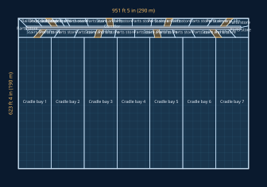
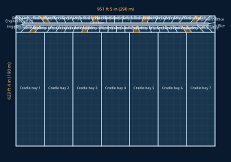

# P4-09 Shaft Door Workshop: plan

Footprint 951 ft 5 in (290 m) × 623 ft 4 in (190 m) · structural grid 32 ft 10 in (10 m)

## Levels

| Level | Floor above deck | Height | Floor area |
|---|---|---|---|
| Level 1 · Hall floor | 0 ft (0 mm) | 52 ft 6 in (16 m) | 574,056 sq ft (53,332 m²) |
| Level 2 · Gallery floor | 52 ft 6 in (16 m) | 14 ft 9 in (4,500 mm) | 574,056 sq ft (53,332 m²) |

## Elements

| ID | Designation | Type | Name | Level(s) | Size / length | Area | Status |
|---|---|---|---|---|---|---|---|
| E001 | D5F2P4B7A3L1R1, D5F2P4B7A3L2R1 | room | Cradle bay 1 | L1, L2 | 135 ft 10 in (41 m) × 544 ft 7 in (166 m) | 73,974 sq ft (6,872 m²) | proposed |
| E002 | D5F2P4B7A3L1R2, D5F2P4B7A3L2R2 | room | Cradle bay 2 | L1, L2 | 136 ft 2 in (42 m) × 544 ft 7 in (166 m) | 74,153 sq ft (6,889 m²) | proposed |
| E003 | D5F2P4B7A3L1R3, D5F2P4B7A3L2R3 | room | Cradle bay 3 | L1, L2 | 135 ft 10 in (41 m) × 544 ft 7 in (166 m) | 73,974 sq ft (6,872 m²) | proposed |
| E004 | D5F2P4B7A3L1R4, D5F2P4B7A3L2R4 | room | Cradle bay 4 | L1, L2 | 135 ft 10 in (41 m) × 544 ft 7 in (166 m) | 73,974 sq ft (6,872 m²) | proposed |
| E005 | D5F2P4B7A3L1R5, D5F2P4B7A3L2R5 | room | Cradle bay 5 | L1, L2 | 135 ft 10 in (41 m) × 544 ft 7 in (166 m) | 73,974 sq ft (6,872 m²) | proposed |
| E006 | D5F2P4B7A3L1R6, D5F2P4B7A3L2R6 | room | Cradle bay 6 | L1, L2 | 136 ft 2 in (42 m) × 544 ft 7 in (166 m) | 74,153 sq ft (6,889 m²) | proposed |
| E007 | D5F2P4B7A3L1R7, D5F2P4B7A3L2R7 | room | Cradle bay 7 | L1, L2 | 135 ft 10 in (41 m) × 544 ft 7 in (166 m) | 73,974 sq ft (6,872 m²) | proposed |
| E008 | D5F2P4B7A3L1R8, D5F2P4B7A3L2R8 | core | Stairs and lifts | L1, L2 | 50 ft 2 in (15 m) × 32 ft 6 in (9,900 mm) | 853 sq ft (79 m²) | proposed |
| E009 | D5F2P4B7A3L1R9, D5F2P4B7A3L2R9 | core | Stairs and lifts | L1, L2 | 33 ft 2 in (10 m) × 32 ft 6 in (9,900 mm) | 853 sq ft (79 m²) | proposed |
| E010 | D5F2P4B7A3L1R10, D5F2P4B7A3L2R10 | core | Stairs and lifts | L1, L2 | 36 ft 5 in (11 m) × 32 ft 6 in (9,900 mm) | 853 sq ft (79 m²) | proposed |
| E011 | D5F2P4B7A3L1R11, D5F2P4B7A3L2R11 | core | Stairs and lifts | L1, L2 | 53 ft 6 in (16 m) × 32 ft 6 in (9,900 mm) | 853 sq ft (79 m²) | proposed |
| E012 | D5F2P4B7A3L1R12, D5F2P4B7A3L2R12 | core | Stairs and lifts | L1, L2 | 50 ft 2 in (15 m) × 32 ft 6 in (9,900 mm) | 853 sq ft (79 m²) | proposed |
| E013 | D5F2P4B7A3L1R13, D5F2P4B7A3L2R13 | core | Stairs and lifts | L1, L2 | 33 ft 2 in (10 m) × 32 ft 6 in (9,900 mm) | 853 sq ft (79 m²) | proposed |
| E014 | D5F2P4B7A3L1R14, D5F2P4B7A3L2R14 | core | Stairs and lifts | L1, L2 | 36 ft 5 in (11 m) × 32 ft 6 in (9,900 mm) | 853 sq ft (79 m²) | proposed |
| E015 | D5F2P4B7A3L1R15, D5F2P4B7A3L2R15 | core | Stairs and lifts | L1, L2 | 53 ft 6 in (16 m) × 32 ft 6 in (9,900 mm) | 853 sq ft (79 m²) | proposed |
| E016 | D5F2P4B7A3L1R16 | zone | Corridor | L1 | 886 ft 6 in (270 m) × 13 ft 9 in (4,200 mm) | 8,764 sq ft (814 m²) | proposed |
| E017 | D5F2P4B7A3L1R17 | room | Rail shop | L1 | 96 ft 5 in (29 m) × 32 ft 6 in (9,900 mm) | 2,153 sq ft (200 m²) | proposed |
| E018 | D5F2P4B7A3L1R18 | room | Door seal shop | L1 | 67 ft 7 in (21 m) × 32 ft 6 in (9,900 mm) | 1,337 sq ft (124 m²) | proposed |
| E019 | D5F2P4B7A3L1R19 | room | Locker room | L1 | 51 ft 10 in (16 m) × 32 ft 6 in (9,900 mm) | 970 sq ft (90 m²) | proposed |
| E020 | D5F2P4B7A3L1R20 | room | Staff toilets and showers | L1 | 43 ft 4 in (13 m) × 32 ft 6 in (9,900 mm) | 757 sq ft (70 m²) | proposed |
| E021 | D5F2P4B7A3L1R21 | room | Parts store | L1 | 95 ft 10 in (29 m) × 32 ft 6 in (9,900 mm) | 2,584 sq ft (240 m²) | proposed |
| E022 | D5F2P4B7A3L1R22 | room | Parts store | L1 | 93 ft 2 in (28 m) × 32 ft 6 in (9,900 mm) | 2,680 sq ft (249 m²) | proposed |
| E023 | D5F2P4B7A3L1R23 | room | Parts store | L1 | 82 ft 8 in (25 m) × 32 ft 6 in (9,900 mm) | 2,584 sq ft (240 m²) | proposed |
| E024 | D5F2P4B7A3L1R24 | room | Parts store | L1 | 82 ft 4 in (25 m) × 32 ft 6 in (9,900 mm) | 2,584 sq ft (240 m²) | proposed |
| E025 | D5F2P4B7A3L1R25 | room | Parts store | L1 | 63 ft (19 m) × 32 ft 6 in (9,900 mm) | 1,812 sq ft (168 m²) | proposed |
| E026 | D5F2P4B7A3L1R26 | room | Parts store | L1 | 93 ft 6 in (28 m) × 32 ft 6 in (9,900 mm) | 2,589 sq ft (241 m²) | proposed |
| E027 | D5F2P4B7A3L1R27 | room | Parts store | L1 | 99 ft 1 in (30 m) × 32 ft 6 in (9,900 mm) | 2,589 sq ft (241 m²) | proposed |
| E028 | D5F2P4B7A3L1R28 | room | Parts store | L1 | 80 ft 1 in (24 m) × 32 ft 6 in (9,900 mm) | 1,812 sq ft (168 m²) | proposed |
| E029 | D5F2P4B7A3L1R29 | room | Parts store | L1 | 91 ft 6 in (28 m) × 38 ft 1 in (12 m) | 2,584 sq ft (240 m²) | proposed |
| E030 | D5F2P4B7A3L1R30 | room | Parts store | L1 | 82 ft 4 in (25 m) × 47 ft 7 in (14 m) | 2,584 sq ft (240 m²) | proposed |
| E031 | D5F2P4B7A3L1R31 | room | Parts store | L1 | 82 ft 8 in (25 m) × 32 ft 6 in (9,900 mm) | 1,812 sq ft (168 m²) | proposed |
| E032 | D5F2P4B7A3L1R32 | room | Parts store | L1 | 99 ft 9 in (30 m) × 32 ft 6 in (9,900 mm) | 2,584 sq ft (240 m²) | proposed |
| E033 | D5F2P4B7A3L1R33 | room | Parts store | L1 | 94 ft 6 in (29 m) × 32 ft 6 in (9,900 mm) | 2,595 sq ft (241 m²) | proposed |
| E034 | D5F2P4B7A3L1R34 | room | Parts store | L1 | 65 ft 7 in (20 m) × 32 ft 6 in (9,900 mm) | 1,812 sq ft (168 m²) | proposed |
| E035 | D5F2P4B7A3L1R35 | room | Parts store | L1 | 82 ft 8 in (25 m) × 32 ft 6 in (9,900 mm) | 2,584 sq ft (240 m²) | proposed |
| E036 | D5F2P4B7A3L1R36 | room | Parts store | L1 | 82 ft 4 in (25 m) × 32 ft 6 in (9,900 mm) | 2,584 sq ft (240 m²) | proposed |
| E037 | D5F2P4B7A3L1R37 | room | Parts store | L1 | 63 ft (19 m) × 32 ft 6 in (9,900 mm) | 1,812 sq ft (168 m²) | proposed |
| E038 | D5F2P4B7A3L1R38 | room | Parts store | L1 | 93 ft 6 in (28 m) × 32 ft 6 in (9,900 mm) | 2,589 sq ft (241 m²) | proposed |
| E039 | D5F2P4B7A3L1R39 | room | Parts store | L1 | 99 ft 1 in (30 m) × 32 ft 6 in (9,900 mm) | 2,589 sq ft (241 m²) | proposed |
| E040 | D5F2P4B7A3L1R40 | room | Parts store | L1 | 80 ft 1 in (24 m) × 32 ft 6 in (9,900 mm) | 1,812 sq ft (168 m²) | proposed |
| E041 | D5F2P4B7A3L1R41 | room | Parts store | L1 | 91 ft 6 in (28 m) × 78 ft 9 in (24 m) | 3,490 sq ft (324 m²) | proposed |
| E042 | D5F2P4B7A3L2R16 | zone | Corridor | L2 | 886 ft 6 in (270 m) × 13 ft 9 in (4,200 mm) | 8,764 sq ft (814 m²) | proposed |
| E043 | D5F2P4B7A3L2R17 | room | Tea point | L2 | 43 ft 4 in (13 m) × 32 ft 6 in (9,900 mm) | 368 sq ft (34 m²) | proposed |
| E044 | D5F2P4B7A3L2R18 | room | Engineers' office | L2 | 69 ft 11 in (21 m) × 32 ft 6 in (9,900 mm) | 1,289 sq ft (120 m²) | proposed |
| E045 | D5F2P4B7A3L2R19 | room | Engineers' office | L2 | 83 ft 4 in (25 m) × 32 ft 6 in (9,900 mm) | 1,833 sq ft (170 m²) | proposed |
| E046 | D5F2P4B7A3L2R20 | room | Engineers' office | L2 | 61 ft 4 in (19 m) × 32 ft 6 in (9,900 mm) | 1,295 sq ft (120 m²) | proposed |
| E047 | D5F2P4B7A3L2R21 | room | Engineers' office | L2 | 58 ft 5 in (18 m) × 32 ft 6 in (9,900 mm) | 1,289 sq ft (120 m²) | proposed |
| E048 | D5F2P4B7A3L2R22 | room | Engineers' office | L2 | 55 ft 9 in (17 m) × 32 ft 6 in (9,900 mm) | 1,295 sq ft (120 m²) | proposed |
| E049 | D5F2P4B7A3L2R23 | room | Engineers' office | L2 | 53 ft 2 in (16 m) × 32 ft 6 in (9,900 mm) | 1,300 sq ft (121 m²) | proposed |
| E050 | D5F2P4B7A3L2R24 | room | Engineers' office | L2 | 65 ft 7 in (20 m) × 32 ft 6 in (9,900 mm) | 1,812 sq ft (168 m²) | proposed |
| E051 | D5F2P4B7A3L2R25 | room | Engineers' office | L2 | 44 ft 3 in (14 m) × 32 ft 6 in (9,900 mm) | 1,289 sq ft (120 m²) | proposed |
| E052 | D5F2P4B7A3L2R26 | room | Engineers' office | L2 | 41 ft 8 in (13 m) × 32 ft 6 in (9,900 mm) | 1,295 sq ft (120 m²) | proposed |
| E053 | D5F2P4B7A3L2R27 | room | Engineers' office | L2 | 41 ft 4 in (13 m) × 32 ft 6 in (9,900 mm) | 1,295 sq ft (120 m²) | proposed |
| E054 | D5F2P4B7A3L2R28 | room | Engineers' office | L2 | 43 ft 8 in (13 m) × 32 ft 6 in (9,900 mm) | 1,289 sq ft (120 m²) | proposed |
| E055 | D5F2P4B7A3L2R29 | room | Engineers' office | L2 | 63 ft (19 m) × 32 ft 6 in (9,900 mm) | 1,812 sq ft (168 m²) | proposed |
| E056 | D5F2P4B7A3L2R30 | room | Engineers' office | L2 | 52 ft 6 in (16 m) × 32 ft 6 in (9,900 mm) | 1,300 sq ft (121 m²) | proposed |
| E057 | D5F2P4B7A3L2R31 | room | Engineers' office | L2 | 54 ft 9 in (17 m) × 32 ft 6 in (9,900 mm) | 1,289 sq ft (120 m²) | proposed |
| E058 | D5F2P4B7A3L2R32 | room | Engineers' office | L2 | 57 ft 9 in (18 m) × 32 ft 6 in (9,900 mm) | 1,295 sq ft (120 m²) | proposed |
| E059 | D5F2P4B7A3L2R33 | room | Engineers' office | L2 | 60 ft 8 in (18 m) × 32 ft 6 in (9,900 mm) | 1,295 sq ft (120 m²) | proposed |
| E060 | D5F2P4B7A3L2R34 | room | Engineers' office | L2 | 80 ft 1 in (24 m) × 32 ft 6 in (9,900 mm) | 1,812 sq ft (168 m²) | proposed |
| E061 | D5F2P4B7A3L2R35 | room | Engineers' office | L2 | 69 ft 3 in (21 m) × 32 ft 6 in (9,900 mm) | 1,289 sq ft (120 m²) | proposed |
| E062 | D5F2P4B7A3L2R36 | room | Engineers' office | L2 | 53 ft 2 in (16 m) × 38 ft 1 in (12 m) | 1,295 sq ft (120 m²) | proposed |
| E063 | D5F2P4B7A3L2R37 | room | Engineers' office | L2 | 44 ft (13 m) × 47 ft 7 in (14 m) | 1,295 sq ft (120 m²) | proposed |
| E064 | D5F2P4B7A3L2R38 | room | Engineers' office | L2 | 69 ft 11 in (21 m) × 32 ft 6 in (9,900 mm) | 1,289 sq ft (120 m²) | proposed |
| E065 | D5F2P4B7A3L2R39 | room | Engineers' office | L2 | 82 ft 8 in (25 m) × 32 ft 6 in (9,900 mm) | 1,812 sq ft (168 m²) | proposed |
| E066 | D5F2P4B7A3L2R40 | room | Engineers' office | L2 | 61 ft 4 in (19 m) × 32 ft 6 in (9,900 mm) | 1,295 sq ft (120 m²) | proposed |
| E067 | D5F2P4B7A3L2R41 | room | Engineers' office | L2 | 58 ft 5 in (18 m) × 32 ft 6 in (9,900 mm) | 1,289 sq ft (120 m²) | proposed |
| E068 | D5F2P4B7A3L2R42 | room | Engineers' office | L2 | 55 ft 9 in (17 m) × 32 ft 6 in (9,900 mm) | 1,295 sq ft (120 m²) | proposed |
| E069 | D5F2P4B7A3L2R43 | room | Engineers' office | L2 | 53 ft 2 in (16 m) × 32 ft 6 in (9,900 mm) | 1,300 sq ft (121 m²) | proposed |
| E070 | D5F2P4B7A3L2R44 | room | Engineers' office | L2 | 65 ft 7 in (20 m) × 32 ft 6 in (9,900 mm) | 1,812 sq ft (168 m²) | proposed |
| E071 | D5F2P4B7A3L2R45 | room | Engineers' office | L2 | 44 ft 3 in (14 m) × 32 ft 6 in (9,900 mm) | 1,289 sq ft (120 m²) | proposed |
| E072 | D5F2P4B7A3L2R46 | room | Engineers' office | L2 | 41 ft 8 in (13 m) × 32 ft 6 in (9,900 mm) | 1,295 sq ft (120 m²) | proposed |
| E073 | D5F2P4B7A3L2R47 | room | Engineers' office | L2 | 41 ft 4 in (13 m) × 32 ft 6 in (9,900 mm) | 1,295 sq ft (120 m²) | proposed |
| E074 | D5F2P4B7A3L2R48 | room | Engineers' office | L2 | 43 ft 8 in (13 m) × 32 ft 6 in (9,900 mm) | 1,289 sq ft (120 m²) | proposed |
| E075 | D5F2P4B7A3L2R49 | room | Engineers' office | L2 | 63 ft (19 m) × 32 ft 6 in (9,900 mm) | 1,812 sq ft (168 m²) | proposed |
| E076 | D5F2P4B7A3L2R50 | room | Engineers' office | L2 | 52 ft 6 in (16 m) × 32 ft 6 in (9,900 mm) | 1,300 sq ft (121 m²) | proposed |
| E077 | D5F2P4B7A3L2R51 | room | Engineers' office | L2 | 54 ft 9 in (17 m) × 32 ft 6 in (9,900 mm) | 1,289 sq ft (120 m²) | proposed |
| E078 | D5F2P4B7A3L2R52 | room | Engineers' office | L2 | 57 ft 9 in (18 m) × 32 ft 6 in (9,900 mm) | 1,295 sq ft (120 m²) | proposed |
| E079 | D5F2P4B7A3L2R53 | room | Engineers' office | L2 | 60 ft 8 in (18 m) × 32 ft 6 in (9,900 mm) | 1,295 sq ft (120 m²) | proposed |
| E080 | D5F2P4B7A3L2R54 | room | Engineers' office | L2 | 80 ft 1 in (24 m) × 32 ft 6 in (9,900 mm) | 1,812 sq ft (168 m²) | proposed |
| E081 | D5F2P4B7A3L2R55 | room | Engineers' office | L2 | 69 ft 3 in (21 m) × 32 ft 6 in (9,900 mm) | 1,289 sq ft (120 m²) | proposed |
| E082 | D5F2P4B7A3L2R56 | room | Engineers' office | L2 | 53 ft 2 in (16 m) × 38 ft 1 in (12 m) | 1,295 sq ft (120 m²) | proposed |
| E083 | D5F2P4B7A3L2R57 | room | Engineers' office | L2 | 32 ft 6 in (9,900 mm) × 47 ft 7 in (14 m) | 906 sq ft (84 m²) | proposed |

## Drawings

### Level 1 · Hall floor

### Level 2 · Gallery floor

