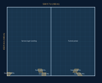
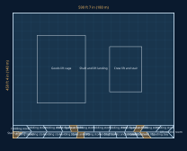
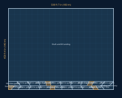

# P4-13 Starboard Launch Service Shaft: plan

Footprint 590 ft 7 in (180 m) × 459 ft 4 in (140 m) · structural grid 32 ft 10 in (10 m)

## Levels

| Level | Floor above deck | Height | Floor area |
|---|---|---|---|
| Level B1 · Service layer landing | −19 ft 8 in (6,000 mm) | 19 ft 8 in (6,000 mm) | 271,251 sq ft (25,200 m²) |
| Level 1 · Lift landing | 0 ft (0 mm) | 29 ft 6 in (9,000 mm) | 266,973 sq ft (24,803 m²) |
| Level 2 · Winding room | 29 ft 6 in (9,000 mm) | 19 ft 8 in (6,000 mm) | 266,973 sq ft (24,803 m²) |

## Elements

| ID | Designation | Type | Name | Level(s) | Size / length | Area | Status |
|---|---|---|---|---|---|---|---|
| E001 | D5F2P4B13A2L1R1, D5F2P4B13A2L2R1 | room | Shaft and lift landing | L1, L2 | 590 ft 7 in (180 m) × 413 ft 5 in (126 m) | 244,126 sq ft (22,680 m²) | proposed |
| E002 |  | fixture | Goods lift cage | L1 | 177 ft 2 in (54 m) × 248 ft (76 m) | 43,943 sq ft (4,082 m²) | proposed |
| E003 |  | fixture | Crew lift and stair | L1 | 118 ft 1 in (36 m) × 165 ft 4 in (50 m) | 19,530 sq ft (1,814 m²) | proposed |
| E004 | D5F2P4B13A2LB1R1, D5F2P4B13A2L1R2, D5F2P4B13A2L2R2 | core | Stairs and lifts | LB1, L1, L2 | 41 ft (12 m) × 21 ft 8 in (6,600 mm) | 568 sq ft (53 m²) | proposed |
| E005 | D5F2P4B13A2LB1R2, D5F2P4B13A2L1R3, D5F2P4B13A2L2R3 | core | Stairs and lifts | LB1, L1, L2 | 29 ft 10 in (9,100 mm) × 21 ft 8 in (6,600 mm) | 568 sq ft (53 m²) | proposed |
| E006 | D5F2P4B13A2LB1R3, D5F2P4B13A2L1R4, D5F2P4B13A2L2R4 | core | Stairs and lifts | LB1, L1, L2 | 34 ft 5 in (10 m) × 24 ft 11 in (7,600 mm) | 572 sq ft (53 m²) | proposed |
| E007 | D5F2P4B13A2LB1R4, D5F2P4B13A2L1R5, D5F2P4B13A2L2R5 | core | Stairs and lifts | LB1, L1, L2 | 31 ft 6 in (9,600 mm) × 21 ft 8 in (6,600 mm) | 568 sq ft (53 m²) | proposed |
| E008 | D5F2P4B13A2LB1R5, D5F2P4B13A2L1R6, D5F2P4B13A2L2R6 | core | Stairs and lifts | LB1, L1, L2 | 38 ft 9 in (12 m) × 21 ft 8 in (6,600 mm) | 565 sq ft (52 m²) | proposed |
| E009 | D5F2P4B13A2L1R7 | room | Lift control room | L1 | 22 ft 4 in (6,800 mm) × 45 ft 11 in (14 m) | 540 sq ft (50 m²) | proposed |
| E010 | D5F2P4B13A2L1R8 | room | Loading bay | L1 | 99 ft 5 in (30 m) × 21 ft 8 in (6,600 mm) | 1,748 sq ft (162 m²) | proposed |
| E011 | D5F2P4B13A2L1R9 | room | Crew check-in | L1 | 32 ft 10 in (10 m) × 21 ft 8 in (6,600 mm) | 430 sq ft (40 m²) | proposed |
| E012 | D5F2P4B13A2L1R10 | room | Tool store | L1 | 49 ft 10 in (15 m) × 21 ft 8 in (6,600 mm) | 853 sq ft (79 m²) | proposed |
| E013 | D5F2P4B13A2L1R11 | room | Staff toilets and showers | L1 | 42 ft 4 in (13 m) × 21 ft 8 in (6,600 mm) | 749 sq ft (70 m²) | proposed |
| E014 | D5F2P4B13A2L1R12 | room | Holding store | L1 | 63 ft 4 in (19 m) × 21 ft 8 in (6,600 mm) | 1,282 sq ft (119 m²) | proposed |
| E015 | D5F2P4B13A2L1R13 | room | Holding store | L1 | 60 ft (18 m) × 21 ft 8 in (6,600 mm) | 1,254 sq ft (116 m²) | proposed |
| E016 | D5F2P4B13A2L1R14 | room | Holding store | L1 | 66 ft 3 in (20 m) × 21 ft 8 in (6,600 mm) | 1,286 sq ft (119 m²) | proposed |
| E017 | D5F2P4B13A2L1R15 | room | Holding store | L1 | 70 ft 6 in (22 m) × 21 ft 8 in (6,600 mm) | 1,279 sq ft (119 m²) | proposed |
| E018 | D5F2P4B13A2L1R16 | room | Holding store | L1 | 75 ft 6 in (23 m) × 21 ft 8 in (6,600 mm) | 1,286 sq ft (119 m²) | proposed |
| E019 | D5F2P4B13A2L1R17 | room | Holding store | L1 | 52 ft 6 in (16 m) × 21 ft 8 in (6,600 mm) | 714 sq ft (66 m²) | proposed |
| E020 | D5F2P4B13A2L1R18 | room | Holding store | L1 | 68 ft 3 in (21 m) × 23 ft (7,000 mm) | 1,289 sq ft (120 m²) | proposed |
| E021 | D5F2P4B13A2L1R19 | room | Holding store | L1 | 75 ft 2 in (23 m) × 21 ft 8 in (6,600 mm) | 1,282 sq ft (119 m²) | proposed |
| E022 | D5F2P4B13A2L1R20 | room | Holding store | L1 | 70 ft 6 in (22 m) × 21 ft 8 in (6,600 mm) | 1,282 sq ft (119 m²) | proposed |
| E023 | D5F2P4B13A2L1R21 | room | Holding store | L1 | 40 ft 8 in (12 m) × 21 ft 8 in (6,600 mm) | 718 sq ft (67 m²) | proposed |
| E024 | D5F2P4B13A2L1R22 | room | Holding store | L1 | 61 ft 4 in (19 m) × 21 ft 8 in (6,600 mm) | 1,282 sq ft (119 m²) | proposed |
| E025 | D5F2P4B13A2L1R23 | room | Holding store | L1 | 61 ft 8 in (19 m) × 21 ft 8 in (6,600 mm) | 1,286 sq ft (119 m²) | proposed |
| E026 | D5F2P4B13A2L1R24 | room | Holding store | L1 | 65 ft 11 in (20 m) × 21 ft 8 in (6,600 mm) | 1,279 sq ft (119 m²) | proposed |
| E027 | D5F2P4B13A2L1R25 | room | Holding store | L1 | 43 ft 8 in (13 m) × 21 ft 8 in (6,600 mm) | 721 sq ft (67 m²) | proposed |
| E028 | D5F2P4B13A2L1R26 | room | Holding store | L1 | 75 ft 6 in (23 m) × 21 ft 8 in (6,600 mm) | 1,286 sq ft (119 m²) | proposed |
| E029 | D5F2P4B13A2L1R27 | room | Holding store | L1 | 66 ft 3 in (20 m) × 21 ft 8 in (6,600 mm) | 1,002 sq ft (93 m²) | proposed |
| E030 | D5F2P4B13A2L2R7 | room | Winding machinery | L2 | 69 ft 11 in (21 m) × 45 ft 11 in (14 m) | 1,609 sq ft (149 m²) | proposed |
| E031 | D5F2P4B13A2L2R8 | room | Shaft ventilation fans | L2 | 48 ft 3 in (15 m) × 21 ft 8 in (6,600 mm) | 678 sq ft (63 m²) | proposed |
| E032 | D5F2P4B13A2L2R9 | room | Machine gallery | L2 | 68 ft 11 in (21 m) × 21 ft 8 in (6,600 mm) | 1,247 sq ft (116 m²) | proposed |
| E033 | D5F2P4B13A2L2R10 | room | Machine gallery | L2 | 64 ft 4 in (20 m) × 21 ft 8 in (6,600 mm) | 1,247 sq ft (116 m²) | proposed |
| E034 | D5F2P4B13A2L2R11 | room | Machine gallery | L2 | 60 ft (18 m) × 21 ft 8 in (6,600 mm) | 1,247 sq ft (116 m²) | proposed |
| E035 | D5F2P4B13A2L2R12 | room | Machine gallery | L2 | 39 ft 8 in (12 m) × 21 ft 8 in (6,600 mm) | 828 sq ft (77 m²) | proposed |
| E036 | D5F2P4B13A2L2R13 | room | Machine gallery | L2 | 64 ft 4 in (20 m) × 21 ft 8 in (6,600 mm) | 1,247 sq ft (116 m²) | proposed |
| E037 | D5F2P4B13A2L2R14 | room | Machine gallery | L2 | 68 ft 7 in (21 m) × 21 ft 8 in (6,600 mm) | 1,243 sq ft (116 m²) | proposed |
| E038 | D5F2P4B13A2L2R15 | room | Machine gallery | L2 | 73 ft 6 in (22 m) × 21 ft 8 in (6,600 mm) | 1,250 sq ft (116 m²) | proposed |
| E039 | D5F2P4B13A2L2R16 | room | Machine gallery | L2 | 57 ft 5 in (18 m) × 21 ft 8 in (6,600 mm) | 824 sq ft (77 m²) | proposed |
| E040 | D5F2P4B13A2L2R17 | room | Machine gallery | L2 | 66 ft 7 in (20 m) × 23 ft (7,000 mm) | 1,250 sq ft (116 m²) | proposed |
| E041 | D5F2P4B13A2L2R18 | room | Machine gallery | L2 | 73 ft 10 in (23 m) × 21 ft 8 in (6,600 mm) | 1,250 sq ft (116 m²) | proposed |
| E042 | D5F2P4B13A2L2R19 | room | Machine gallery | L2 | 68 ft 11 in (21 m) × 21 ft 8 in (6,600 mm) | 1,243 sq ft (115 m²) | proposed |
| E043 | D5F2P4B13A2L2R20 | room | Machine gallery | L2 | 45 ft 11 in (14 m) × 21 ft 8 in (6,600 mm) | 828 sq ft (77 m²) | proposed |
| E044 | D5F2P4B13A2L2R21 | room | Machine gallery | L2 | 59 ft 9 in (18 m) × 21 ft 8 in (6,600 mm) | 1,247 sq ft (116 m²) | proposed |
| E045 | D5F2P4B13A2L2R22 | room | Machine gallery | L2 | 59 ft 9 in (18 m) × 21 ft 8 in (6,600 mm) | 1,247 sq ft (116 m²) | proposed |
| E046 | D5F2P4B13A2L2R23 | room | Machine gallery | L2 | 64 ft (20 m) × 21 ft 8 in (6,600 mm) | 1,247 sq ft (116 m²) | proposed |
| E047 | D5F2P4B13A2L2R24 | room | Machine gallery | L2 | 48 ft 3 in (15 m) × 21 ft 8 in (6,600 mm) | 828 sq ft (77 m²) | proposed |
| E048 | D5F2P4B13A2L2R25 | room | Machine gallery | L2 | 73 ft 6 in (22 m) × 21 ft 8 in (6,600 mm) | 1,247 sq ft (116 m²) | proposed |
| E049 | D5F2P4B13A2L2R26 | room | Machine gallery | L2 | 67 ft 11 in (21 m) × 21 ft 8 in (6,600 mm) | 1,041 sq ft (97 m²) | proposed |
| E050 | D5F2P4B13A2LB1R6 | room | Service layer landing | LB1 | 295 ft 3 in (90 m) × 459 ft 4 in (140 m) | 135,625 sq ft (12,600 m²) | proposed |
| E051 | D5F2P4B13A2LB1R7 | room | Tunnel portal | LB1 | 295 ft 3 in (90 m) × 459 ft 4 in (140 m) | 135,625 sq ft (12,600 m²) | proposed |

## Drawings

### Level B1 · Service layer landing

### Level 1 · Lift landing

### Level 2 · Winding room

