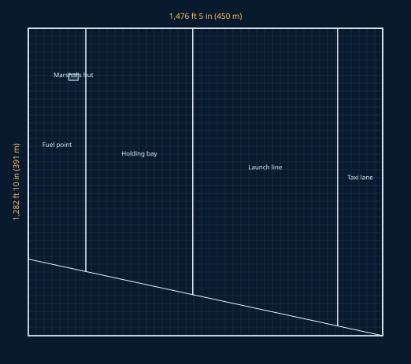

# P4-14 Launch Apron 1: plan

Footprint 1,476 ft 5 in (450 m) × 1,282 ft 10 in (391 m) · structural grid 32 ft 10 in (10 m)

## Levels

| Level | Floor above deck | Height | Floor area |
|---|---|---|---|
| Level 1 · Ground | 0 ft (0 mm) | 13 ft 1 in (4,000 mm) | 1,033 sq ft (96 m²) |

## Elements

| ID | Designation | Type | Name | Level(s) | Size / length | Area | Status |
|---|---|---|---|---|---|---|---|
| E001 | D5F2P4B8A2R1 | zone | Fuel point | L1 | 239 ft 6 in (73 m) × 1,015 ft 1 in (309 m) | 236,908 sq ft (22,010 m²) | proposed |
| E002 | D5F2P4B8A2R2 | room | Marshal's hut | L1 | 39 ft 4 in (12 m) × 26 ft 3 in (8,000 mm) | 1,033 sq ft (96 m²) | proposed |
| E003 | D5F2P4B8A2R3 | zone | Holding bay | L1 | 445 ft 6 in (136 m) × 1,111 ft 7 in (339 m) | 473,750 sq ft (44,013 m²) | proposed |
| E004 | D5F2P4B8A2R4 | zone | Launch line | L1 | 603 ft 8 in (184 m) × 1,242 ft 2 in (379 m) | 710,427 sq ft (66,001 m²) | proposed |
| E005 | D5F2P4B8A2R5 | zone | Taxi lane | L1 | 187 ft 8 in (57 m) × 1,282 ft 10 in (391 m) | 236,920 sq ft (22,011 m²) | proposed |

## Drawings

### Level 1 · Ground

