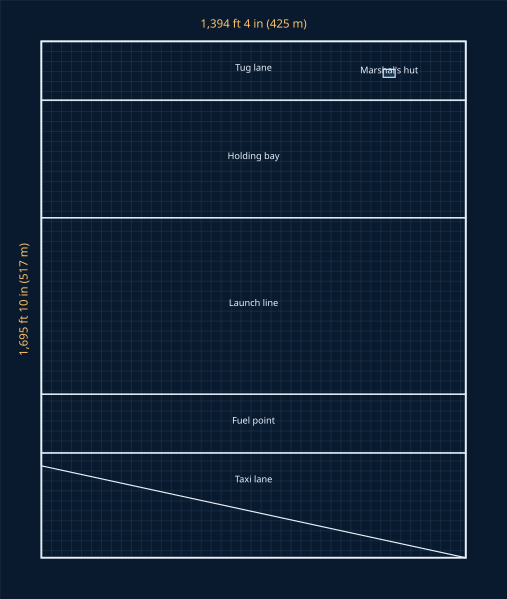

# P4-15 Launch Apron 2: plan

Footprint 1,394 ft 4 in (425 m) × 1,695 ft 10 in (517 m) · structural grid 32 ft 10 in (10 m)

## Levels

| Level | Floor above deck | Height | Floor area |
|---|---|---|---|
| Level 1 · Ground | 0 ft (0 mm) | 13 ft 1 in (4,000 mm) | 1,033 sq ft (96 m²) |

## Elements

| ID | Designation | Type | Name | Level(s) | Size / length | Area | Status |
|---|---|---|---|---|---|---|---|
| E001 | D5F2P4B9A1R1 | zone | Tug lane | L1 | 1,394 ft 4 in (425 m) × 193 ft 3 in (59 m) | 269,448 sq ft (25,032 m²) | proposed |
| E002 | D5F2P4B9A1R2 | room | Marshal's hut | L1 | 39 ft 4 in (12 m) × 26 ft 3 in (8,000 mm) | 1,033 sq ft (96 m²) | proposed |
| E003 | D5F2P4B9A1R3 | zone | Holding bay | L1 | 1,394 ft 4 in (425 m) × 386 ft 2 in (118 m) | 538,438 sq ft (50,022 m²) | proposed |
| E004 | D5F2P4B9A1R4 | zone | Launch line | L1 | 1,394 ft 4 in (425 m) × 579 ft 5 in (177 m) | 807,885 sq ft (75,055 m²) | proposed |
| E005 | D5F2P4B9A1R5 | zone | Fuel point | L1 | 1,394 ft 4 in (425 m) × 192 ft 11 in (59 m) | 268,990 sq ft (24,990 m²) | proposed |
| E006 | D5F2P4B9A1R6 | zone | Taxi lane | L1 | 1,394 ft 4 in (425 m) × 344 ft 2 in (105 m) | 269,448 sq ft (25,032 m²) | proposed |

## Drawings

### Level 1 · Ground

