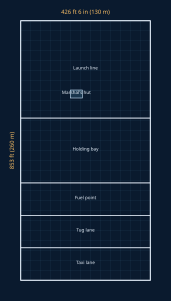

# P4-16 Launch Apron 3: plan

Footprint 426 ft 6 in (130 m) × 853 ft (260 m) · structural grid 32 ft 10 in (10 m)

## Levels

| Level | Floor above deck | Height | Floor area |
|---|---|---|---|
| Level 1 · Ground | 0 ft (0 mm) | 13 ft 1 in (4,000 mm) | 1,033 sq ft (96 m²) |

## Elements

| ID | Designation | Type | Name | Level(s) | Size / length | Area | Status |
|---|---|---|---|---|---|---|---|
| E001 | D5F2P4B11A3R1 | zone | Launch line | L1 | 426 ft 6 in (130 m) × 319 ft 11 in (98 m) | 136,433 sq ft (12,675 m²) | proposed |
| E002 | D5F2P4B11A3R2 | room | Marshal's hut | L1 | 39 ft 4 in (12 m) × 26 ft 3 in (8,000 mm) | 1,033 sq ft (96 m²) | proposed |
| E003 | D5F2P4B11A3R3 | zone | Holding bay | L1 | 426 ft 6 in (130 m) × 213 ft 3 in (65 m) | 90,955 sq ft (8,450 m²) | proposed |
| E004 | D5F2P4B11A3R4 | zone | Fuel point | L1 | 426 ft 6 in (130 m) × 106 ft 8 in (32 m) | 45,478 sq ft (4,225 m²) | proposed |
| E005 | D5F2P4B11A3R5 | zone | Tug lane | L1 | 426 ft 6 in (130 m) × 106 ft 8 in (32 m) | 45,478 sq ft (4,225 m²) | proposed |
| E006 | D5F2P4B11A3R6 | zone | Taxi lane | L1 | 426 ft 6 in (130 m) × 106 ft 8 in (32 m) | 45,478 sq ft (4,225 m²) | proposed |

## Drawings

### Level 1 · Ground

