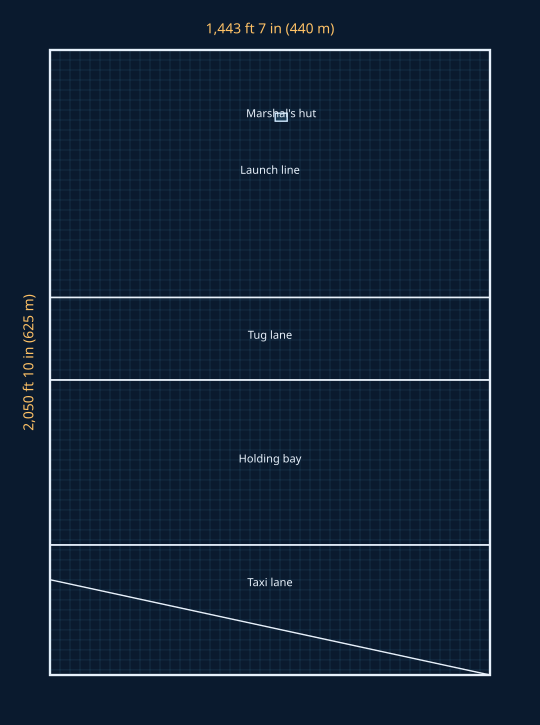

# P4-17 Launch Apron 4: plan

Footprint 1,443 ft 7 in (440 m) × 2,050 ft 10 in (625 m) · structural grid 32 ft 10 in (10 m)

## Levels

| Level | Floor above deck | Height | Floor area |
|---|---|---|---|
| Level 1 · Ground | 0 ft (0 mm) | 13 ft 1 in (4,000 mm) | 1,033 sq ft (96 m²) |

## Elements

| ID | Designation | Type | Name | Level(s) | Size / length | Area | Status |
|---|---|---|---|---|---|---|---|
| E001 | D5F2P4B12A1R1 | zone | Launch line | L1 | 1,443 ft 7 in (440 m) × 812 ft (248 m) | 1,172,190 sq ft (108,900 m²) | proposed |
| E002 | D5F2P4B12A1R2 | room | Marshal's hut | L1 | 39 ft 4 in (12 m) × 26 ft 3 in (8,000 mm) | 1,033 sq ft (96 m²) | proposed |
| E003 | D5F2P4B12A1R3 | zone | Tug lane | L1 | 1,443 ft 7 in (440 m) × 270 ft 8 in (82 m) | 390,730 sq ft (36,300 m²) | proposed |
| E004 | D5F2P4B12A1R4 | zone | Holding bay | L1 | 1,443 ft 7 in (440 m) × 541 ft 4 in (165 m) | 781,460 sq ft (72,600 m²) | proposed |
| E005 | D5F2P4B12A1R5 | zone | Taxi lane | L1 | 1,443 ft 7 in (440 m) × 426 ft 10 in (130 m) | 390,493 sq ft (36,278 m²) | proposed |

## Drawings

### Level 1 · Ground

