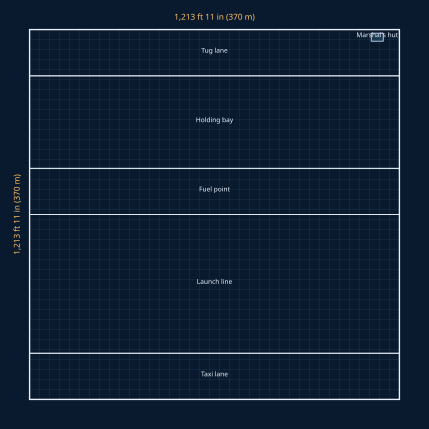

# P4-18 Launch Apron 5: plan

Footprint 1,213 ft 11 in (370 m) × 1,213 ft 11 in (370 m) · structural grid 32 ft 10 in (10 m)

## Levels

| Level | Floor above deck | Height | Floor area |
|---|---|---|---|
| Level 1 · Ground | 0 ft (0 mm) | 13 ft 1 in (4,000 mm) | 1,033 sq ft (96 m²) |

## Elements

| ID | Designation | Type | Name | Level(s) | Size / length | Area | Status |
|---|---|---|---|---|---|---|---|
| E001 | D5F2P4B13A3R1 | zone | Tug lane | L1 | 1,213 ft 11 in (370 m) × 151 ft 11 in (46 m) | 184,397 sq ft (17,131 m²) | proposed |
| E002 | D5F2P4B13A3R2 | room | Marshal's hut | L1 | 39 ft 4 in (12 m) × 26 ft 3 in (8,000 mm) | 1,033 sq ft (96 m²) | proposed |
| E003 | D5F2P4B13A3R3 | zone | Holding bay | L1 | 1,213 ft 11 in (370 m) × 303 ft 6 in (93 m) | 368,395 sq ft (34,225 m²) | proposed |
| E004 | D5F2P4B13A3R4 | zone | Fuel point | L1 | 1,213 ft 11 in (370 m) × 151 ft 7 in (46 m) | 183,998 sq ft (17,094 m²) | proposed |
| E005 | D5F2P4B13A3R5 | zone | Launch line | L1 | 1,213 ft 11 in (370 m) × 455 ft 5 in (139 m) | 552,791 sq ft (51,356 m²) | proposed |
| E006 | D5F2P4B13A3R6 | zone | Taxi lane | L1 | 1,213 ft 11 in (370 m) × 151 ft 7 in (46 m) | 183,998 sq ft (17,094 m²) | proposed |

## Drawings

### Level 1 · Ground

