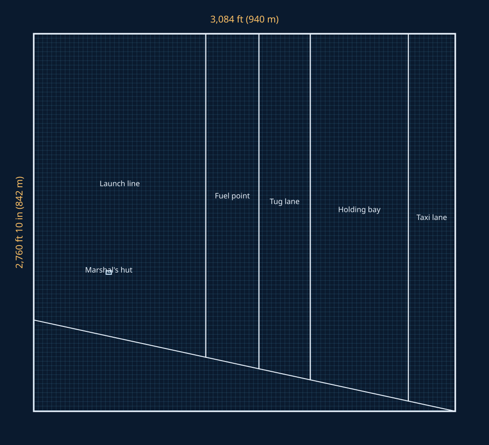

# P4-19 Launch Apron 6: plan

Footprint 3,084 ft (940 m) × 2,760 ft 10 in (842 m) · structural grid 32 ft 10 in (10 m)

## Levels

| Level | Floor above deck | Height | Floor area |
|---|---|---|---|
| Level 1 · Ground | 0 ft (0 mm) | 13 ft 1 in (4,000 mm) | 1,033 sq ft (96 m²) |

## Elements

| ID | Designation | Type | Name | Level(s) | Size / length | Area | Status |
|---|---|---|---|---|---|---|---|
| E001 | D5F2P4B14A1R1 | zone | Launch line | L1 | 1,258 ft 10 in (384 m) × 2,365 ft 10 in (721 m) | 2,806,825 sq ft (260,763 m²) | proposed |
| E002 | D5F2P4B14A1R2 | room | Marshal's hut | L1 | 39 ft 4 in (12 m) × 26 ft 3 in (8,000 mm) | 1,033 sq ft (96 m²) | proposed |
| E003 | D5F2P4B14A1R3 | zone | Fuel point | L1 | 388 ft 9 in (118 m) × 2,450 ft 2 in (747 m) | 936,170 sq ft (86,973 m²) | proposed |
| E004 | D5F2P4B14A1R4 | zone | Tug lane | L1 | 375 ft 8 in (115 m) × 2,531 ft 2 in (772 m) | 935,628 sq ft (86,923 m²) | proposed |
| E005 | D5F2P4B14A1R5 | zone | Holding bay | L1 | 717 ft 2 in (219 m) × 2,686 ft 4 in (819 m) | 1,870,981 sq ft (173,820 m²) | proposed |
| E006 | D5F2P4B14A1R6 | zone | Taxi lane | L1 | 343 ft 6 in (105 m) × 2,760 ft 10 in (842 m) | 935,564 sq ft (86,917 m²) | proposed |

## Drawings

### Level 1 · Ground

