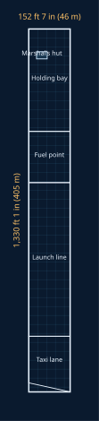

# P4-20 Launch Apron 7: plan

Footprint 152 ft 7 in (46 m) × 1,330 ft 1 in (405 m) · structural grid 32 ft 10 in (10 m)

## Levels

| Level | Floor above deck | Height | Floor area |
|---|---|---|---|
| Level 1 · Ground | 0 ft (0 mm) | 13 ft 1 in (4,000 mm) | 1,033 sq ft (96 m²) |

## Elements

| ID | Designation | Type | Name | Level(s) | Size / length | Area | Status |
|---|---|---|---|---|---|---|---|
| E001 | D5F2P4B8A3R1 | zone | Holding bay | L1 | 152 ft 7 in (46 m) × 375 ft 4 in (114 m) | 57,260 sq ft (5,320 m²) | proposed |
| E002 | D5F2P4B8A3R2 | room | Marshal's hut | L1 | 39 ft 4 in (12 m) × 26 ft 3 in (8,000 mm) | 1,033 sq ft (96 m²) | proposed |
| E003 | D5F2P4B8A3R3 | zone | Fuel point | L1 | 152 ft 7 in (46 m) × 187 ft 8 in (57 m) | 28,630 sq ft (2,660 m²) | proposed |
| E004 | D5F2P4B8A3R4 | zone | Launch line | L1 | 152 ft 7 in (46 m) × 563 ft (172 m) | 85,890 sq ft (7,979 m²) | proposed |
| E005 | D5F2P4B8A3R5 | zone | Taxi lane | L1 | 152 ft 7 in (46 m) × 204 ft 1 in (62 m) | 28,605 sq ft (2,657 m²) | proposed |

## Drawings

### Level 1 · Ground

