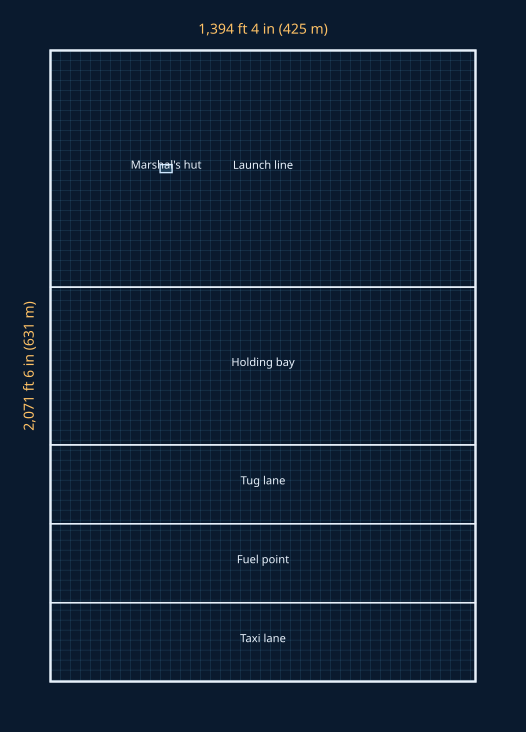

# P4-21 Launch Apron 8: plan

Footprint 1,394 ft 4 in (425 m) × 2,071 ft 6 in (631 m) · structural grid 32 ft 10 in (10 m)

## Levels

| Level | Floor above deck | Height | Floor area |
|---|---|---|---|
| Level 1 · Ground | 0 ft (0 mm) | 13 ft 1 in (4,000 mm) | 1,033 sq ft (96 m²) |

## Elements

| ID | Designation | Type | Name | Level(s) | Size / length | Area | Status |
|---|---|---|---|---|---|---|---|
| E001 | D5F2P4B10A2R1 | zone | Launch line | L1 | 1,394 ft 4 in (425 m) × 776 ft 11 in (237 m) | 1,083,280 sq ft (100,640 m²) | proposed |
| E002 | D5F2P4B10A2R2 | room | Marshal's hut | L1 | 39 ft 4 in (12 m) × 26 ft 3 in (8,000 mm) | 1,033 sq ft (96 m²) | proposed |
| E003 | D5F2P4B10A2R3 | zone | Holding bay | L1 | 1,394 ft 4 in (425 m) × 517 ft 9 in (158 m) | 721,882 sq ft (67,065 m²) | proposed |
| E004 | D5F2P4B10A2R4 | zone | Tug lane | L1 | 1,394 ft 4 in (425 m) × 258 ft 10 in (79 m) | 360,941 sq ft (33,532 m²) | proposed |
| E005 | D5F2P4B10A2R5 | zone | Fuel point | L1 | 1,394 ft 4 in (425 m) × 259 ft 2 in (79 m) | 361,398 sq ft (33,575 m²) | proposed |
| E006 | D5F2P4B10A2R6 | zone | Taxi lane | L1 | 1,394 ft 4 in (425 m) × 258 ft 10 in (79 m) | 360,941 sq ft (33,532 m²) | proposed |

## Drawings

### Level 1 · Ground

