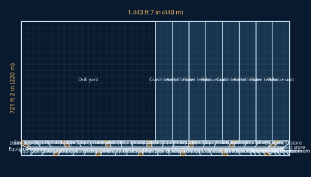
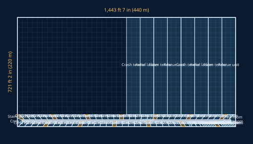
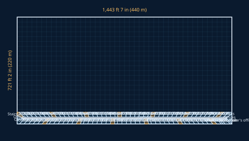

# P5-20 Port Racks Fire Station: plan

Footprint 1,443 ft 7 in (440 m) × 721 ft 2 in (220 m) · structural grid 32 ft 10 in (10 m)

## Levels

| Level | Floor above deck | Height | Floor area |
|---|---|---|---|
| Level 1 · Appliance floor | 0 ft (0 mm) | 23 ft (7,000 mm) | 547,249 sq ft (50,841 m²) |
| Level 2 · Crew floor | 23 ft (7,000 mm) | 13 ft 9 in (4,200 mm) | 547,249 sq ft (50,841 m²) |
| Level 3 · Training floor | 36 ft 9 in (11 m) | 13 ft 9 in (4,200 mm) | 83,582 sq ft (7,765 m²) |

## Elements

| ID | Designation | Type | Name | Level(s) | Size / length | Area | Status |
|---|---|---|---|---|---|---|---|
| E001 | D5F2P5B24A1L1R1, D5F2P5B24A1L2R1 | room | Crash tender | L1, L2 | 90 ft 3 in (28 m) × 642 ft 5 in (196 m) | 57,958 sq ft (5,384 m²) | proposed |
| E002 | D5F2P5B24A1L1R2, D5F2P5B24A1L2R2 | room | Aerial ladder | L1, L2 | 90 ft 3 in (28 m) × 642 ft 5 in (196 m) | 57,958 sq ft (5,384 m²) | proposed |
| E003 | D5F2P5B24A1L1R3, D5F2P5B24A1L2R3 | room | Foam tender | L1, L2 | 90 ft 3 in (28 m) × 642 ft 5 in (196 m) | 57,958 sq ft (5,384 m²) | proposed |
| E004 | D5F2P5B24A1L1R4, D5F2P5B24A1L2R4 | room | Rescue unit | L1, L2 | 90 ft 3 in (28 m) × 642 ft 5 in (196 m) | 57,958 sq ft (5,385 m²) | proposed |
| E005 | D5F2P5B24A1L1R5, D5F2P5B24A1L2R5 | room | Crash tender | L1, L2 | 90 ft 3 in (28 m) × 642 ft 5 in (196 m) | 57,958 sq ft (5,384 m²) | proposed |
| E006 | D5F2P5B24A1L1R6, D5F2P5B24A1L2R6 | room | Aerial ladder | L1, L2 | 90 ft 3 in (28 m) × 642 ft 5 in (196 m) | 57,958 sq ft (5,384 m²) | proposed |
| E007 | D5F2P5B24A1L1R7, D5F2P5B24A1L2R7 | room | Foam tender | L1, L2 | 90 ft 3 in (28 m) × 642 ft 5 in (196 m) | 57,958 sq ft (5,384 m²) | proposed |
| E008 | D5F2P5B24A1L1R8, D5F2P5B24A1L2R8 | room | Rescue unit | L1, L2 | 90 ft 3 in (28 m) × 642 ft 5 in (196 m) | 57,958 sq ft (5,384 m²) | proposed |
| E009 | D5F2P5B24A1L1R9 | zone | Drill yard | L1 | 721 ft 9 in (220 m) × 642 ft 5 in (196 m) | 463,666 sq ft (43,076 m²) | proposed |
| E010 | D5F2P5B24A1L1R10, D5F2P5B24A1L2R9, D5F2P5B24A1L3R1 | core | Stairs and lifts | L1, L2, L3 | 53 ft 6 in (16 m) × 32 ft 6 in (9,900 mm) | 847 sq ft (79 m²) | proposed |
| E011 | D5F2P5B24A1L1R11, D5F2P5B24A1L2R10, D5F2P5B24A1L3R2 | core | Stairs and lifts | L1, L2, L3 | 43 ft 4 in (13 m) × 32 ft 6 in (9,900 mm) | 858 sq ft (80 m²) | proposed |
| E012 | D5F2P5B24A1L1R12, D5F2P5B24A1L2R11, D5F2P5B24A1L3R3 | core | Stairs and lifts | L1, L2, L3 | 32 ft 10 in (10 m) × 32 ft 6 in (9,900 mm) | 853 sq ft (79 m²) | proposed |
| E013 | D5F2P5B24A1L1R13, D5F2P5B24A1L2R12, D5F2P5B24A1L3R4 | core | Stairs and lifts | L1, L2, L3 | 29 ft 10 in (9,100 mm) × 32 ft 6 in (9,900 mm) | 853 sq ft (79 m²) | proposed |
| E014 | D5F2P5B24A1L1R14, D5F2P5B24A1L2R13, D5F2P5B24A1L3R5 | core | Stairs and lifts | L1, L2, L3 | 40 ft 4 in (12 m) × 32 ft 6 in (9,900 mm) | 858 sq ft (80 m²) | proposed |
| E015 | D5F2P5B24A1L1R15, D5F2P5B24A1L2R14, D5F2P5B24A1L3R6 | core | Stairs and lifts | L1, L2, L3 | 50 ft 6 in (15 m) × 32 ft 6 in (9,900 mm) | 853 sq ft (79 m²) | proposed |
| E016 | D5F2P5B24A1L1R16, D5F2P5B24A1L2R15, D5F2P5B24A1L3R7 | core | Stairs and lifts | L1, L2, L3 | 45 ft 3 in (14 m) × 36 ft 5 in (11 m) | 853 sq ft (79 m²) | proposed |
| E017 | D5F2P5B24A1L1R17, D5F2P5B24A1L2R16, D5F2P5B24A1L3R8 | core | Stairs and lifts | L1, L2, L3 | 48 ft 7 in (15 m) × 32 ft 6 in (9,900 mm) | 853 sq ft (79 m²) | proposed |
| E018 | D5F2P5B24A1L1R18, D5F2P5B24A1L2R17, D5F2P5B24A1L3R9 | core | Stairs and lifts | L1, L2, L3 | 38 ft 1 in (12 m) × 32 ft 6 in (9,900 mm) | 853 sq ft (79 m²) | proposed |
| E019 | D5F2P5B24A1L1R19, D5F2P5B24A1L2R18, D5F2P5B24A1L3R10 | core | Stairs and lifts | L1, L2, L3 | 27 ft 11 in (8,500 mm) × 32 ft 6 in (9,900 mm) | 853 sq ft (79 m²) | proposed |
| E020 | D5F2P5B24A1L1R20, D5F2P5B24A1L2R19, D5F2P5B24A1L3R11 | core | Stairs and lifts | L1, L2, L3 | 34 ft 9 in (11 m) × 32 ft 6 in (9,900 mm) | 847 sq ft (79 m²) | proposed |
| E021 | D5F2P5B24A1L1R21, D5F2P5B24A1L2R20, D5F2P5B24A1L3R12 | core | Stairs and lifts | L1, L2, L3 | 45 ft 7 in (14 m) × 32 ft 6 in (9,900 mm) | 858 sq ft (80 m²) | proposed |
| E022 | D5F2P5B24A1L1R22, D5F2P5B24A1L2R21, D5F2P5B24A1L3R13 | core | Stairs and lifts | L1, L2, L3 | 55 ft 9 in (17 m) × 32 ft 6 in (9,900 mm) | 853 sq ft (79 m²) | proposed |
| E023 | D5F2P5B24A1L1R23 | zone | Corridor | L1 | 1,378 ft 7 in (420 m) × 13 ft 9 in (4,200 mm) | 13,608 sq ft (1,264 m²) | proposed |
| E024 | D5F2P5B24A1L1R24 | room | Watch room | L1 | 51 ft 10 in (16 m) × 32 ft 6 in (9,900 mm) | 645 sq ft (60 m²) | proposed |
| E025 | D5F2P5B24A1L1R25 | room | Breathing apparatus room | L1 | 57 ft 5 in (18 m) × 32 ft 6 in (9,900 mm) | 863 sq ft (80 m²) | proposed |
| E026 | D5F2P5B24A1L1R26 | room | Decontamination room | L1 | 49 ft 6 in (15 m) × 32 ft 6 in (9,900 mm) | 645 sq ft (60 m²) | proposed |
| E027 | D5F2P5B24A1L1R27 | room | Turnout gear room | L1 | 61 ft 4 in (19 m) × 32 ft 6 in (9,900 mm) | 1,066 sq ft (99 m²) | proposed |
| E028 | D5F2P5B24A1L1R28 | room | Rack rescue kit room | L1 | 52 ft 10 in (16 m) × 32 ft 6 in (9,900 mm) | 863 sq ft (80 m²) | proposed |
| E029 | D5F2P5B24A1L1R29 | room | Hose store | L1 | 48 ft 3 in (15 m) × 32 ft 6 in (9,900 mm) | 757 sq ft (70 m²) | proposed |
| E030 | D5F2P5B24A1L1R30 | room | Staff toilets and showers | L1 | 46 ft 11 in (14 m) × 32 ft 6 in (9,900 mm) | 751 sq ft (70 m²) | proposed |
| E031 | D5F2P5B24A1L1R31 | room | Equipment store | L1 | 81 ft 8 in (25 m) × 32 ft 6 in (9,900 mm) | 1,939 sq ft (180 m²) | proposed |
| E032 | D5F2P5B24A1L1R32 | room | Equipment store | L1 | 84 ft 4 in (26 m) × 32 ft 6 in (9,900 mm) | 2,121 sq ft (197 m²) | proposed |
| E033 | D5F2P5B24A1L1R33 | room | Equipment store | L1 | 74 ft 6 in (23 m) × 32 ft 6 in (9,900 mm) | 1,934 sq ft (180 m²) | proposed |
| E034 | D5F2P5B24A1L1R34 | room | Equipment store | L1 | 71 ft 10 in (22 m) × 32 ft 6 in (9,900 mm) | 1,939 sq ft (180 m²) | proposed |
| E035 | D5F2P5B24A1L1R35 | room | Equipment store | L1 | 87 ft 7 in (27 m) × 32 ft 6 in (9,900 mm) | 2,552 sq ft (237 m²) | proposed |
| E036 | D5F2P5B24A1L1R36 | room | Equipment store | L1 | 64 ft 4 in (20 m) × 32 ft 6 in (9,900 mm) | 1,939 sq ft (180 m²) | proposed |
| E037 | D5F2P5B24A1L1R37 | room | Equipment store | L1 | 61 ft 8 in (19 m) × 32 ft 6 in (9,900 mm) | 1,939 sq ft (180 m²) | proposed |
| E038 | D5F2P5B24A1L1R38 | room | Equipment store | L1 | 80 ft 5 in (24 m) × 32 ft 6 in (9,900 mm) | 2,552 sq ft (237 m²) | proposed |
| E039 | D5F2P5B24A1L1R39 | room | Equipment store | L1 | 65 ft 3 in (20 m) × 32 ft 6 in (9,900 mm) | 1,939 sq ft (180 m²) | proposed |
| E040 | D5F2P5B24A1L1R40 | room | Equipment store | L1 | 67 ft 11 in (21 m) × 32 ft 6 in (9,900 mm) | 1,939 sq ft (180 m²) | proposed |
| E041 | D5F2P5B24A1L1R41 | room | Equipment store | L1 | 89 ft 11 in (27 m) × 32 ft 6 in (9,900 mm) | 2,547 sq ft (237 m²) | proposed |
| E042 | D5F2P5B24A1L1R42 | room | Equipment store | L1 | 75 ft 6 in (23 m) × 32 ft 6 in (9,900 mm) | 1,934 sq ft (180 m²) | proposed |
| E043 | D5F2P5B24A1L1R43 | room | Equipment store | L1 | 78 ft 5 in (24 m) × 32 ft 6 in (9,900 mm) | 1,939 sq ft (180 m²) | proposed |
| E044 | D5F2P5B24A1L1R44 | room | Equipment store | L1 | 100 ft 5 in (31 m) × 32 ft 6 in (9,900 mm) | 2,552 sq ft (237 m²) | proposed |
| E045 | D5F2P5B24A1L1R45 | room | Equipment store | L1 | 85 ft 11 in (26 m) × 32 ft 6 in (9,900 mm) | 1,939 sq ft (180 m²) | proposed |
| E046 | D5F2P5B24A1L1R46 | room | Equipment store | L1 | 88 ft 11 in (27 m) × 32 ft 6 in (9,900 mm) | 1,945 sq ft (181 m²) | proposed |
| E047 | D5F2P5B24A1L1R47 | room | Equipment store | L1 | 76 ft 9 in (23 m) × 56 ft 5 in (17 m) | 2,547 sq ft (237 m²) | proposed |
| E048 | D5F2P5B24A1L1R48 | room | Equipment store | L1 | 90 ft 3 in (28 m) × 32 ft 6 in (9,900 mm) | 1,939 sq ft (180 m²) | proposed |
| E049 | D5F2P5B24A1L1R49 | room | Equipment store | L1 | 87 ft 7 in (27 m) × 32 ft 6 in (9,900 mm) | 1,939 sq ft (180 m²) | proposed |
| E050 | D5F2P5B24A1L1R50 | room | Equipment store | L1 | 103 ft 4 in (32 m) × 32 ft 6 in (9,900 mm) | 2,552 sq ft (237 m²) | proposed |
| E051 | D5F2P5B24A1L1R51 | room | Equipment store | L1 | 80 ft 1 in (24 m) × 32 ft 6 in (9,900 mm) | 1,939 sq ft (180 m²) | proposed |
| E052 | D5F2P5B24A1L1R52 | room | Equipment store | L1 | 77 ft 1 in (24 m) × 32 ft 6 in (9,900 mm) | 1,934 sq ft (180 m²) | proposed |
| E053 | D5F2P5B24A1L1R53 | room | Equipment store | L1 | 92 ft 10 in (28 m) × 32 ft 6 in (9,900 mm) | 2,552 sq ft (237 m²) | proposed |
| E054 | D5F2P5B24A1L1R54 | room | Equipment store | L1 | 69 ft 7 in (21 m) × 32 ft 6 in (9,900 mm) | 1,939 sq ft (180 m²) | proposed |
| E055 | D5F2P5B24A1L1R55 | room | Equipment store | L1 | 66 ft 11 in (20 m) × 32 ft 6 in (9,900 mm) | 1,945 sq ft (181 m²) | proposed |
| E056 | D5F2P5B24A1L1R56 | room | Equipment store | L1 | 82 ft 4 in (25 m) × 32 ft 6 in (9,900 mm) | 2,547 sq ft (237 m²) | proposed |
| E057 | D5F2P5B24A1L1R57 | room | Equipment store | L1 | 61 ft 4 in (19 m) × 32 ft 6 in (9,900 mm) | 1,945 sq ft (181 m²) | proposed |
| E058 | D5F2P5B24A1L1R58 | room | Equipment store | L1 | 63 ft (19 m) × 32 ft 6 in (9,900 mm) | 1,939 sq ft (180 m²) | proposed |
| E059 | D5F2P5B24A1L1R59 | room | Equipment store | L1 | 85 ft (26 m) × 32 ft 6 in (9,900 mm) | 2,552 sq ft (237 m²) | proposed |
| E060 | D5F2P5B24A1L1R60 | room | Equipment store | L1 | 70 ft 6 in (22 m) × 32 ft 6 in (9,900 mm) | 1,945 sq ft (181 m²) | proposed |
| E061 | D5F2P5B24A1L1R61 | room | Equipment store | L1 | 73 ft 2 in (22 m) × 32 ft 6 in (9,900 mm) | 1,934 sq ft (180 m²) | proposed |
| E062 | D5F2P5B24A1L1R62 | room | Equipment store | L1 | 95 ft 6 in (29 m) × 32 ft 6 in (9,900 mm) | 2,552 sq ft (237 m²) | proposed |
| E063 | D5F2P5B24A1L1R63 | room | Equipment store | L1 | 80 ft 9 in (25 m) × 32 ft 6 in (9,900 mm) | 1,934 sq ft (180 m²) | proposed |
| E064 | D5F2P5B24A1L1R64 | room | Equipment store | L1 | 83 ft 8 in (26 m) × 32 ft 6 in (9,900 mm) | 1,939 sq ft (180 m²) | proposed |
| E065 | D5F2P5B24A1L1R65 | room | Equipment store | L1 | 105 ft 8 in (32 m) × 32 ft 6 in (9,900 mm) | 2,552 sq ft (237 m²) | proposed |
| E066 | D5F2P5B24A1L1R66 | room | Equipment store | L1 | 84 ft (26 m) × 34 ft 5 in (10 m) | 1,934 sq ft (180 m²) | proposed |
| E067 | D5F2P5B24A1L1R67 | room | Equipment store | L1 | 32 ft 6 in (9,900 mm) × 66 ft 11 in (20 m) | 1,279 sq ft (119 m²) | proposed |
| E068 | D5F2P5B24A1L2R22 | zone | Corridor | L2 | 1,378 ft 7 in (420 m) × 13 ft 9 in (4,200 mm) | 13,608 sq ft (1,264 m²) | proposed |
| E069 | D5F2P5B24A1L2R23 | room | Bunk rooms | L2 | 43 ft 8 in (13 m) × 32 ft 6 in (9,900 mm) | 368 sq ft (34 m²) | proposed |
| E070 | D5F2P5B24A1L2R24 | room | Bunk rooms | L2 | 43 ft 4 in (13 m) × 32 ft 6 in (9,900 mm) | 373 sq ft (35 m²) | proposed |
| E071 | D5F2P5B24A1L2R25 | room | Bunk rooms | L2 | 42 ft 4 in (13 m) × 32 ft 6 in (9,900 mm) | 362 sq ft (34 m²) | proposed |
| E072 | D5F2P5B24A1L2R26 | room | Bunk rooms | L2 | 42 ft (13 m) × 32 ft 6 in (9,900 mm) | 373 sq ft (35 m²) | proposed |
| E073 | D5F2P5B24A1L2R27 | room | Bunk rooms | L2 | 41 ft 4 in (13 m) × 32 ft 6 in (9,900 mm) | 368 sq ft (34 m²) | proposed |
| E074 | D5F2P5B24A1L2R28 | room | Bunk rooms | L2 | 41 ft (12 m) × 32 ft 6 in (9,900 mm) | 368 sq ft (34 m²) | proposed |
| E075 | D5F2P5B24A1L2R29 | room | Bunk rooms | L2 | 40 ft 8 in (12 m) × 32 ft 6 in (9,900 mm) | 373 sq ft (35 m²) | proposed |
| E076 | D5F2P5B24A1L2R30 | room | Bunk rooms | L2 | 47 ft 11 in (15 m) × 32 ft 6 in (9,900 mm) | 634 sq ft (59 m²) | proposed |
| E077 | D5F2P5B24A1L2R31 | room | Bunk rooms | L2 | 38 ft 1 in (12 m) × 32 ft 6 in (9,900 mm) | 373 sq ft (35 m²) | proposed |
| E078 | D5F2P5B24A1L2R32 | room | Bunk rooms | L2 | 37 ft 1 in (11 m) × 32 ft 6 in (9,900 mm) | 362 sq ft (34 m²) | proposed |
| E079 | D5F2P5B24A1L2R33 | room | Bunk rooms | L2 | 36 ft 9 in (11 m) × 32 ft 6 in (9,900 mm) | 373 sq ft (35 m²) | proposed |
| E080 | D5F2P5B24A1L2R34 | room | Bunk rooms | L2 | 36 ft 1 in (11 m) × 32 ft 6 in (9,900 mm) | 368 sq ft (34 m²) | proposed |
| E081 | D5F2P5B24A1L2R35 | room | Bunk rooms | L2 | 35 ft 9 in (11 m) × 32 ft 6 in (9,900 mm) | 373 sq ft (35 m²) | proposed |
| E082 | D5F2P5B24A1L2R36 | room | Bunk rooms | L2 | 35 ft 1 in (11 m) × 32 ft 6 in (9,900 mm) | 368 sq ft (34 m²) | proposed |
| E083 | D5F2P5B24A1L2R37 | room | Bunk rooms | L2 | 34 ft 9 in (11 m) × 32 ft 6 in (9,900 mm) | 368 sq ft (34 m²) | proposed |
| E084 | D5F2P5B24A1L2R38 | room | Kitchen | L2 | 39 ft 4 in (12 m) × 32 ft 6 in (9,900 mm) | 538 sq ft (50 m²) | proposed |
| E085 | D5F2P5B24A1L2R39 | room | Mess room | L2 | 51 ft 6 in (16 m) × 32 ft 6 in (9,900 mm) | 970 sq ft (90 m²) | proposed |
| E086 | D5F2P5B24A1L2R40 | room | Gym | L2 | 50 ft 2 in (15 m) × 32 ft 6 in (9,900 mm) | 970 sq ft (90 m²) | proposed |
| E087 | D5F2P5B24A1L2R41 | room | Laundry | L2 | 30 ft 10 in (9,400 mm) × 32 ft 6 in (9,900 mm) | 373 sq ft (35 m²) | proposed |
| E088 | D5F2P5B24A1L2R42 | room | Crew room | L2 | 48 ft 11 in (15 m) × 32 ft 6 in (9,900 mm) | 996 sq ft (93 m²) | proposed |
| E089 | D5F2P5B24A1L2R43 | room | Crew room | L2 | 55 ft 1 in (17 m) × 32 ft 6 in (9,900 mm) | 1,289 sq ft (120 m²) | proposed |
| E090 | D5F2P5B24A1L2R44 | room | Crew room | L2 | 53 ft 6 in (16 m) × 32 ft 6 in (9,900 mm) | 1,295 sq ft (120 m²) | proposed |
| E091 | D5F2P5B24A1L2R45 | room | Crew room | L2 | 51 ft 6 in (16 m) × 32 ft 6 in (9,900 mm) | 1,289 sq ft (120 m²) | proposed |
| E092 | D5F2P5B24A1L2R46 | room | Crew room | L2 | 49 ft 10 in (15 m) × 32 ft 6 in (9,900 mm) | 1,295 sq ft (120 m²) | proposed |
| E093 | D5F2P5B24A1L2R47 | room | Crew room | L2 | 46 ft 11 in (14 m) × 32 ft 6 in (9,900 mm) | 1,257 sq ft (117 m²) | proposed |
| E094 | D5F2P5B24A1L2R48 | room | Crew room | L2 | 44 ft 11 in (14 m) × 32 ft 6 in (9,900 mm) | 1,295 sq ft (120 m²) | proposed |
| E095 | D5F2P5B24A1L2R49 | room | Crew room | L2 | 43 ft (13 m) × 32 ft 6 in (9,900 mm) | 1,289 sq ft (120 m²) | proposed |
| E096 | D5F2P5B24A1L2R50 | room | Crew room | L2 | 41 ft 4 in (13 m) × 32 ft 6 in (9,900 mm) | 1,295 sq ft (120 m²) | proposed |
| E097 | D5F2P5B24A1L2R51 | room | Crew room | L2 | 40 ft 8 in (12 m) × 32 ft 6 in (9,900 mm) | 1,289 sq ft (120 m²) | proposed |
| E098 | D5F2P5B24A1L2R52 | room | Crew room | L2 | 41 ft (12 m) × 32 ft 6 in (9,900 mm) | 1,263 sq ft (117 m²) | proposed |
| E099 | D5F2P5B24A1L2R53 | room | Crew room | L2 | 44 ft 11 in (14 m) × 32 ft 6 in (9,900 mm) | 1,295 sq ft (120 m²) | proposed |
| E100 | D5F2P5B24A1L2R54 | room | Crew room | L2 | 46 ft 7 in (14 m) × 32 ft 6 in (9,900 mm) | 1,289 sq ft (120 m²) | proposed |
| E101 | D5F2P5B24A1L2R55 | room | Crew room | L2 | 48 ft 7 in (15 m) × 32 ft 6 in (9,900 mm) | 1,295 sq ft (120 m²) | proposed |
| E102 | D5F2P5B24A1L2R56 | room | Crew room | L2 | 50 ft 2 in (15 m) × 32 ft 6 in (9,900 mm) | 1,289 sq ft (120 m²) | proposed |
| E103 | D5F2P5B24A1L2R57 | room | Crew room | L2 | 51 ft 2 in (16 m) × 32 ft 6 in (9,900 mm) | 1,257 sq ft (117 m²) | proposed |
| E104 | D5F2P5B24A1L2R58 | room | Crew room | L2 | 55 ft 1 in (17 m) × 32 ft 6 in (9,900 mm) | 1,289 sq ft (120 m²) | proposed |
| E105 | D5F2P5B24A1L2R59 | room | Crew room | L2 | 57 ft 1 in (17 m) × 32 ft 6 in (9,900 mm) | 1,295 sq ft (120 m²) | proposed |
| E106 | D5F2P5B24A1L2R60 | room | Crew room | L2 | 58 ft 9 in (18 m) × 32 ft 6 in (9,900 mm) | 1,289 sq ft (120 m²) | proposed |
| E107 | D5F2P5B24A1L2R61 | room | Crew room | L2 | 61 ft (19 m) × 32 ft 6 in (9,900 mm) | 1,300 sq ft (121 m²) | proposed |
| E108 | D5F2P5B24A1L2R62 | room | Crew room | L2 | 61 ft 4 in (19 m) × 32 ft 6 in (9,900 mm) | 1,252 sq ft (116 m²) | proposed |
| E109 | D5F2P5B24A1L2R63 | room | Crew room | L2 | 65 ft 7 in (20 m) × 32 ft 6 in (9,900 mm) | 1,295 sq ft (120 m²) | proposed |
| E110 | D5F2P5B24A1L2R64 | room | Crew room | L2 | 67 ft 3 in (20 m) × 32 ft 6 in (9,900 mm) | 1,289 sq ft (120 m²) | proposed |
| E111 | D5F2P5B24A1L2R65 | room | Crew room | L2 | 69 ft 7 in (21 m) × 32 ft 6 in (9,900 mm) | 1,300 sq ft (121 m²) | proposed |
| E112 | D5F2P5B24A1L2R66 | room | Crew room | L2 | 71 ft 2 in (22 m) × 32 ft 6 in (9,900 mm) | 1,295 sq ft (120 m²) | proposed |
| E113 | D5F2P5B24A1L2R67 | room | Crew room | L2 | 37 ft 9 in (12 m) × 56 ft 5 in (17 m) | 1,252 sq ft (116 m²) | proposed |
| E114 | D5F2P5B24A1L2R68 | room | Crew room | L2 | 70 ft 10 in (22 m) × 32 ft 6 in (9,900 mm) | 1,295 sq ft (120 m²) | proposed |
| E115 | D5F2P5B24A1L2R69 | room | Crew room | L2 | 68 ft 11 in (21 m) × 32 ft 6 in (9,900 mm) | 1,289 sq ft (120 m²) | proposed |
| E116 | D5F2P5B24A1L2R70 | room | Crew room | L2 | 67 ft 3 in (20 m) × 32 ft 6 in (9,900 mm) | 1,295 sq ft (120 m²) | proposed |
| E117 | D5F2P5B24A1L2R71 | room | Crew room | L2 | 65 ft 3 in (20 m) × 32 ft 6 in (9,900 mm) | 1,289 sq ft (120 m²) | proposed |
| E118 | D5F2P5B24A1L2R72 | room | Crew room | L2 | 62 ft 8 in (19 m) × 32 ft 6 in (9,900 mm) | 1,263 sq ft (117 m²) | proposed |
| E119 | D5F2P5B24A1L2R73 | room | Crew room | L2 | 60 ft 4 in (18 m) × 32 ft 6 in (9,900 mm) | 1,289 sq ft (120 m²) | proposed |
| E120 | D5F2P5B24A1L2R74 | room | Crew room | L2 | 58 ft 9 in (18 m) × 32 ft 6 in (9,900 mm) | 1,295 sq ft (120 m²) | proposed |
| E121 | D5F2P5B24A1L2R75 | room | Crew room | L2 | 56 ft 9 in (17 m) × 32 ft 6 in (9,900 mm) | 1,289 sq ft (120 m²) | proposed |
| E122 | D5F2P5B24A1L2R76 | room | Crew room | L2 | 55 ft 1 in (17 m) × 32 ft 6 in (9,900 mm) | 1,300 sq ft (121 m²) | proposed |
| E123 | D5F2P5B24A1L2R77 | room | Crew room | L2 | 51 ft 10 in (16 m) × 32 ft 6 in (9,900 mm) | 1,252 sq ft (116 m²) | proposed |
| E124 | D5F2P5B24A1L2R78 | room | Crew room | L2 | 50 ft 2 in (15 m) × 32 ft 6 in (9,900 mm) | 1,295 sq ft (120 m²) | proposed |
| E125 | D5F2P5B24A1L2R79 | room | Crew room | L2 | 48 ft 7 in (15 m) × 32 ft 6 in (9,900 mm) | 1,295 sq ft (120 m²) | proposed |
| E126 | D5F2P5B24A1L2R80 | room | Crew room | L2 | 46 ft 7 in (14 m) × 32 ft 6 in (9,900 mm) | 1,295 sq ft (120 m²) | proposed |
| E127 | D5F2P5B24A1L2R81 | room | Crew room | L2 | 44 ft 7 in (14 m) × 32 ft 6 in (9,900 mm) | 1,295 sq ft (120 m²) | proposed |
| E128 | D5F2P5B24A1L2R82 | room | Crew room | L2 | 41 ft 8 in (13 m) × 32 ft 6 in (9,900 mm) | 1,252 sq ft (116 m²) | proposed |
| E129 | D5F2P5B24A1L2R83 | room | Crew room | L2 | 40 ft 8 in (12 m) × 32 ft 6 in (9,900 mm) | 1,295 sq ft (120 m²) | proposed |
| E130 | D5F2P5B24A1L2R84 | room | Crew room | L2 | 41 ft 8 in (13 m) × 32 ft 6 in (9,900 mm) | 1,295 sq ft (120 m²) | proposed |
| E131 | D5F2P5B24A1L2R85 | room | Crew room | L2 | 43 ft 8 in (13 m) × 32 ft 6 in (9,900 mm) | 1,295 sq ft (120 m²) | proposed |
| E132 | D5F2P5B24A1L2R86 | room | Crew room | L2 | 45 ft 3 in (14 m) × 32 ft 6 in (9,900 mm) | 1,289 sq ft (120 m²) | proposed |
| E133 | D5F2P5B24A1L2R87 | room | Crew room | L2 | 46 ft 3 in (14 m) × 32 ft 6 in (9,900 mm) | 1,263 sq ft (117 m²) | proposed |
| E134 | D5F2P5B24A1L2R88 | room | Crew room | L2 | 50 ft 2 in (15 m) × 32 ft 6 in (9,900 mm) | 1,295 sq ft (120 m²) | proposed |
| E135 | D5F2P5B24A1L2R89 | room | Crew room | L2 | 52 ft 2 in (16 m) × 32 ft 6 in (9,900 mm) | 1,295 sq ft (120 m²) | proposed |
| E136 | D5F2P5B24A1L2R90 | room | Crew room | L2 | 53 ft 10 in (16 m) × 32 ft 6 in (9,900 mm) | 1,289 sq ft (120 m²) | proposed |
| E137 | D5F2P5B24A1L2R91 | room | Crew room | L2 | 55 ft 9 in (17 m) × 32 ft 6 in (9,900 mm) | 1,295 sq ft (120 m²) | proposed |
| E138 | D5F2P5B24A1L2R92 | room | Crew room | L2 | 56 ft 5 in (17 m) × 32 ft 6 in (9,900 mm) | 1,257 sq ft (117 m²) | proposed |
| E139 | D5F2P5B24A1L2R93 | room | Crew room | L2 | 60 ft 4 in (18 m) × 32 ft 6 in (9,900 mm) | 1,289 sq ft (120 m²) | proposed |
| E140 | D5F2P5B24A1L2R94 | room | Crew room | L2 | 62 ft 4 in (19 m) × 32 ft 6 in (9,900 mm) | 1,295 sq ft (120 m²) | proposed |
| E141 | D5F2P5B24A1L2R95 | room | Crew room | L2 | 64 ft (20 m) × 32 ft 6 in (9,900 mm) | 1,289 sq ft (120 m²) | proposed |
| E142 | D5F2P5B24A1L2R96 | room | Crew room | L2 | 65 ft 11 in (20 m) × 32 ft 6 in (9,900 mm) | 1,295 sq ft (120 m²) | proposed |
| E143 | D5F2P5B24A1L2R97 | room | Crew room | L2 | 66 ft 7 in (20 m) × 32 ft 6 in (9,900 mm) | 1,257 sq ft (117 m²) | proposed |
| E144 | D5F2P5B24A1L2R98 | room | Crew room | L2 | 70 ft 10 in (22 m) × 32 ft 6 in (9,900 mm) | 1,295 sq ft (120 m²) | proposed |
| E145 | D5F2P5B24A1L2R99 | room | Crew room | L2 | 44 ft 11 in (14 m) × 45 ft 11 in (14 m) | 1,289 sq ft (120 m²) | proposed |
| E146 | D5F2P5B24A1L2R100 | room | Crew room | L2 | 32 ft 6 in (9,900 mm) × 38 ft 5 in (12 m) | 629 sq ft (58 m²) | proposed |
| E147 | D5F2P5B24A1L3R14 | zone | Corridor | L3 | 1,378 ft 7 in (420 m) × 13 ft 9 in (4,200 mm) | 13,608 sq ft (1,264 m²) | proposed |
| E148 | D5F2P5B24A1L3R15 | room | Station commander's office | L3 | 43 ft 8 in (13 m) × 32 ft 6 in (9,900 mm) | 368 sq ft (34 m²) | proposed |
| E149 | D5F2P5B24A1L3R16 | room | Training room | L3 | 64 ft 8 in (20 m) × 32 ft 6 in (9,900 mm) | 1,082 sq ft (100 m²) | proposed |
| E150 | D5F2P5B24A1L3R17 | room | Fire safety office | L3 | 43 ft 4 in (13 m) × 32 ft 6 in (9,900 mm) | 426 sq ft (40 m²) | proposed |
| E151 | D5F2P5B24A1L3R18 | room | Records room | L3 | 41 ft (12 m) × 32 ft 6 in (9,900 mm) | 373 sq ft (35 m²) | proposed |
| E152 | D5F2P5B24A1L3R19 | room | Offices | L3 | 58 ft 5 in (18 m) × 32 ft 6 in (9,900 mm) | 970 sq ft (90 m²) | proposed |
| E153 | D5F2P5B24A1L3R20 | room | Offices | L3 | 56 ft 1 in (17 m) × 32 ft 6 in (9,900 mm) | 975 sq ft (91 m²) | proposed |
| E154 | D5F2P5B24A1L3R21 | room | Offices | L3 | 54 ft 6 in (17 m) × 32 ft 6 in (9,900 mm) | 970 sq ft (90 m²) | proposed |
| E155 | D5F2P5B24A1L3R22 | room | Offices | L3 | 53 ft 2 in (16 m) × 32 ft 6 in (9,900 mm) | 970 sq ft (90 m²) | proposed |
| E156 | D5F2P5B24A1L3R23 | room | Offices | L3 | 51 ft 10 in (16 m) × 32 ft 6 in (9,900 mm) | 970 sq ft (90 m²) | proposed |
| E157 | D5F2P5B24A1L3R24 | room | Offices | L3 | 50 ft 2 in (15 m) × 32 ft 6 in (9,900 mm) | 964 sq ft (90 m²) | proposed |
| E158 | D5F2P5B24A1L3R25 | room | Offices | L3 | 48 ft 11 in (15 m) × 32 ft 6 in (9,900 mm) | 970 sq ft (90 m²) | proposed |
| E159 | D5F2P5B24A1L3R26 | room | Offices | L3 | 36 ft 9 in (11 m) × 32 ft 6 in (9,900 mm) | 613 sq ft (57 m²) | proposed |
| E160 | D5F2P5B24A1L3R27 | room | Offices | L3 | 45 ft 3 in (14 m) × 32 ft 6 in (9,900 mm) | 964 sq ft (90 m²) | proposed |
| E161 | D5F2P5B24A1L3R28 | room | Offices | L3 | 44 ft (13 m) × 32 ft 6 in (9,900 mm) | 970 sq ft (90 m²) | proposed |
| E162 | D5F2P5B24A1L3R29 | room | Offices | L3 | 42 ft 8 in (13 m) × 32 ft 6 in (9,900 mm) | 970 sq ft (90 m²) | proposed |
| E163 | D5F2P5B24A1L3R30 | room | Offices | L3 | 41 ft 4 in (13 m) × 32 ft 6 in (9,900 mm) | 970 sq ft (90 m²) | proposed |
| E164 | D5F2P5B24A1L3R31 | room | Offices | L3 | 40 ft (12 m) × 32 ft 6 in (9,900 mm) | 970 sq ft (90 m²) | proposed |
| E165 | D5F2P5B24A1L3R32 | room | Offices | L3 | 38 ft 9 in (12 m) × 32 ft 6 in (9,900 mm) | 970 sq ft (90 m²) | proposed |
| E166 | D5F2P5B24A1L3R33 | room | Offices | L3 | 26 ft 7 in (8,100 mm) × 32 ft 6 in (9,900 mm) | 613 sq ft (57 m²) | proposed |
| E167 | D5F2P5B24A1L3R34 | room | Offices | L3 | 35 ft 1 in (11 m) × 32 ft 6 in (9,900 mm) | 970 sq ft (90 m²) | proposed |
| E168 | D5F2P5B24A1L3R35 | room | Offices | L3 | 33 ft 10 in (10 m) × 32 ft 6 in (9,900 mm) | 970 sq ft (90 m²) | proposed |
| E169 | D5F2P5B24A1L3R36 | room | Offices | L3 | 32 ft 6 in (9,900 mm) × 32 ft 6 in (9,900 mm) | 970 sq ft (90 m²) | proposed |
| E170 | D5F2P5B24A1L3R37 | room | Offices | L3 | 31 ft 2 in (9,500 mm) × 32 ft 6 in (9,900 mm) | 970 sq ft (90 m²) | proposed |
| E171 | D5F2P5B24A1L3R38 | room | Offices | L3 | 30 ft 6 in (9,300 mm) × 32 ft 6 in (9,900 mm) | 970 sq ft (90 m²) | proposed |
| E172 | D5F2P5B24A1L3R39 | room | Offices | L3 | 31 ft 2 in (9,500 mm) × 32 ft 6 in (9,900 mm) | 970 sq ft (90 m²) | proposed |
| E173 | D5F2P5B24A1L3R40 | room | Offices | L3 | 21 ft 4 in (6,500 mm) × 32 ft 6 in (9,900 mm) | 613 sq ft (57 m²) | proposed |
| E174 | D5F2P5B24A1L3R41 | room | Offices | L3 | 34 ft 9 in (11 m) × 32 ft 6 in (9,900 mm) | 970 sq ft (90 m²) | proposed |
| E175 | D5F2P5B24A1L3R42 | room | Offices | L3 | 36 ft 1 in (11 m) × 32 ft 6 in (9,900 mm) | 970 sq ft (90 m²) | proposed |
| E176 | D5F2P5B24A1L3R43 | room | Offices | L3 | 37 ft 5 in (11 m) × 32 ft 6 in (9,900 mm) | 970 sq ft (90 m²) | proposed |
| E177 | D5F2P5B24A1L3R44 | room | Offices | L3 | 38 ft 9 in (12 m) × 32 ft 6 in (9,900 mm) | 970 sq ft (90 m²) | proposed |
| E178 | D5F2P5B24A1L3R45 | room | Offices | L3 | 40 ft (12 m) × 32 ft 6 in (9,900 mm) | 970 sq ft (90 m²) | proposed |
| E179 | D5F2P5B24A1L3R46 | room | Offices | L3 | 41 ft 8 in (13 m) × 32 ft 6 in (9,900 mm) | 970 sq ft (90 m²) | proposed |
| E180 | D5F2P5B24A1L3R47 | room | Offices | L3 | 31 ft 10 in (9,700 mm) × 32 ft 6 in (9,900 mm) | 607 sq ft (56 m²) | proposed |
| E181 | D5F2P5B24A1L3R48 | room | Offices | L3 | 44 ft 11 in (14 m) × 32 ft 6 in (9,900 mm) | 970 sq ft (90 m²) | proposed |
| E182 | D5F2P5B24A1L3R49 | room | Offices | L3 | 46 ft 3 in (14 m) × 32 ft 6 in (9,900 mm) | 964 sq ft (90 m²) | proposed |
| E183 | D5F2P5B24A1L3R50 | room | Offices | L3 | 47 ft 11 in (15 m) × 32 ft 6 in (9,900 mm) | 970 sq ft (90 m²) | proposed |
| E184 | D5F2P5B24A1L3R51 | room | Offices | L3 | 49 ft 3 in (15 m) × 32 ft 6 in (9,900 mm) | 970 sq ft (90 m²) | proposed |
| E185 | D5F2P5B24A1L3R52 | room | Offices | L3 | 50 ft 10 in (16 m) × 32 ft 6 in (9,900 mm) | 975 sq ft (91 m²) | proposed |
| E186 | D5F2P5B24A1L3R53 | room | Offices | L3 | 52 ft 2 in (16 m) × 32 ft 6 in (9,900 mm) | 970 sq ft (90 m²) | proposed |
| E187 | D5F2P5B24A1L3R54 | room | Offices | L3 | 42 ft (13 m) × 32 ft 6 in (9,900 mm) | 607 sq ft (56 m²) | proposed |
| E188 | D5F2P5B24A1L3R55 | room | Offices | L3 | 55 ft 5 in (17 m) × 32 ft 6 in (9,900 mm) | 970 sq ft (90 m²) | proposed |
| E189 | D5F2P5B24A1L3R56 | room | Offices | L3 | 56 ft 9 in (17 m) × 32 ft 6 in (9,900 mm) | 970 sq ft (90 m²) | proposed |
| E190 | D5F2P5B24A1L3R57 | room | Offices | L3 | 58 ft 1 in (18 m) × 32 ft 6 in (9,900 mm) | 970 sq ft (90 m²) | proposed |
| E191 | D5F2P5B24A1L3R58 | room | Offices | L3 | 59 ft 9 in (18 m) × 32 ft 6 in (9,900 mm) | 975 sq ft (91 m²) | proposed |
| E192 | D5F2P5B24A1L3R59 | room | Offices | L3 | 61 ft (19 m) × 32 ft 6 in (9,900 mm) | 970 sq ft (90 m²) | proposed |
| E193 | D5F2P5B24A1L3R60 | room | Offices | L3 | 47 ft 7 in (14 m) × 36 ft 9 in (11 m) | 964 sq ft (90 m²) | proposed |
| E194 | D5F2P5B24A1L3R61 | room | Offices | L3 | 32 ft 6 in (9,900 mm) × 32 ft 2 in (9,800 mm) | 613 sq ft (57 m²) | proposed |
| E195 | D5F2P5B24A1L3R62 | room | Offices | L3 | 61 ft (19 m) × 32 ft 6 in (9,900 mm) | 970 sq ft (90 m²) | proposed |
| E196 | D5F2P5B24A1L3R63 | room | Offices | L3 | 59 ft 9 in (18 m) × 32 ft 6 in (9,900 mm) | 970 sq ft (90 m²) | proposed |
| E197 | D5F2P5B24A1L3R64 | room | Offices | L3 | 58 ft 5 in (18 m) × 32 ft 6 in (9,900 mm) | 970 sq ft (90 m²) | proposed |
| E198 | D5F2P5B24A1L3R65 | room | Offices | L3 | 57 ft 1 in (17 m) × 32 ft 6 in (9,900 mm) | 970 sq ft (90 m²) | proposed |
| E199 | D5F2P5B24A1L3R66 | room | Offices | L3 | 55 ft 9 in (17 m) × 32 ft 6 in (9,900 mm) | 970 sq ft (90 m²) | proposed |
| E200 | D5F2P5B24A1L3R67 | room | Offices | L3 | 54 ft 2 in (16 m) × 32 ft 6 in (9,900 mm) | 970 sq ft (90 m²) | proposed |
| E201 | D5F2P5B24A1L3R68 | room | Offices | L3 | 42 ft (13 m) × 32 ft 6 in (9,900 mm) | 613 sq ft (57 m²) | proposed |
| E202 | D5F2P5B24A1L3R69 | room | Offices | L3 | 50 ft 10 in (16 m) × 32 ft 6 in (9,900 mm) | 970 sq ft (90 m²) | proposed |
| E203 | D5F2P5B24A1L3R70 | room | Offices | L3 | 49 ft 6 in (15 m) × 32 ft 6 in (9,900 mm) | 970 sq ft (90 m²) | proposed |
| E204 | D5F2P5B24A1L3R71 | room | Offices | L3 | 47 ft 11 in (15 m) × 32 ft 6 in (9,900 mm) | 964 sq ft (90 m²) | proposed |
| E205 | D5F2P5B24A1L3R72 | room | Offices | L3 | 46 ft 7 in (14 m) × 32 ft 6 in (9,900 mm) | 970 sq ft (90 m²) | proposed |
| E206 | D5F2P5B24A1L3R73 | room | Offices | L3 | 45 ft 3 in (14 m) × 32 ft 6 in (9,900 mm) | 975 sq ft (91 m²) | proposed |
| E207 | D5F2P5B24A1L3R74 | room | Offices | L3 | 43 ft 8 in (13 m) × 32 ft 6 in (9,900 mm) | 970 sq ft (90 m²) | proposed |
| E208 | D5F2P5B24A1L3R75 | room | Offices | L3 | 31 ft 6 in (9,600 mm) × 32 ft 6 in (9,900 mm) | 607 sq ft (56 m²) | proposed |
| E209 | D5F2P5B24A1L3R76 | room | Offices | L3 | 40 ft 4 in (12 m) × 32 ft 6 in (9,900 mm) | 970 sq ft (90 m²) | proposed |
| E210 | D5F2P5B24A1L3R77 | room | Offices | L3 | 39 ft 1 in (12 m) × 32 ft 6 in (9,900 mm) | 970 sq ft (90 m²) | proposed |
| E211 | D5F2P5B24A1L3R78 | room | Offices | L3 | 37 ft 9 in (12 m) × 32 ft 6 in (9,900 mm) | 975 sq ft (91 m²) | proposed |
| E212 | D5F2P5B24A1L3R79 | room | Offices | L3 | 36 ft 1 in (11 m) × 32 ft 6 in (9,900 mm) | 970 sq ft (90 m²) | proposed |
| E213 | D5F2P5B24A1L3R80 | room | Offices | L3 | 34 ft 9 in (11 m) × 32 ft 6 in (9,900 mm) | 970 sq ft (90 m²) | proposed |
| E214 | D5F2P5B24A1L3R81 | room | Offices | L3 | 33 ft 6 in (10 m) × 32 ft 6 in (9,900 mm) | 970 sq ft (90 m²) | proposed |
| E215 | D5F2P5B24A1L3R82 | room | Offices | L3 | 21 ft 4 in (6,500 mm) × 32 ft 6 in (9,900 mm) | 607 sq ft (56 m²) | proposed |
| E216 | D5F2P5B24A1L3R83 | room | Offices | L3 | 30 ft 6 in (9,300 mm) × 32 ft 6 in (9,900 mm) | 970 sq ft (90 m²) | proposed |
| E217 | D5F2P5B24A1L3R84 | room | Offices | L3 | 31 ft 2 in (9,500 mm) × 32 ft 6 in (9,900 mm) | 975 sq ft (91 m²) | proposed |
| E218 | D5F2P5B24A1L3R85 | room | Offices | L3 | 32 ft 6 in (9,900 mm) × 32 ft 6 in (9,900 mm) | 970 sq ft (90 m²) | proposed |
| E219 | D5F2P5B24A1L3R86 | room | Offices | L3 | 33 ft 10 in (10 m) × 32 ft 6 in (9,900 mm) | 970 sq ft (90 m²) | proposed |
| E220 | D5F2P5B24A1L3R87 | room | Offices | L3 | 35 ft 1 in (11 m) × 32 ft 6 in (9,900 mm) | 970 sq ft (90 m²) | proposed |
| E221 | D5F2P5B24A1L3R88 | room | Offices | L3 | 36 ft 5 in (11 m) × 32 ft 6 in (9,900 mm) | 970 sq ft (90 m²) | proposed |
| E222 | D5F2P5B24A1L3R89 | room | Offices | L3 | 26 ft 7 in (8,100 mm) × 32 ft 6 in (9,900 mm) | 613 sq ft (57 m²) | proposed |
| E223 | D5F2P5B24A1L3R90 | room | Offices | L3 | 40 ft (12 m) × 32 ft 6 in (9,900 mm) | 975 sq ft (91 m²) | proposed |
| E224 | D5F2P5B24A1L3R91 | room | Offices | L3 | 41 ft 4 in (13 m) × 32 ft 6 in (9,900 mm) | 970 sq ft (90 m²) | proposed |
| E225 | D5F2P5B24A1L3R92 | room | Offices | L3 | 42 ft 8 in (13 m) × 32 ft 6 in (9,900 mm) | 970 sq ft (90 m²) | proposed |
| E226 | D5F2P5B24A1L3R93 | room | Offices | L3 | 44 ft (13 m) × 32 ft 6 in (9,900 mm) | 964 sq ft (90 m²) | proposed |
| E227 | D5F2P5B24A1L3R94 | room | Offices | L3 | 45 ft 7 in (14 m) × 32 ft 6 in (9,900 mm) | 970 sq ft (90 m²) | proposed |
| E228 | D5F2P5B24A1L3R95 | room | Offices | L3 | 46 ft 11 in (14 m) × 32 ft 6 in (9,900 mm) | 970 sq ft (90 m²) | proposed |
| E229 | D5F2P5B24A1L3R96 | room | Offices | L3 | 37 ft 1 in (11 m) × 32 ft 6 in (9,900 mm) | 613 sq ft (57 m²) | proposed |
| E230 | D5F2P5B24A1L3R97 | room | Offices | L3 | 50 ft 2 in (15 m) × 32 ft 6 in (9,900 mm) | 964 sq ft (90 m²) | proposed |
| E231 | D5F2P5B24A1L3R98 | room | Offices | L3 | 51 ft 10 in (16 m) × 32 ft 6 in (9,900 mm) | 970 sq ft (90 m²) | proposed |
| E232 | D5F2P5B24A1L3R99 | room | Offices | L3 | 53 ft 2 in (16 m) × 32 ft 6 in (9,900 mm) | 970 sq ft (90 m²) | proposed |
| E233 | D5F2P5B24A1L3R100 | room | Offices | L3 | 54 ft 6 in (17 m) × 32 ft 6 in (9,900 mm) | 970 sq ft (90 m²) | proposed |
| E234 | D5F2P5B24A1L3R101 | room | Offices | L3 | 55 ft 9 in (17 m) × 32 ft 6 in (9,900 mm) | 970 sq ft (90 m²) | proposed |
| E235 | D5F2P5B24A1L3R102 | room | Offices | L3 | 57 ft 1 in (17 m) × 32 ft 6 in (9,900 mm) | 970 sq ft (90 m²) | proposed |
| E236 | D5F2P5B24A1L3R103 | room | Offices | L3 | 47 ft 3 in (14 m) × 32 ft 6 in (9,900 mm) | 613 sq ft (57 m²) | proposed |
| E237 | D5F2P5B24A1L3R104 | room | Offices | L3 | 60 ft 8 in (18 m) × 32 ft 6 in (9,900 mm) | 970 sq ft (90 m²) | proposed |
| E238 | D5F2P5B24A1L3R105 | room | Offices | L3 | 54 ft 9 in (17 m) × 34 ft 5 in (10 m) | 964 sq ft (90 m²) | proposed |
| E239 | D5F2P5B24A1L3R106 | room | Offices | L3 | 32 ft 6 in (9,900 mm) × 66 ft 11 in (20 m) | 1,279 sq ft (119 m²) | proposed |

## Drawings

### Level 1 · Appliance floor

### Level 2 · Crew floor

### Level 3 · Training floor

