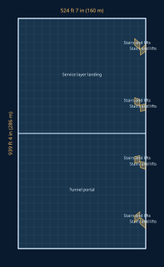
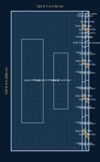
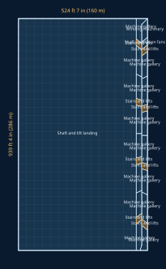

# P5-23 Port Racks Service Shaft: plan

Footprint 524 ft 7 in (160 m) × 939 ft 4 in (286 m) · structural grid 32 ft 10 in (10 m)

## Levels

| Level | Floor above deck | Height | Floor area |
|---|---|---|---|
| Level B1 · Service layer landing | −19 ft 8 in (6,000 mm) | 19 ft 8 in (6,000 mm) | 492,765 sq ft (45,779 m²) |
| Level 1 · Lift landing | 0 ft (0 mm) | 29 ft 6 in (9,000 mm) | 485,867 sq ft (45,138 m²) |
| Level 2 · Winding room | 29 ft 6 in (9,000 mm) | 19 ft 8 in (6,000 mm) | 485,867 sq ft (45,138 m²) |

## Elements

| ID | Designation | Type | Name | Level(s) | Size / length | Area | Status |
|---|---|---|---|---|---|---|---|
| E001 | D5F2P5B27A1L1R1, D5F2P5B27A1L2R1 | room | Shaft and lift landing | L1, L2 | 478 ft 8 in (146 m) × 939 ft 4 in (286 m) | 449,621 sq ft (41,771 m²) | proposed |
| E002 |  | fixture | Goods lift cage | L1 | 143 ft 8 in (44 m) × 563 ft 4 in (172 m) | 80,950 sq ft (7,520 m²) | proposed |
| E003 |  | fixture | Crew lift and stair | L1 | 95 ft 10 in (29 m) × 375 ft 8 in (114 m) | 35,988 sq ft (3,343 m²) | proposed |
| E004 | D5F2P5B27A1LB1R1, D5F2P5B27A1L1R2, D5F2P5B27A1L2R2 | core | Stairs and lifts | LB1, L1, L2 | 21 ft 8 in (6,600 mm) × 42 ft 8 in (13 m) | 568 sq ft (53 m²) | proposed |
| E005 | D5F2P5B27A1LB1R2, D5F2P5B27A1L1R3, D5F2P5B27A1L2R3 | core | Stairs and lifts | LB1, L1, L2 | 21 ft 8 in (6,600 mm) × 31 ft 2 in (9,500 mm) | 568 sq ft (53 m²) | proposed |
| E006 | D5F2P5B27A1LB1R3, D5F2P5B27A1L1R4, D5F2P5B27A1L2R4 | core | Stairs and lifts | LB1, L1, L2 | 21 ft 8 in (6,600 mm) × 32 ft 2 in (9,800 mm) | 568 sq ft (53 m²) | proposed |
| E007 | D5F2P5B27A1LB1R4, D5F2P5B27A1L1R5, D5F2P5B27A1L2R5 | core | Stairs and lifts | LB1, L1, L2 | 21 ft 8 in (6,600 mm) × 43 ft 8 in (13 m) | 568 sq ft (53 m²) | proposed |
| E008 | D5F2P5B27A1LB1R5, D5F2P5B27A1L1R6, D5F2P5B27A1L2R6 | core | Stairs and lifts | LB1, L1, L2 | 21 ft 8 in (6,600 mm) × 42 ft 8 in (13 m) | 568 sq ft (53 m²) | proposed |
| E009 | D5F2P5B27A1LB1R6, D5F2P5B27A1L1R7, D5F2P5B27A1L2R7 | core | Stairs and lifts | LB1, L1, L2 | 21 ft 8 in (6,600 mm) × 31 ft 2 in (9,500 mm) | 568 sq ft (53 m²) | proposed |
| E010 | D5F2P5B27A1LB1R7, D5F2P5B27A1L1R8, D5F2P5B27A1L2R8 | core | Stairs and lifts | LB1, L1, L2 | 21 ft 8 in (6,600 mm) × 32 ft 2 in (9,800 mm) | 568 sq ft (53 m²) | proposed |
| E011 | D5F2P5B27A1LB1R8, D5F2P5B27A1L1R9, D5F2P5B27A1L2R9 | core | Stairs and lifts | LB1, L1, L2 | 21 ft 8 in (6,600 mm) × 43 ft 8 in (13 m) | 568 sq ft (53 m²) | proposed |
| E012 | D5F2P5B27A1L1R10 | room | Lift control room | L1 | 21 ft 8 in (6,600 mm) × 45 ft 11 in (14 m) | 536 sq ft (50 m²) | proposed |
| E013 | D5F2P5B27A1L1R11 | room | Loading bay | L1 | 21 ft 8 in (6,600 mm) × 98 ft 9 in (30 m) | 1,730 sq ft (161 m²) | proposed |
| E014 | D5F2P5B27A1L1R12 | room | Crew check-in | L1 | 21 ft 8 in (6,600 mm) × 35 ft 1 in (11 m) | 430 sq ft (40 m²) | proposed |
| E015 | D5F2P5B27A1L1R13 | room | Tool store | L1 | 21 ft 8 in (6,600 mm) × 53 ft 2 in (16 m) | 853 sq ft (79 m²) | proposed |
| E016 | D5F2P5B27A1L1R14 | room | Staff toilets and showers | L1 | 21 ft 8 in (6,600 mm) × 46 ft 7 in (14 m) | 749 sq ft (70 m²) | proposed |
| E017 | D5F2P5B27A1L1R15 | room | Holding store | L1 | 21 ft 8 in (6,600 mm) × 123 ft 8 in (38 m) | 2,497 sq ft (232 m²) | proposed |
| E018 | D5F2P5B27A1L1R16 | room | Holding store | L1 | 21 ft 8 in (6,600 mm) × 90 ft 3 in (28 m) | 1,904 sq ft (177 m²) | proposed |
| E019 | D5F2P5B27A1L1R17 | room | Holding store | L1 | 21 ft 8 in (6,600 mm) × 124 ft (38 m) | 2,625 sq ft (244 m²) | proposed |
| E020 | D5F2P5B27A1L1R18 | room | Holding store | L1 | 21 ft 8 in (6,600 mm) × 96 ft 9 in (30 m) | 1,904 sq ft (177 m²) | proposed |
| E021 | D5F2P5B27A1L1R19 | room | Holding store | L1 | 21 ft 8 in (6,600 mm) × 135 ft 2 in (41 m) | 2,625 sq ft (244 m²) | proposed |
| E022 | D5F2P5B27A1L1R20 | room | Holding store | L1 | 22 ft 8 in (6,900 mm) × 100 ft 5 in (31 m) | 1,907 sq ft (177 m²) | proposed |
| E023 | D5F2P5B27A1L1R21 | room | Holding store | L1 | 31 ft 10 in (9,700 mm) × 124 ft (38 m) | 2,629 sq ft (244 m²) | proposed |
| E024 | D5F2P5B27A1L1R22 | room | Holding store | L1 | 21 ft 8 in (6,600 mm) × 101 ft 5 in (31 m) | 1,904 sq ft (177 m²) | proposed |
| E025 | D5F2P5B27A1L1R23 | room | Holding store | L1 | 21 ft 8 in (6,600 mm) × 129 ft 7 in (40 m) | 2,625 sq ft (244 m²) | proposed |
| E026 | D5F2P5B27A1L1R24 | room | Holding store | L1 | 21 ft 8 in (6,600 mm) × 90 ft 3 in (28 m) | 1,904 sq ft (177 m²) | proposed |
| E027 | D5F2P5B27A1L1R25 | room | Holding store | L1 | 21 ft 8 in (6,600 mm) × 124 ft (38 m) | 2,625 sq ft (244 m²) | proposed |
| E028 | D5F2P5B27A1L1R26 | room | Holding store | L1 | 21 ft 8 in (6,600 mm) × 96 ft 9 in (30 m) | 1,904 sq ft (177 m²) | proposed |
| E029 | D5F2P5B27A1L1R27 | room | Holding store | L1 | 21 ft 8 in (6,600 mm) × 135 ft 2 in (41 m) | 2,625 sq ft (244 m²) | proposed |
| E030 | D5F2P5B27A1L1R28 | room | Holding store | L1 | 45 ft 11 in (14 m) × 100 ft 5 in (31 m) | 2,270 sq ft (211 m²) | proposed |
| E031 | D5F2P5B27A1L2R10 | room | Winding machinery | L2 | 21 ft 8 in (6,600 mm) × 94 ft 2 in (29 m) | 1,606 sq ft (149 m²) | proposed |
| E032 | D5F2P5B27A1L2R11 | room | Shaft ventilation fans | L2 | 21 ft 8 in (6,600 mm) × 48 ft 3 in (15 m) | 661 sq ft (61 m²) | proposed |
| E033 | D5F2P5B27A1L2R12 | room | Machine gallery | L2 | 21 ft 8 in (6,600 mm) × 109 ft 7 in (33 m) | 2,085 sq ft (194 m²) | proposed |
| E034 | D5F2P5B27A1L2R13 | room | Machine gallery | L2 | 21 ft 8 in (6,600 mm) × 121 ft 1 in (37 m) | 2,444 sq ft (227 m²) | proposed |
| E035 | D5F2P5B27A1L2R14 | room | Machine gallery | L2 | 21 ft 8 in (6,600 mm) × 98 ft 5 in (30 m) | 2,085 sq ft (194 m²) | proposed |
| E036 | D5F2P5B27A1L2R15 | room | Machine gallery | L2 | 21 ft 8 in (6,600 mm) × 115 ft 6 in (35 m) | 2,444 sq ft (227 m²) | proposed |
| E037 | D5F2P5B27A1L2R16 | room | Machine gallery | L2 | 21 ft 8 in (6,600 mm) × 105 ft 4 in (32 m) | 2,085 sq ft (194 m²) | proposed |
| E038 | D5F2P5B27A1L2R17 | room | Machine gallery | L2 | 21 ft 8 in (6,600 mm) × 127 ft (39 m) | 2,444 sq ft (227 m²) | proposed |
| E039 | D5F2P5B27A1L2R18 | room | Machine gallery | L2 | 30 ft 2 in (9,200 mm) × 100 ft 5 in (31 m) | 2,089 sq ft (194 m²) | proposed |
| E040 | D5F2P5B27A1L2R19 | room | Machine gallery | L2 | 22 ft 8 in (6,900 mm) × 124 ft (38 m) | 2,447 sq ft (227 m²) | proposed |
| E041 | D5F2P5B27A1L2R20 | room | Machine gallery | L2 | 21 ft 8 in (6,600 mm) × 109 ft 7 in (33 m) | 2,085 sq ft (194 m²) | proposed |
| E042 | D5F2P5B27A1L2R21 | room | Machine gallery | L2 | 21 ft 8 in (6,600 mm) × 121 ft 1 in (37 m) | 2,444 sq ft (227 m²) | proposed |
| E043 | D5F2P5B27A1L2R22 | room | Machine gallery | L2 | 21 ft 8 in (6,600 mm) × 98 ft 5 in (30 m) | 2,085 sq ft (194 m²) | proposed |
| E044 | D5F2P5B27A1L2R23 | room | Machine gallery | L2 | 21 ft 8 in (6,600 mm) × 115 ft 6 in (35 m) | 2,444 sq ft (227 m²) | proposed |
| E045 | D5F2P5B27A1L2R24 | room | Machine gallery | L2 | 21 ft 8 in (6,600 mm) × 105 ft 4 in (32 m) | 2,085 sq ft (194 m²) | proposed |
| E046 | D5F2P5B27A1L2R25 | room | Machine gallery | L2 | 21 ft 8 in (6,600 mm) × 127 ft (39 m) | 2,444 sq ft (227 m²) | proposed |
| E047 | D5F2P5B27A1L2R26 | room | Machine gallery | L2 | 45 ft 11 in (14 m) × 100 ft 5 in (31 m) | 2,270 sq ft (211 m²) | proposed |
| E048 | D5F2P5B27A1LB1R9 | room | Service layer landing | LB1 | 524 ft 7 in (160 m) × 469 ft 6 in (143 m) | 246,296 sq ft (22,882 m²) | proposed |
| E049 | D5F2P5B27A1LB1R10 | room | Tunnel portal | LB1 | 524 ft 7 in (160 m) × 469 ft 10 in (143 m) | 246,469 sq ft (22,898 m²) | proposed |

## Drawings

### Level B1 · Service layer landing

### Level 1 · Lift landing

### Level 2 · Winding room

