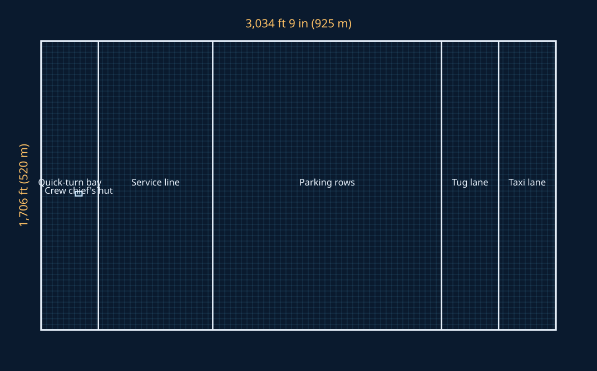

# P5-24 Open Bay 1: plan

Footprint 3,034 ft 9 in (925 m) × 1,706 ft (520 m) · structural grid 32 ft 10 in (10 m)

## Levels

| Level | Floor above deck | Height | Floor area |
|---|---|---|---|
| Level 1 · Ground | 0 ft (0 mm) | 13 ft 1 in (4,000 mm) | 1,033 sq ft (96 m²) |

## Elements

| ID | Designation | Type | Name | Level(s) | Size / length | Area | Status |
|---|---|---|---|---|---|---|---|
| E001 | D5F2P5B6A1R1 | zone | Quick-turn bay | L1 | 337 ft 3 in (103 m) × 1,706 ft (520 m) | 575,396 sq ft (53,456 m²) | proposed |
| E002 | D5F2P5B6A1R2 | room | Crew chief's hut | L1 | 39 ft 4 in (12 m) × 26 ft 3 in (8,000 mm) | 1,033 sq ft (96 m²) | proposed |
| E003 | D5F2P5B6A1R3 | zone | Service line | L1 | 674 ft 3 in (206 m) × 1,706 ft (520 m) | 1,150,232 sq ft (106,860 m²) | proposed |
| E004 | D5F2P5B6A1R4 | zone | Parking rows | L1 | 1,348 ft 9 in (411 m) × 1,706 ft (520 m) | 2,301,023 sq ft (213,772 m²) | proposed |
| E005 | D5F2P5B6A1R5 | zone | Tug lane | L1 | 337 ft 3 in (103 m) × 1,706 ft (520 m) | 575,396 sq ft (53,456 m²) | proposed |
| E006 | D5F2P5B6A1R6 | zone | Taxi lane | L1 | 337 ft 3 in (103 m) × 1,706 ft (520 m) | 575,396 sq ft (53,456 m²) | proposed |

## Drawings

### Level 1 · Ground

