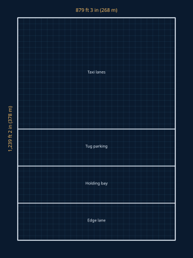

# P5-25 Taxi Apron 1: plan

Footprint 879 ft 3 in (268 m) × 1,239 ft 2 in (378 m) · structural grid 32 ft 10 in (10 m)

## Levels

| Level | Floor above deck | Height | Floor area |
|---|---|---|---|
| Level 1 · Ground | 0 ft (0 mm) | 13 ft 1 in (4,000 mm) | — |

## Elements

| ID | Designation | Type | Name | Level(s) | Size / length | Area | Status |
|---|---|---|---|---|---|---|---|
| E001 | D5F2P5B9A2R1 | zone | Taxi lanes | L1 | 879 ft 3 in (268 m) × 619 ft 9 in (189 m) | 544,925 sq ft (50,625 m²) | proposed |
| E002 | D5F2P5B9A2R2 | zone | Tug parking | L1 | 879 ft 3 in (268 m) × 206 ft 4 in (63 m) | 181,449 sq ft (16,857 m²) | proposed |
| E003 | D5F2P5B9A2R3 | zone | Holding bay | L1 | 879 ft 3 in (268 m) × 206 ft 8 in (63 m) | 181,738 sq ft (16,884 m²) | proposed |
| E004 | D5F2P5B9A2R4 | zone | Edge lane | L1 | 879 ft 3 in (268 m) × 206 ft 4 in (63 m) | 181,449 sq ft (16,857 m²) | proposed |

## Drawings

### Level 1 · Ground

