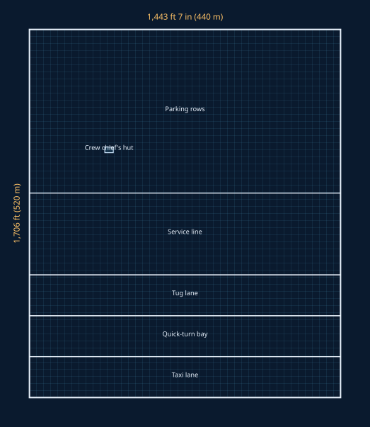

# P5-28 Open Bay 3: plan

Footprint 1,443 ft 7 in (440 m) × 1,706 ft (520 m) · structural grid 32 ft 10 in (10 m)

## Levels

| Level | Floor above deck | Height | Floor area |
|---|---|---|---|
| Level 1 · Ground | 0 ft (0 mm) | 13 ft 1 in (4,000 mm) | 1,033 sq ft (96 m²) |

## Elements

| ID | Designation | Type | Name | Level(s) | Size / length | Area | Status |
|---|---|---|---|---|---|---|---|
| E001 | D5F2P5B14A1R1 | zone | Parking rows | L1 | 1,443 ft 7 in (440 m) × 758 ft 2 in (231 m) | 1,094,518 sq ft (101,684 m²) | proposed |
| E002 | D5F2P5B14A1R2 | room | Crew chief's hut | L1 | 39 ft 4 in (12 m) × 26 ft 3 in (8,000 mm) | 1,033 sq ft (96 m²) | proposed |
| E003 | D5F2P5B14A1R3 | zone | Service line | L1 | 1,443 ft 7 in (440 m) × 379 ft 3 in (116 m) | 547,496 sq ft (50,864 m²) | proposed |
| E004 | D5F2P5B14A1R4 | zone | Tug lane | L1 | 1,443 ft 7 in (440 m) × 189 ft 4 in (58 m) | 273,274 sq ft (25,388 m²) | proposed |
| E005 | D5F2P5B14A1R5 | zone | Quick-turn bay | L1 | 1,443 ft 7 in (440 m) × 189 ft 8 in (58 m) | 273,748 sq ft (25,432 m²) | proposed |
| E006 | D5F2P5B14A1R6 | zone | Taxi lane | L1 | 1,443 ft 7 in (440 m) × 189 ft 8 in (58 m) | 273,748 sq ft (25,432 m²) | proposed |

## Drawings

### Level 1 · Ground

