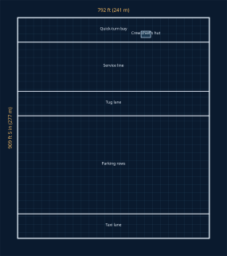

# P5-30 Open Bay 4: plan

Footprint 792 ft (241 m) × 909 ft 5 in (277 m) · structural grid 32 ft 10 in (10 m)

## Levels

| Level | Floor above deck | Height | Floor area |
|---|---|---|---|
| Level 1 · Ground | 0 ft (0 mm) | 13 ft 1 in (4,000 mm) | 1,033 sq ft (96 m²) |

## Elements

| ID | Designation | Type | Name | Level(s) | Size / length | Area | Status |
|---|---|---|---|---|---|---|---|
| E001 | D5F2P5B22A2R1 | zone | Quick-turn bay | L1 | 792 ft (241 m) × 101 ft 1 in (31 m) | 80,031 sq ft (7,435 m²) | proposed |
| E002 | D5F2P5B22A2R2 | room | Crew chief's hut | L1 | 39 ft 4 in (12 m) × 26 ft 3 in (8,000 mm) | 1,033 sq ft (96 m²) | proposed |
| E003 | D5F2P5B22A2R3 | zone | Service line | L1 | 792 ft (241 m) × 202 ft 1 in (62 m) | 160,062 sq ft (14,870 m²) | proposed |
| E004 | D5F2P5B22A2R4 | zone | Tug lane | L1 | 792 ft (241 m) × 101 ft 1 in (31 m) | 80,031 sq ft (7,435 m²) | proposed |
| E005 | D5F2P5B22A2R5 | zone | Parking rows | L1 | 792 ft (241 m) × 404 ft 2 in (123 m) | 320,124 sq ft (29,740 m²) | proposed |
| E006 | D5F2P5B22A2R6 | zone | Taxi lane | L1 | 792 ft (241 m) × 101 ft 1 in (31 m) | 80,031 sq ft (7,435 m²) | proposed |

## Drawings

### Level 1 · Ground

