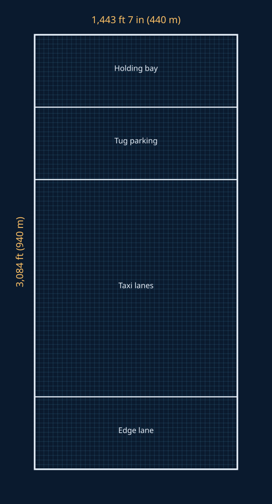

# P5-31 Taxi Apron 4: plan

Footprint 1,443 ft 7 in (440 m) × 3,084 ft (940 m) · structural grid 32 ft 10 in (10 m)

## Levels

| Level | Floor above deck | Height | Floor area |
|---|---|---|---|
| Level 1 · Ground | 0 ft (0 mm) | 13 ft 1 in (4,000 mm) | — |

## Elements

| ID | Designation | Type | Name | Level(s) | Size / length | Area | Status |
|---|---|---|---|---|---|---|---|
| E001 | D5F2P5B23A1R1 | zone | Holding bay | L1 | 1,443 ft 7 in (440 m) × 514 ft 1 in (157 m) | 742,150 sq ft (68,948 m²) | proposed |
| E002 | D5F2P5B23A1R2 | zone | Tug parking | L1 | 1,443 ft 7 in (440 m) × 513 ft 9 in (157 m) | 741,677 sq ft (68,904 m²) | proposed |
| E003 | D5F2P5B23A1R3 | zone | Taxi lanes | L1 | 1,443 ft 7 in (440 m) × 1,542 ft (470 m) | 2,225,977 sq ft (206,800 m²) | proposed |
| E004 | D5F2P5B23A1R4 | zone | Edge lane | L1 | 1,443 ft 7 in (440 m) × 514 ft 1 in (157 m) | 742,150 sq ft (68,948 m²) | proposed |

## Drawings

### Level 1 · Ground

