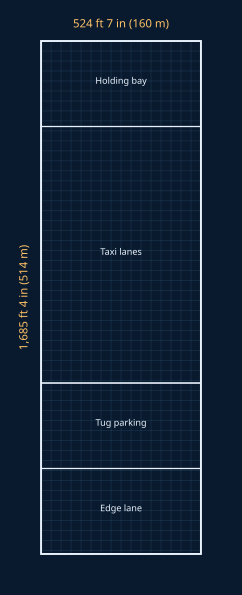

# P5-33 Taxi Apron 5: plan

Footprint 524 ft 7 in (160 m) × 1,685 ft 4 in (514 m) · structural grid 32 ft 10 in (10 m)

## Levels

| Level | Floor above deck | Height | Floor area |
|---|---|---|---|
| Level 1 · Ground | 0 ft (0 mm) | 13 ft 1 in (4,000 mm) | — |

## Elements

| ID | Designation | Type | Name | Level(s) | Size / length | Area | Status |
|---|---|---|---|---|---|---|---|
| E001 | D5F2P5B27A2R1 | zone | Holding bay | L1 | 524 ft 7 in (160 m) × 280 ft 10 in (86 m) | 147,330 sq ft (13,687 m²) | proposed |
| E002 | D5F2P5B27A2R2 | zone | Taxi lanes | L1 | 524 ft 7 in (160 m) × 842 ft 10 in (257 m) | 442,163 sq ft (41,078 m²) | proposed |
| E003 | D5F2P5B27A2R3 | zone | Tug parking | L1 | 524 ft 7 in (160 m) × 280 ft 10 in (86 m) | 147,330 sq ft (13,687 m²) | proposed |
| E004 | D5F2P5B27A2R4 | zone | Edge lane | L1 | 524 ft 7 in (160 m) × 280 ft 10 in (86 m) | 147,330 sq ft (13,687 m²) | proposed |

## Drawings

### Level 1 · Ground

