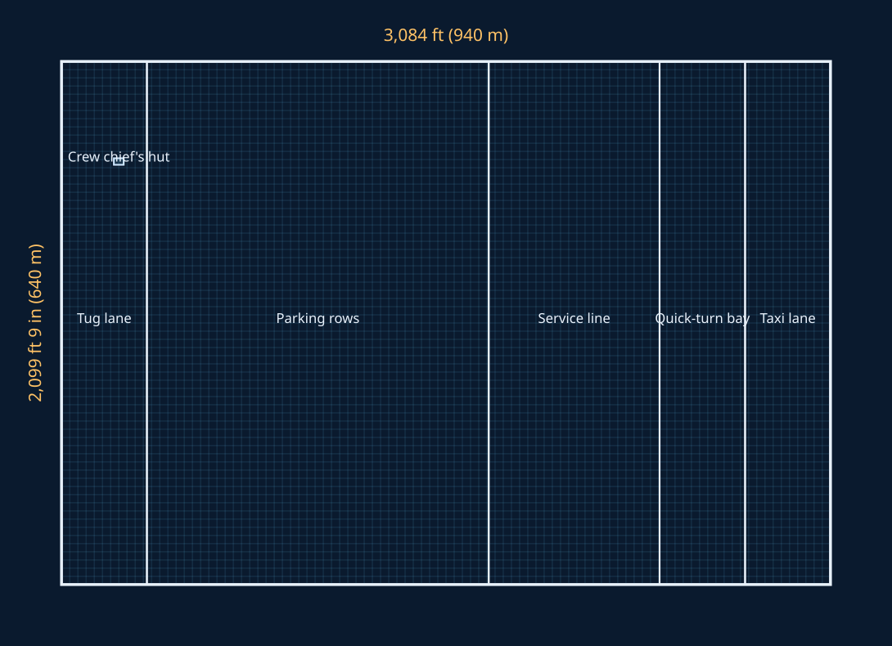

# P5-34 Open Bay 6: plan

Footprint 3,084 ft (940 m) × 2,099 ft 9 in (640 m) · structural grid 32 ft 10 in (10 m)

## Levels

| Level | Floor above deck | Height | Floor area |
|---|---|---|---|
| Level 1 · Ground | 0 ft (0 mm) | 13 ft 1 in (4,000 mm) | 1,033 sq ft (96 m²) |

## Elements

| ID | Designation | Type | Name | Level(s) | Size / length | Area | Status |
|---|---|---|---|---|---|---|---|
| E001 | D5F2P5B28A1R1 | zone | Tug lane | L1 | 342 ft 6 in (104 m) × 2,099 ft 9 in (640 m) | 719,201 sq ft (66,816 m²) | proposed |
| E002 | D5F2P5B28A1R2 | room | Crew chief's hut | L1 | 39 ft 4 in (12 m) × 26 ft 3 in (8,000 mm) | 1,033 sq ft (96 m²) | proposed |
| E003 | D5F2P5B28A1R3 | zone | Parking rows | L1 | 1,370 ft 9 in (418 m) × 2,099 ft 9 in (640 m) | 2,878,184 sq ft (267,392 m²) | proposed |
| E004 | D5F2P5B28A1R4 | zone | Service line | L1 | 685 ft 4 in (209 m) × 2,099 ft 9 in (640 m) | 1,439,092 sq ft (133,696 m²) | proposed |
| E005 | D5F2P5B28A1R5 | zone | Quick-turn bay | L1 | 342 ft 10 in (104 m) × 2,099 ft 9 in (640 m) | 719,890 sq ft (66,880 m²) | proposed |
| E006 | D5F2P5B28A1R6 | zone | Taxi lane | L1 | 342 ft 6 in (104 m) × 2,099 ft 9 in (640 m) | 719,201 sq ft (66,816 m²) | proposed |

## Drawings

### Level 1 · Ground

