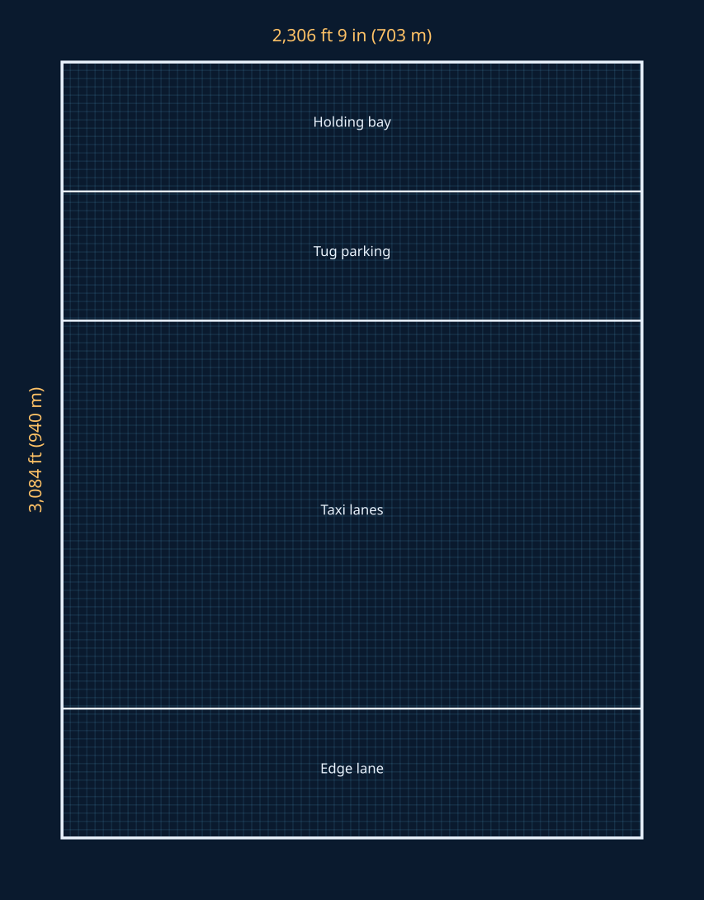

# P5-35 Taxi Apron 6: plan

Footprint 2,306 ft 9 in (703 m) × 3,084 ft (940 m) · structural grid 32 ft 10 in (10 m)

## Levels

| Level | Floor above deck | Height | Floor area |
|---|---|---|---|
| Level 1 · Ground | 0 ft (0 mm) | 13 ft 1 in (4,000 mm) | — |

## Elements

| ID | Designation | Type | Name | Level(s) | Size / length | Area | Status |
|---|---|---|---|---|---|---|---|
| E001 | D5F2P5B1A2R1 | zone | Holding bay | L1 | 2,306 ft 9 in (703 m) × 514 ft 1 in (157 m) | 1,185,922 sq ft (110,176 m²) | proposed |
| E002 | D5F2P5B1A2R2 | zone | Tug parking | L1 | 2,306 ft 9 in (703 m) × 513 ft 9 in (157 m) | 1,185,165 sq ft (110,105 m²) | proposed |
| E003 | D5F2P5B1A2R3 | zone | Taxi lanes | L1 | 2,306 ft 9 in (703 m) × 1,542 ft (470 m) | 3,557,010 sq ft (330,457 m²) | proposed |
| E004 | D5F2P5B1A2R4 | zone | Edge lane | L1 | 2,306 ft 9 in (703 m) × 514 ft 1 in (157 m) | 1,185,922 sq ft (110,176 m²) | proposed |

## Drawings

### Level 1 · Ground

