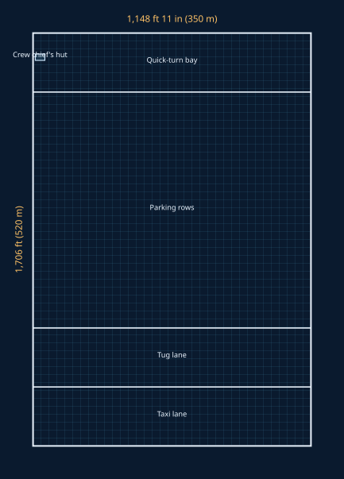

# P5-36 Open Bay 7: plan

Footprint 1,148 ft 11 in (350 m) × 1,706 ft (520 m) · structural grid 32 ft 10 in (10 m)

## Levels

| Level | Floor above deck | Height | Floor area |
|---|---|---|---|
| Level 1 · Ground | 0 ft (0 mm) | 13 ft 1 in (4,000 mm) | 1,033 sq ft (96 m²) |

## Elements

| ID | Designation | Type | Name | Level(s) | Size / length | Area | Status |
|---|---|---|---|---|---|---|---|
| E001 | D5F2P5B2A2R1 | zone | Quick-turn bay | L1 | 1,148 ft 11 in (350 m) × 243 ft 9 in (74 m) | 280,075 sq ft (26,020 m²) | proposed |
| E002 | D5F2P5B2A2R2 | room | Crew chief's hut | L1 | 39 ft 4 in (12 m) × 26 ft 3 in (8,000 mm) | 1,033 sq ft (96 m²) | proposed |
| E003 | D5F2P5B2A2R3 | zone | Parking rows | L1 | 1,148 ft 11 in (350 m) × 974 ft 9 in (297 m) | 1,119,925 sq ft (104,044 m²) | proposed |
| E004 | D5F2P5B2A2R4 | zone | Tug lane | L1 | 1,148 ft 11 in (350 m) × 243 ft 9 in (74 m) | 280,075 sq ft (26,020 m²) | proposed |
| E005 | D5F2P5B2A2R5 | zone | Taxi lane | L1 | 1,148 ft 11 in (350 m) × 243 ft 9 in (74 m) | 280,075 sq ft (26,020 m²) | proposed |

## Drawings

### Level 1 · Ground

