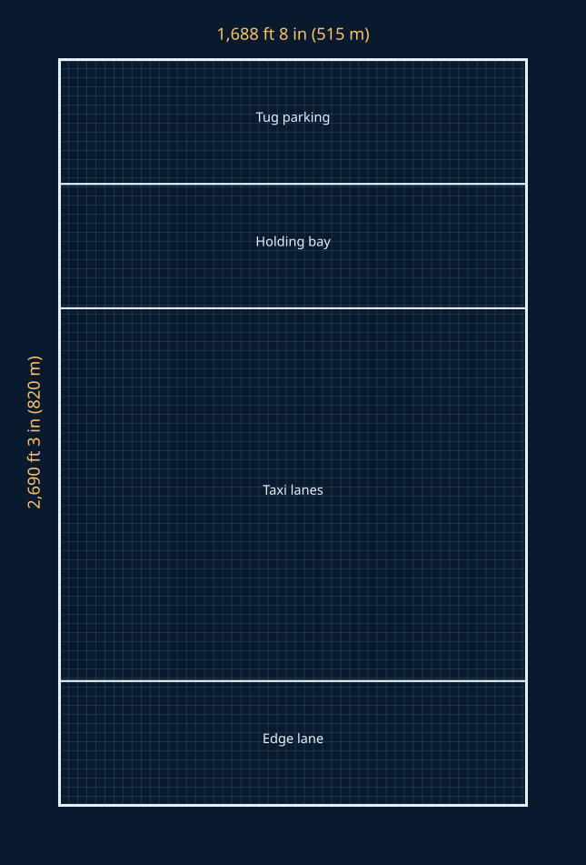

# P5-37 Taxi Apron 7: plan

Footprint 1,688 ft 8 in (515 m) × 2,690 ft 3 in (820 m) · structural grid 32 ft 10 in (10 m)

## Levels

| Level | Floor above deck | Height | Floor area |
|---|---|---|---|
| Level 1 · Ground | 0 ft (0 mm) | 13 ft 1 in (4,000 mm) | — |

## Elements

| ID | Designation | Type | Name | Level(s) | Size / length | Area | Status |
|---|---|---|---|---|---|---|---|
| E001 | D5F2P5B3A2R1 | zone | Tug parking | L1 | 1,688 ft 8 in (515 m) × 448 ft 6 in (137 m) | 757,343 sq ft (70,359 m²) | proposed |
| E002 | D5F2P5B3A2R2 | zone | Holding bay | L1 | 1,688 ft 8 in (515 m) × 448 ft 2 in (137 m) | 756,789 sq ft (70,308 m²) | proposed |
| E003 | D5F2P5B3A2R3 | zone | Taxi lanes | L1 | 1,688 ft 8 in (515 m) × 1,345 ft 2 in (410 m) | 2,271,476 sq ft (211,027 m²) | proposed |
| E004 | D5F2P5B3A2R4 | zone | Edge lane | L1 | 1,688 ft 8 in (515 m) × 448 ft 6 in (137 m) | 757,343 sq ft (70,359 m²) | proposed |

## Drawings

### Level 1 · Ground

