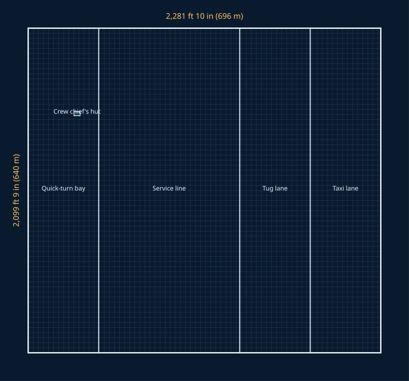

# P5-38 Open Bay 8: plan

Footprint 2,281 ft 10 in (696 m) × 2,099 ft 9 in (640 m) · structural grid 32 ft 10 in (10 m)

## Levels

| Level | Floor above deck | Height | Floor area |
|---|---|---|---|
| Level 1 · Ground | 0 ft (0 mm) | 13 ft 1 in (4,000 mm) | 1,033 sq ft (96 m²) |

## Elements

| ID | Designation | Type | Name | Level(s) | Size / length | Area | Status |
|---|---|---|---|---|---|---|---|
| E001 | D5F2P5B4A2R1 | zone | Quick-turn bay | L1 | 456 ft 4 in (139 m) × 2,099 ft 9 in (640 m) | 958,246 sq ft (89,024 m²) | proposed |
| E002 | D5F2P5B4A2R2 | room | Crew chief's hut | L1 | 39 ft 4 in (12 m) × 26 ft 3 in (8,000 mm) | 1,033 sq ft (96 m²) | proposed |
| E003 | D5F2P5B4A2R3 | zone | Service line | L1 | 912 ft 9 in (278 m) × 2,099 ft 9 in (640 m) | 1,916,493 sq ft (178,048 m²) | proposed |
| E004 | D5F2P5B4A2R4 | zone | Tug lane | L1 | 456 ft 4 in (139 m) × 2,099 ft 9 in (640 m) | 958,246 sq ft (89,024 m²) | proposed |
| E005 | D5F2P5B4A2R5 | zone | Taxi lane | L1 | 456 ft 4 in (139 m) × 2,099 ft 9 in (640 m) | 958,246 sq ft (89,024 m²) | proposed |

## Drawings

### Level 1 · Ground

